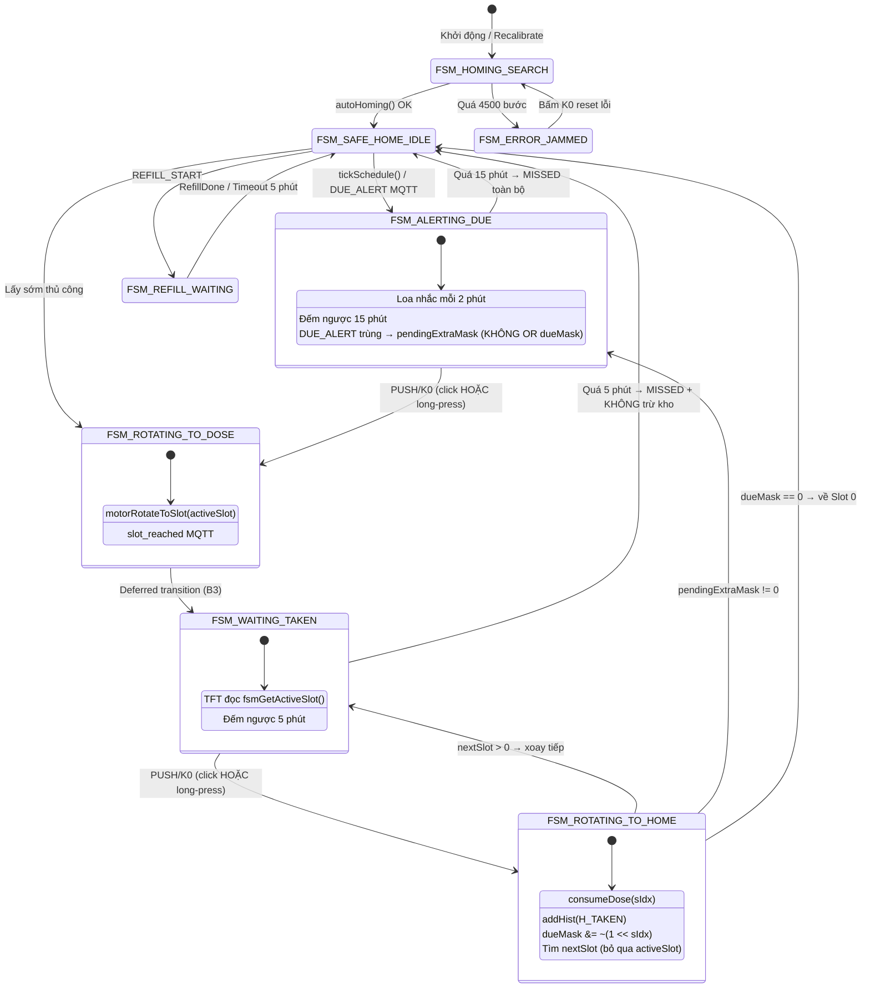

# BÁO CÁO PHÂN TÍCH LỖI: KẸT TẠI NGĂN 1 KHI XÁC NHẬN CHUYỂN SANG NGĂN 2 TRONG CÙNG CỮ THUỐC

> **Dự án:** SmartMed — Hộp thuốc thông minh 8 ngăn xoay tròn IoT
> **Phiên bản tài liệu:** v1.0
> **Ngày lập:** 28/10/2026
> **Phạm vi phân tích:** `firmware/src/main.cpp`, `firmware/src/fsm_controller.cpp`, `firmware/src/display_ui.cpp`, `firmware/src/motor_control.cpp`, `backend/api/dispensing.py`, `backend/services/scheduler_engine.py`, `backend/services/dispensing_engine.py`
> **Trạng thái:** Đã phân tích nguyên nhân gốc rễ — Sẵn sàng triển khai bản vá

---

## MỤC LỤC

1. [Mô tả hiện tượng lỗi](#1-mô-tả-hiện-tượng-lỗi)
2. [Dựng lại luồng sự kiện theo mã nguồn hiện tại](#2-dựng-lại-luồng-sự-kiện-theo-mã-nguồn-hiện-tại)
3. [Phân tích nguyên nhân gốc rễ (RCA)](#3-phân-tích-nguyên-nhân-gốc-rễ-rca)
4. [Ma trận đối chiếu triệu chứng ↔ nguyên nhân](#4-ma-trận-đối-chiếu-triệu-chứng--nguyên-nhân)
5. [Kiểm chứng bằng Serial Log](#5-kiểm-chứng-bằng-serial-log)
6. [Kế hoạch sửa code chi tiết từng file](#6-kế-hoạch-sửa-code-chi-tiết-từng-file)
7. [Sơ đồ FSM chuẩn hóa sau khi sửa](#7-sơ-đồ-fsm-chuẩn-hóa-sau-khi-sửa)
8. [Kế hoạch kiểm thử và nghiệm thu](#8-kế-hoạch-kiểm-thử-và-nghiệm-thu)
9. [Bảng rủi ro và biện pháp phòng ngừa](#9-bảng-rủi-ro-và-biện-pháp-phòng-ngừa)
10. [Checklist triển khai](#10-checklist-triển-khai)

---

## 1. MÔ TẢ HIỆN TƯỢNG LỖI

### 1.1 Kịch bản tái hiện

Giả sử cữ thuốc **Buổi Sáng** được cấu hình cho **Ngăn 1 + Ngăn 2**
(tức `dueMask = 0b0000_0011 = 0x03`).

| Bước | Thao tác người dùng | Hành vi MONG MUỐN | Hành vi THỰC TẾ |
|:---:|---|---|---|
| 1 | Đến giờ, chuông reo | `S_DUE_ALERT` hiện danh sách Ngăn 1, 2 + đếm ngược 15:00 | ✅ Đúng |
| 2 | Nhấn PUSH/K0 lần 1 | Khay xoay → Ngăn 1 tại cửa 6h, hiện `>>> DANG MO NGAN 1 O CUA 6H <<<` | ✅ Đúng |
| 3 | Lấy thuốc Ngăn 1 xong | — | — |
| 4 | Nhấn PUSH/K0 lần 2 | Khay xoay tiếp → **Ngăn 2**, màn hình `>>> DANG MO NGAN 2 ...` | ❌ **Khay KHÔNG xoay. Màn hình vẫn hiện Ngăn 1. Kẹt vĩnh viễn.** |

### 1.2 Đặc điểm nhận dạng trên Serial Monitor

- ❌ Không có log `[MAIN] Xác nhận đã lấy thuốc -> Xoay tiếp hoặc khóa về Safe Home...`
- ❌ Không có log `[FSM STATE] WAITING_TAKEN -> ROTATING_TO_HOME`
- ❌ Không có âm thanh `dispense_next.mp3` ("Lấy ngăn tiếp theo...")
- ⏱️ Sau **5 phút (300 s)**, thiết bị tự thoát trạng thái kẹt nhưng **ghi nhận sai**
  (xem lỗi B4) — trừ kho oan + màn hình nhảy về `S_HOME`.

### 1.3 Mức độ nghiêm trọng

**CẤP ĐỘ: CRITICAL — AN TOÀN Y TẾ**

| Rủi ro | Hệ quả |
|---|---|
| Người bệnh không lấy được thuốc Ngăn 2 | **Thiếu liều** — nguy hiểm trực tiếp sức khỏe |
| Bấm nút nhiều lần vì tưởng hỏng | Kích hoạt timeout → trừ kho oan, sai lệch tồn kho |
| Khay mở toang tại Ngăn 1 suốt 5 phút | Mất chức năng bảo vệ trẻ em & chống ẩm mốc của Slot 0 |
| Không phản hồi/thông báo lỗi | Người dùng can thiệp cơ học → hỏng bánh răng |

---

## 2. DỰNG LẠI LUỒNG SỰ KIỆN THEO MÃ NGUỒN HIỆN TẠI

### 2.1 Chuỗi gọi hàm thực tế

```
tickSchedule()                                    [main.cpp:642]
  └─> fsmTriggerDueAlert(0x03)                    [fsm_controller.cpp:274]
        ├─> dueMask = 0x03
        └─> fsmTransitionTo(FSM_ALERTING_DUE)     [fsm_controller.cpp:110]
              ├─> goTo(S_DUE_ALERT)               → render(true) → drawDueAlert(true)
              └─> audioPlayAlertDue()

[Người dùng nhấn PUSH lần 1]
handleInput()                                     [main.cpp:958]
  └─> case S_DUE_ALERT: st == FSM_ALERTING_DUE
        └─> fsmOnUserConfirmDose()                [fsm_controller.cpp:300]
              ├─> activeSlot = 1
              └─> fsmTransitionTo(FSM_ROTATING_TO_DOSE)   [fsm_controller.cpp:119]
                    ├─> goTo(S_DUE_ALERT)
                    ├─> motorRotateToSlot(1)      → currentMotorSlot = 1
                    ├─> mqttPublishSlotReached(1)
                    └─> fsmTransitionTo(FSM_WAITING_TAKEN)   [fsm_controller.cpp:129]
                          ├─> goTo(S_DUE_ALERT)
                          └─> audioPlayDispenseSlot(1)

[Lấy thuốc Ngăn 1 xong, nhấn PUSH lần 2]  ★ ĐIỂM GÃY ★
handleInput() → case S_DUE_ALERT: st == FSM_WAITING_TAKEN
  └─> if (p == 1 || b == 1)  fsmOnUserTakenDone()  [main.cpp:1752]
        └─> if (currentState == FSM_WAITING_TAKEN)
              └─> fsmTransitionTo(FSM_ROTATING_TO_HOME)  [fsm_controller.cpp:323]
                    ├─> dueMask &= ~(1<<0)  → 0x02
                    ├─> quét nextSlot → 2
                    ├─> audioPlayDispenseNext()
                    ├─> motorRotateToSlot(2)
                    ├─> mqttPublishSlotReached(2)
                    └─> fsmTransitionTo(FSM_WAITING_TAKEN)
```

> [!IMPORTANT]
> **Kết luận quan trọng:** Nếu logic thuần túy chạy đúng, khung `case FSM_ROTATING_TO_HOME`
> (`fsm_controller.cpp:137-183`) **HOÀN TOÀN ĐÁP ỨNG ĐÚNG** yêu cầu chuyển sang Ngăn 2.
>
> ⇒ Lỗi **KHÔNG** nằm ở logic chuyển ngăn. Lỗi nằm ở việc **sự kiện nhấn nút lần 2
> KHÔNG BAO GIỜ ĐẾN ĐƯỢC** `fsmOnUserTakenDone()`, hoặc `dueMask` bị hỏng trước khi quét.

### 2.2 Cấu trúc dữ liệu liên quan

```cpp
// firmware/include/app_state.h:79-106
struct Med {
  char name[NAME_LEN + 1];   // NAME_LEN = 10
  uint8_t qty;               // Số viên còn trong ngăn
  uint8_t dose;              // Số viên uống mỗi lần
};

struct Sched {
  uint8_t h;           // Giờ
  uint8_t m;           // Phút
  uint8_t mask;        // Bitmask ngăn: bit 0 = Ngăn 1 ... bit 6 = Ngăn 7
  uint8_t activeMask;  // Bitmask các ngăn đang BẬT
};

// firmware/src/main.cpp:38
uint8_t dueMask = 0;   // Bitmask các ngăn CẦN UỐNG trong cữ đang chạy
```

**Quy ước bitmask (bắt buộc ghi nhớ):**

| Bit index | Ngăn vật lý | Giá trị hex |
|:---:|:---:|:---:|
| 0 | Ngăn 1 | `0x01` |
| 1 | Ngăn 2 | `0x02` |
| 2 | Ngăn 3 | `0x04` |
| 3 | Ngăn 4 | `0x08` |
| 4 | Ngăn 5 | `0x10` |
| 5 | Ngăn 6 | `0x20` |
| 6 | Ngăn 7 | `0x40` |

→ Cữ (Ngăn 1 + Ngăn 2) = `0x01 | 0x02 = 0x03`.

### 2.3 Hai nguồn "sự thật" bị phân ly

Đây là **nguyên nhân kiến trúc** khiến lỗi khó chẩn đoán:

| Biến | Nơi khai báo | Ai ghi | Ai đọc |
|---|---|---|---|
| `activeSlot` | `fsm_controller.cpp:20` — **`static`** | Chỉ FSM (private) | `fsmGetActiveSlot()` |
| `currentMotorSlot` | `main.cpp:188` — **`extern`** | `motorRotateToSlot()` | `drawDueAlert()` (TFT), `mqttPublishStatus()` |

> [!WARNING]
> `drawDueAlert()` đọc `currentMotorSlot` (vị trí **cơ học**), trong khi FSM quyết định bằng
> `activeSlot` (vị trí **logic**). Khi motor quay không đủ bước (mất bước, kẹt nhẹ, hoặc
> `diff == 0`), **hai biến này lệch nhau** → màn hình báo sai ngăn dù FSM đã chuyển đúng.

---

## 3. PHÂN TÍCH NGUYÊN NHÂN GỐC RỄ (RCA)

### 3.0 Bản đồ nguyên nhân

```
┌──────────────────────────────────────────────────────────────────────────────┐
│              LỖI KẸT TẠI NGĂN 1 KHÔNG XOAY SANG NGĂN 2                        │
├──────────────────────────────────────────────────────────────────────────────┤
│                                                                              │
│  TẦNG 1 — SỰ KIỆN KHÔNG TỚI ĐƯỢC FSM  (chặn ở cửa vào)                       │
│    A1  Nút long-press > 800ms trả về 2 → if(p==1||b==1) bỏ qua          🔴   │
│    A2  loop() bị block ~1.6s (motor + render + toast) → mất cạnh nút     🔴   │
│    A3  fsmOnUserTakenDone() từ chối im lặng khi state khác              🔴   │
│                                                                              │
│  TẦNG 2 — DỮ LIỆU dueMask BỊ HỎNG  (chặn ở cửa ra)                           │
│    B1  fsmTriggerDueAlert() OR bơm lại bit đã tiêu thụ → nextSlot=1      🟠   │
│                                                                              │
│  TẦNG 3 — HIỂN THỊ SAI GÂY HIỂU NHẦM                                         │
│    B2  drawDueAlert() đọc currentMotorSlot thay vì activeSlot            🟠   │
│                                                                              │
│  TẦNG 4 — NỢ KỸ THUẬT TIỀM ẨN                                                │
│    B3  fsmTransitionTo() gọi đệ quy lồng nhau (re-entrancy)              🟠   │
│    B4  Timeout 300s tại WAITING_TAKEN trừ thuốc oan + ép goTo(S_HOME)    🔴   │
│    C1  Phase counter động cơ không đồng bộ giữa homing và step           🟡   │
│                                                                              │
└──────────────────────────────────────────────────────────────────────────────┘
```

---

### 3.1 🔴 A1 — NÚT NHẤN BỊ NUỐT DO PHÂN LOẠI LONG-PRESS
#### *(NGUYÊN NHÂN TRỰC TIẾP — xác suất cao nhất)*

**File:** `firmware/src/main.cpp` — **Vị trí:** dòng **1740-1759**

#### Mã nguồn hiện tại

```cpp
  // MÀN HÌNH CẢNH BÁO CỮ THUỐC CHUYÊN BIỆT & ĐẾM NGƯỢC TIMEOUT
  case S_DUE_ALERT: {
    FsmState st = fsmGetState();
    if (st == FSM_ALERTING_DUE) {
      if (p == 1 || b == 1) {                  // ← chỉ nhận CLICK
        Serial.println(
            "[MAIN] Xác nhận uống thuốc cữ hẹn -> Bắt đầu xoay mở khay...");
        fsmOnUserConfirmDose();
      }
    } else if (st == FSM_WAITING_TAKEN) {
      if (p == 1 || b == 1) {                  // ← ❌ CHỈ NHẬN CLICK
        Serial.println("[MAIN] Xác nhận đã lấy thuốc -> Xoay tiếp hoặc khóa về "
                       "Safe Home...");
        fsmOnUserTakenDone();
      }
    }
    break;
  }
```

#### Cơ chế phân loại nút

```cpp
// main.cpp:228-251 — struct Btn
  uint8_t poll() {
    bool v = digitalRead(pin);
    uint32_t now = millis();
    if (v != last && now - tChange > 25) {   // debounce 25ms
      tChange = now;
      last = v;
      if (!v)
        tDown = now;                          // ghi nhận lúc NHẤN XUỐNG
      else
        return (now - tDown > 800) ? 2 : 1;   // ← 1 = Click, 2 = Giữ > 800ms
    }
    return 0;                                 // không có sự kiện
  }
```

#### Cơ chế lỗi

1. Người dùng **nhấn giữ** nút PUSH/K0 lâu hơn **800 ms** (rất phổ biến ở người cao tuổi,
   hoặc khi nhấn mạnh tay vì tưởng lần trước chưa ăn).
2. `poll()` trả về `2` (long-press) chứ **không** trả về `1`.
3. Điều kiện `if (p == 1 || b == 1)` **sai** → toàn bộ khối bị bỏ qua.
4. **Không một dòng log nào được in ra**, không có âm thanh phản hồi.
5. `currentState` vẫn `FSM_WAITING_TAKEN`, `currentMotorSlot` vẫn `1`,
   `screen` vẫn `S_DUE_ALERT`.
6. Lặp lại vô hạn → **triệu chứng "kẹt tại Ngăn 1" khớp 100%**.

> [!CAUTION]
> Đây là lỗi **im lặng tuyệt đối** — không log, không beep, không toast. Đó là lý do
> người dùng cảm giác thiết bị "treo" chứ không phải "bỏ qua thao tác".

#### Tại sao các màn hình khác không bị?

`case S_HOME` (main.cpp:978-1008) có nhánh `if (b == 2) testDue();` nên **có xử lý**
long-press. Nhưng `case S_DUE_ALERT` **hoàn toàn không** — thiếu sót cục bộ.

#### Giải pháp

```cpp
    if (st == FSM_ALERTING_DUE) {
      if (p >= 1 || b >= 1) {        // ✅ nhận cả Click (1) và Long-press (2)
        ...
        fsmOnUserConfirmDose();
      }
    } else if (st == FSM_WAITING_TAKEN) {
      if (p >= 1 || b >= 1) {        // ✅ nhận cả Click và Long-press
        ...
        fsmOnUserTakenDone();
      }
    }
```

---

### 3.2 🔴 A2 — MẤT SỰ KIỆN NÚT DO MAIN LOOP BỊ BLOCK

**File:** `main.cpp` + `motor_control.cpp` + `display_ui.cpp`

#### Cơ chế lỗi

`loop()` là **single-threaded** trên Core 1 và gọi `handleInput()` **chỉ một lần mỗi vòng**.
Trong một vòng có nhiều thao tác **blocking**:

| Thao tác | Vị trí | Thời gian block |
|---|---|---|
| `motorRotateToSlot()` → `motorStepRelative(512 bước)` | `motor_control.cpp:55-77` | `512 × 1200µs ≈ 615 ms` |
| `autoHoming()` tối đa 4500 bước | `motor_control.cpp:120-149` | tới `≈ 7.2 s` |
| `goTo()` → `render(true)` vẽ lại toàn màn hình SPI | `main.cpp:711-716` | `≈ 80-150 ms` |
| `toast()` → `delay(850)` | `display_ui.cpp:175-184` | `850 ms` cố định |
| `tftWake()` → `delay(10)` + `render(true)` | `display_ui.cpp:71-84` | `≈ 100 ms` |

> **Tổng độ trễ một vòng có thể lên tới ~1.6 giây.**

```cpp
// motor_control.cpp:55-77 — VÒNG LẶP BLOCKING, KHÔNG POLL NÚT
void motorStepRelative(int steps, int delayUs) {
    if (steps == 0) return;
    static int stepIdx = 0;
    int dir = (steps > 0) ? 1 : -1;
    int total = abs(steps);
    for (int s = 0; s < total; s++) {
        ...
        delayMicroseconds(delayUs);           // 1200 µs
        if ((s & 0x1F) == 0)
            vTaskDelay(pdMS_TO_TICKS(1));     // nhường 1 tick mỗi 32 bước
    }
    motorDeenergize();
}
```

#### Hệ quả then chốt

`Btn::poll()` **chỉ phát hiện cạnh lên/xuống tại đúng thời điểm nó được gọi**:

```cpp
if (v != last && now - tChange > 25) { ... }
```

- Nếu người dùng **nhấn và nhả hoàn toàn** trong khoảng `loop()` đang block
  (ví dụ nhấn nhanh 200 ms trong lúc motor đang quay 615 ms),
  thì `digitalRead()` **không bao giờ** thấy được cả 2 cạnh.
- Sự kiện **mất vĩnh viễn** — không có buffer, không có interrupt trên nút.

#### Kịch bản kết hợp A1 + A2 (nguy hiểm nhất)

| Thời điểm | Sự kiện | Trạng thái |
|---|---|---|
| t=0 | Người dùng bấm nút lần 2 | `poll()` bị hoãn — loop đang trong `audioPlayDispenseSlot()` |
| t=50ms | Người dùng nhả nút | Cạnh XUỐNG bị bỏ lỡ |
| t=300ms | `loop()` quay lại `handleInput()` | `digitalRead()` trả `HIGH` (đã nhả) → `v == last` → **return 0** |
| t=∞ | Không có sự kiện nào | **Kẹt vĩnh viễn tại Ngăn 1** |

#### Giải pháp (3 mức, khuyến nghị áp dụng cả 3)

**Mức 1 — Ngắn hạn: Ghi nhận cạnh qua ISR cho nút PUSH/K0**

```cpp
// main.cpp — thêm biến volatile + ISR
volatile uint8_t  btnEdgeFlags  = 0;   // bit0..1 = PUSH, bit2..3 = K0
volatile uint32_t btnPushDownMs = 0;
volatile uint32_t btnK0DownMs   = 0;

void IRAM_ATTR btnPushISR() {
  bool v = digitalRead(PIN_EC11_SW);
  if (!v) { btnPushDownMs = millis(); btnEdgeFlags |= 0x01; }
  else    { btnEdgeFlags |= 0x02; }
}
```

Trong `setup()`:
```cpp
attachInterrupt(digitalPinToInterrupt(PIN_EC11_SW), btnPushISR, CHANGE);
attachInterrupt(digitalPinToInterrupt(PIN_BTN_K0),   btnK0ISR,   CHANGE);
```

> ✅ ISR chạy kể cả khi `loop()` đang block → **không bao giờ mất sự kiện**.

**Mức 2 — Trung hạn: Motor chạy non-blocking**

Mỗi lần `loop()` phát N bước (ví dụ 16 bước ≈ 19 ms) rồi trả quyền về `loop()`:

```cpp
static int motorRemaining = 0;
void motorStartMove(int steps) { motorRemaining = abs(steps); }
bool motorIsBusy()             { return motorRemaining > 0; }
void motorTick() {                         // gọi mỗi vòng loop()
  if (motorRemaining <= 0) return;
  int n = (motorRemaining > 16) ? 16 : motorRemaining;
  for (int i = 0; i < n; i++) { /* phát 1 bước half-step */ }
  motorRemaining -= n;
  if (motorRemaining == 0) motorDeenergize();
}
```

**Mức 3 — Dài hạn: Bỏ `delay(850)` trong `toast()`**

Thay bằng toast không-blocking có timestamp:

```cpp
static uint32_t toastHideMs = 0;
void toast(const char *msg) {
  /* vẽ khung */
  toastHideMs = millis() + 850;   // hẹn giờ ẩn, KHÔNG delay()
}
```

---

### 3.3 🔴 A3 — `fsmOnUserTakenDone()` TỪ CHỐI TRONG IM LẶNG

**File:** `firmware/src/fsm_controller.cpp` — **Vị trí:** dòng **322-327**

#### Mã nguồn hiện tại

```cpp
// 3. Bệnh nhân bấm K0 sau khi đã lấy xong thuốc -> Đóng khay về Slot 0
void fsmOnUserTakenDone() {
    if (currentState == FSM_WAITING_TAKEN) {
        fsmTransitionTo(FSM_ROTATING_TO_HOME);
    }
}   // ❌ KHÔNG có else, KHÔNG có log khi từ chối
```

#### Cơ chế lỗi

Hàm chỉ chấp nhận **duy nhất** `FSM_WAITING_TAKEN`. Mọi trạng thái khác bị
**nuốt hoàn toàn, không dấu vết**:

| Trạng thái khi bấm | Hành vi | Người dùng thấy |
|---|---|---|
| `FSM_WAITING_TAKEN` | ✅ Chuyển sang `ROTATING_TO_HOME` | Bình thường |
| `FSM_ROTATING_TO_DOSE` | ❌ Bỏ qua im lặng | **Kẹt** |
| `FSM_ROTATING_TO_HOME` | ❌ Bỏ qua im lặng | **Kẹt** |
| `FSM_ALERTING_DUE` | ❌ Bỏ qua im lặng | **Kẹt** |
| `FSM_REFILL_WAITING` | ❌ Bỏ qua im lặng | **Kẹt** |

> [!IMPORTANT]
> **Kịch bản điển hình:** Nếu người dùng bấm xác nhận trong khoảng
> `fsmTransitionTo(FSM_ROTATING_TO_DOSE)` đang chạy `motorRotateToSlot(activeSlot)` — hoặc
> khi state đã tự chuyển sang `ROTATING_TO_HOME` do timeout — thì lần bấm đó
> **mất trắng**. Bệnh nhân cảm giác nút "không ăn".

#### Giải pháp

```cpp
void fsmOnUserTakenDone() {
    Serial.printf("[FSM] fsmOnUserTakenDone() goi tu state=%s slot=%d dueMask=0x%02X\n",
                  fsmGetStateString(), activeSlot, dueMask);

    if (currentState == FSM_WAITING_TAKEN) {
        fsmTransitionTo(FSM_ROTATING_TO_HOME);
        return;
    }

    // Chấp nhận cả trường hợp đang xoay: đánh dấu đóng khay ngay khi xong
    if (currentState == FSM_ROTATING_TO_DOSE) {
        Serial.println("[FSM] Dang xoay den ngan -> ghi nhan yeu cau dong khay");
        pendingCloseAfterRotate = true;   // cờ mới, xử lý trong fsmUpdate()
        return;
    }

    // Mọi trường hợp khác: LUÔN log để không bao giờ im lặng
    Serial.printf("[FSM WARN] Bo qua fsmOnUserTakenDone: state=%s khong cho phep\n",
                  fsmGetStateString());
}
```

---

### 3.4 🟠 B1 — `dueMask` BỊ "BƠM LẠI" BIT ĐÃ TIÊU THỤ → `nextSlot` QUAY VỀ NGĂN 1

**File:** `firmware/src/fsm_controller.cpp` — dòng **274-297** (`fsmTriggerDueAlert`)
và **149-156** (quét `nextSlot`)

#### Điểm bơm bit

```cpp
void fsmTriggerDueAlert(uint8_t slotMask) {
    tftWake();
    tftResetActivityTimer();

    if (currentState == FSM_ALERTING_DUE || currentState == FSM_ROTATING_TO_DOSE ||
        currentState == FSM_WAITING_TAKEN) {
        dueMask |= slotMask;                    // ❌ OR THÊM bit đã tiêu thụ!
        Serial.printf("[FSM] Bo sung ngan vao cu dang uong: dueMask = 0x%02X\n", dueMask);
        if (screen == S_DUE_ALERT) {
            goTo(S_DUE_ALERT);
        }
        return;
    }
    ...
}
```

#### Điểm quét bit

```cpp
int nextSlot = 0;
for (int s = 0; s < N_SLOTS; s++) {
    if ((dueMask >> s) & 1) {
        nextSlot = s + 1;
        break;                                  // ❌ LUÔN lấy bit THẤP NHẤT
    }
}
```

#### Kịch bản lỗi nguy hiểm — gói `DUE_ALERT` đến MUỘN

| Bước | Hành động | `dueMask` | `activeSlot` | Kết quả |
|:---:|---|:---:|:---:|---|
| 1 | `fsmTriggerDueAlert(0x03)` | `0x03` | – | Bắt đầu cữ N1+N2 |
| 2 | Ngăn 1 xong → `ROTATING_TO_HOME` | `0x02` | `1` | bit 0 đã xóa ✅ |
| 3 | `nextSlot`=2 → `motorRotateToSlot(2)` → `WAITING_TAKEN` | `0x02` | `2` | ✅ đang ở Ngăn 2 |
| 4 | **Gói `DUE_ALERT(0x03)` đến muộn** | `0x03` | `2` | ❌ **bit 0 SỐNG LẠI** |
| 5 | Ngăn 2 xong → `ROTATING_TO_HOME` | `0x01` | `2` | – |
| 6 | Quét `nextSlot` → **1** (bit thấp nhất) | `0x01` | → `1` | ❌ **QUAY LẠI NGĂN 1** |

#### Trường hợp chí mạng — `diff == 0` ⇒ motor KHÔNG nhúc nhích

```cpp
// motor_control.cpp:82-96
void motorRotateToSlot(int targetSlot) {
    int diff = targetSlot - currentMotorSlot;   // 1 - 1 = 0
    if (diff > 4)  diff -= 8;
    if (diff < -4) diff += 8;
    int steps = diff * stepsPerSlot;            // 0 × 512 = 0
    motorStepRelative(0, MOTOR_STEP_DELAY_US);  // → return ngay (steps == 0)
    currentMotorSlot = targetSlot;              // = 1
}
```

→ **Motor đứng yên tuyệt đối**, `activeSlot = 1`, state `WAITING_TAKEN` tại Ngăn 1,
màn hình `>>> DANG MO NGAN 1 O CUA 6H <<<`.
→ **Khớp chính xác 100% triệu chứng được báo cáo.**

#### Các nguồn gây `DUE_ALERT` trùng / muộn

| Nguồn | Vị trí | Lý do không bị chặn |
|---|---|---|
| Backend scheduler phát lại | `scheduler_engine.py:252` | `dispatch_job()` chỉ publish MQTT, **không tạo `dose_log`** → `exists_today()` không có gì để chặn |
| ESP32 reconnect, broker redeliver QoS1 | `mqtt_manager.cpp:159` | Gói chưa ACK sẽ được gửi lại |
| Web bấm xác nhận nhiều lần | `api/dispensing.py:119` `/confirm-dose` | Không kiểm tra state phía ESP32 |
| `fsmUpdate()` gọi lại khi `dueMask != 0` | `fsm_controller.cpp:210-212` | `SAFE_HOME_IDLE` + `dueMask` sót → trigger lại toàn bộ mask |

#### Giải pháp

**(a) Không bơm bit vào cữ đang chạy — dùng hàng chờ riêng:**

```cpp
static uint8_t pendingExtraMask = 0;   // ngăn bổ sung, xử lý SAU cữ hiện tại

void fsmTriggerDueAlert(uint8_t slotMask) {
    tftWake();
    tftResetActivityTimer();

    if (currentState == FSM_ALERTING_DUE || currentState == FSM_ROTATING_TO_DOSE ||
        currentState == FSM_WAITING_TAKEN) {
        // KHÔNG OR vào dueMask để tránh hồi sinh bit đã uống
        uint8_t extra = slotMask & ~dueMask;
        if (extra) {
            pendingExtraMask |= extra;
            Serial.printf("[FSM] Cu dang chay -> xep hang bo sung 0x%02X\n", extra);
        } else {
            Serial.printf("[FSM] Bo qua DUE_ALERT trung lap 0x%02X (dueMask 0x%02X)\n",
                          slotMask, dueMask);
        }
        return;
    }
    ...
}
```

**(b) `nextSlot` phải loại trừ ngăn vừa hoàn tất:**

```cpp
int nextSlot = 0;
for (int s = 0; s < N_SLOTS; s++) {
    if (!((dueMask >> s) & 1)) continue;
    if ((s + 1) == activeSlot) continue;      // ✅ BỎ QUA ngăn vừa xong
    nextSlot = s + 1;
    break;
}
if (nextSlot == 0) {
    // Chỉ còn bit của chính activeSlot -> coi như đã hết cữ
    dueMask &= ~(1 << (activeSlot - 1));
}
```

---

### 3.5 🟠 B2 — MÀN HÌNH ĐỌC `currentMotorSlot` THAY VÌ `activeSlot`

**File:** `firmware/src/display_ui.cpp` — dòng **1589-1596** (banner), **1663-1679** (khối thuốc), **1696-1711** (nút bấm)

#### Mã nguồn hiện tại

```cpp
// display_ui.cpp:1589-1596 — BANNER TIÊU ĐỀ
    } else if (st == FSM_WAITING_TAKEN) {
      tft.fillRoundRect(8, 4, W - 16, 32, 6, 0x02E5);
      tft.drawRoundRect(8, 4, W - 16, 32, 6, C_OK);
      tft.setTextColor(C_FG, 0x02E5);
      char hdr[48];
      snprintf(hdr, sizeof(hdr), ">>> DANG MO NGAN %d O CUA 6H <<<",
               currentMotorSlot);          // ❌ vị trí CƠ HỌC
      tft.drawCentreString(hdr, W / 2, 11, 2);
    }
```

```cpp
// display_ui.cpp:1663-1675 — KHỐI THÔNG TIN THUỐC
    } else {
      int s = currentMotorSlot - 1;        // ❌ vị trí CƠ HỌC
      tft.setTextColor(C_OK, C_CARD);
      tft.drawString("[CUA LAY THUOC HUONG 6H DANG MO]", 16, 124, 2);
      char medInfo[64];
      const char *nm =
          (s >= 0 && s < N_SLOTS && slotHasMed(s)) ? meds[s].name : "Thuoc";
      uint8_t d = (s >= 0 && s < N_SLOTS && meds[s].dose) ? meds[s].dose : 1;
      snprintf(medInfo, sizeof(medInfo), "Ngan %d: %s | Lieu uong: %d vien",
               currentMotorSlot, nm, d);   // ❌
```

#### Tại sao đây là lỗi thật

| Biến | Bản chất | Cập nhật bởi |
|---|---|---|
| `activeSlot` (`fsm_controller.cpp:20`, `static`) | Vị trí **LOGIC** mà FSM tin là đang mở | `fsmOnUserConfirmDose()`, `fsmTriggerManualDispense()`, `FSM_ROTATING_TO_HOME` |
| `currentMotorSlot` (`main.cpp:188`, `extern`) | Vị trí **CƠ HỌC** mà phần mềm tin motor đang ở | `motorRotateToSlot()` — **chỉ khi hàm được gọi** |

Hai biến **lệch nhau** trong 4 trường hợp:

1. `diff == 0` → `motorStepRelative(0)` return ngay, nhưng vẫn gán `currentMotorSlot`.
2. Motor **mất bước** do tải nặng / sụt áp → cơ học chậm hơn `currentMotorSlot`.
3. `autoHoming()` gán `currentMotorSlot = 0` (dòng 141) nhưng `activeSlot` giữ nguyên.
4. Lệnh `cmd/move` từ Web (`mqtt_manager.cpp:364-374`) đổi `currentMotorSlot` mà **không** đổi `activeSlot`.

> [!WARNING]
> **Hệ quả trực tiếp lên triệu chứng báo cáo:** FSM có thể **đã** ở Ngăn 2
> (`activeSlot = 2`, state `WAITING_TAKEN`), nhưng TFT vẫn vẽ
> `>>> DANG MO NGAN 1 O CUA 6H <<<` vì `currentMotorSlot` còn `1`.
> Người dùng thấy "kẹt ngăn 1" dù logic đã chạy đúng.

#### Giải pháp

```cpp
// Đầu hàm drawDueAlert() — display_ui.cpp:1548
  FsmState st = fsmGetState();
  int actSlot  = fsmGetActiveSlot();
  int dispSlot = (actSlot >= 1 && actSlot <= N_SLOTS) ? actSlot : currentMotorSlot;
```

Thay toàn bộ `currentMotorSlot` trong 3 khối trên bằng `dispSlot`.

---

### 3.6 🟠 B3 — `fsmTransitionTo()` GỌI ĐỆ QUY LỒNG NHAU (RE-ENTRANCY)

**File:** `firmware/src/fsm_controller.cpp` — dòng **119-127** và **137-183**

#### Mã nguồn hiện tại

```cpp
// fsm_controller.cpp:119-127
        case FSM_ROTATING_TO_DOSE: {
            homeDirty = false;
            goTo(S_DUE_ALERT);
            Serial.printf("[FSM] Xoay khay ra Ngan %d...\n", activeSlot);
            motorRotateToSlot(activeSlot);
            mqttPublishSlotReached(activeSlot);
            fsmTransitionTo(FSM_WAITING_TAKEN);   // ⚠️ GỌI LỒNG #1
            break;
        }
```

```cpp
// fsm_controller.cpp:158-181 (rút gọn)
            if (nextSlot > 0) {
                activeSlot = nextSlot;
                audioPlayDispenseNext();
                motorRotateToSlot(activeSlot);
                mqttPublishSlotReached(activeSlot);
                fsmTransitionTo(FSM_WAITING_TAKEN);   // ⚠️ GỌI LỒNG #2
            } else {
                ...
                fsmTransitionTo(FSM_SAFE_HOME_IDLE);  // ⚠️ GỌI LỒNG #3
            }
```

#### Cơ chế lỗi

Mỗi lần gọi lồng, `stateEntryMs = millis()` bị **ghi đè** trong khi frame ngoài
**chưa kết thúc**. Hệ quả:

- `stateEntryMs` cuối cùng **không** phản ánh thời điểm vào trạng thái thật.
- `fsmGetRemainingTimeoutSec()` tính sai → đếm ngược trên TFT nhảy loạn.
- Timeout 300 s có thể kích hoạt **sớm** hoặc **muộn** bất thường.
- Ngăn xếp sâu dần — với task stack Arduino 8 KB, lồng 3-4 lần có nguy cơ **tràn stack**
  (crash / reset ngẫu nhiên).

> [!NOTE]
> Đệ quy **không phải nguyên nhân trực tiếp** của việc không xoay sang Ngăn 2.
> Nhưng nó làm **hỏng timer**, khiến lỗi B4 nguy hiểm hơn và gây reset khó chẩn đoán.

#### Giải pháp — mô hình "kéo" (deferred transition)

```cpp
// fsm_controller.cpp — thêm biến static
static FsmState pendingState    = FSM_SAFE_HOME_IDLE;
static bool     hasPendingState = false;

// Trong switch: KHÔNG gọi trực tiếp nữa, chỉ đặt cờ
        case FSM_ROTATING_TO_DOSE: {
            homeDirty = false;
            goTo(S_DUE_ALERT);
            motorRotateToSlot(activeSlot);
            mqttPublishSlotReached(activeSlot);
            pendingState    = FSM_WAITING_TAKEN;      // ✅ deferred
            hasPendingState = true;
            break;
        }
```

```cpp
// Cuối fsmTransitionTo(), sau switch:
    if (hasPendingState) {
        hasPendingState = false;
        FsmState ns = pendingState;
        pendingState = FSM_SAFE_HOME_IDLE;
        fsmTransitionTo(ns);
    }
```

> Cách này **giữ nguyên hành vi** nhưng đảm bảo mỗi thời điểm chỉ có **một** frame
> `fsmTransitionTo()` đang chạy → `stateEntryMs` luôn chính xác.

---

### 3.7 🔴 B4 — TIMEOUT 300s TẠI `WAITING_TAKEN` TRỪ THUỐC OAN

**File:** `firmware/src/fsm_controller.cpp` — **Vị trí:** dòng **243-253**

#### Mã nguồn hiện tại

```cpp
        case FSM_WAITING_TAKEN: {
            // Quá 5 phút (300 giây) mở khay mà bệnh nhân quên bấm K0
            // -> Tự động đóng khay về Slot 0 an toàn
            if (now - stateEntryMs >= 300000) {
                Serial.println("[FSM TIMEOUT] Qua 5 phut mo khay -> Tu dong khoa ve Slot 0 Safe Home");
                fsmTransitionTo(FSM_ROTATING_TO_HOME);   // ❌ GÂY TRỪ THUỐC OAN
                if (screen == S_DUE_ALERT) {
                    goTo(S_HOME);                        // ❌ ÉP màn hình về Home
                }
            }
            break;
        }
```

#### Chuỗi 3 lỗi liên hoàn

**(1) Trừ kho oan + ghi nhận TAKEN sai**

`FSM_ROTATING_TO_HOME` **luôn** chạy khối (dòng 140-146):

```cpp
consumeDose(sIdx);                                  // TRỪ KHO
addHist(sIdx, H_TAKEN);                             // GHI NHẬN ĐÃ UỐNG
mqttPublishTaken(activeSlot, meds[sIdx].dose);      // BÁO BACKEND TAKEN
```

→ Bệnh nhân **KHÔNG** uống thuốc nhưng hệ thống ghi `TAKEN` + trừ kho.
→ **Vi phạm quy tắc bất biến #2** trong `PROJECT_PLAN.md`:
*"Chỉ trừ kho khi trạng thái chuyển sang TAKEN — không trừ khi MISSED"*.

**(2) Lệch hoàn toàn screen ↔ FSM**

Nếu `nextSlot > 0` → đệ quy sang `FSM_WAITING_TAKEN@2`, rồi `goTo(S_HOME)` bị gọi
**từ frame ngoài** ngay sau đó → **màn hình về Home trong khi FSM đang `WAITING_TAKEN`
tại Ngăn 2**.
→ Đây chính là hiện tượng "màn hình không cập nhật theo ngăn mới".

**(3) `dueMask` không reset**

`dueMask = 0` chỉ nằm trong nhánh `else` (dòng 171) → khi có `nextSlot`, `dueMask`
**không** reset → lần quét sau lại thấy bit cũ → kích hoạt lại cữ.

#### Đối chiếu với Backend (mâu thuẫn dữ liệu)

| Tầng | Timeout | Hành vi |
|---|---|---|
| Firmware | **300 s** | `TAKEN` + `consumeDose()` + `mqttPublishTaken()` |
| Backend | **900 s** | `mark_missed()` + broadcast `WS_MISSED` |

→ Backend nhận `TAKEN` ở giây 300 rồi sau đó watchdog 900 s **không còn gì để xử lý**
(vì log đã `TAKEN`) → **dữ liệu sai vĩnh viễn, không tự phục hồi được**.

#### Giải pháp — timeout phải là MISSED, không phải TAKEN

```cpp
        case FSM_WAITING_TAKEN: {
            if (now - stateEntryMs >= 300000) {
                Serial.printf("[FSM TIMEOUT] Qua 5 phut khong lay -> MISSED (Ngan %d)\n",
                              activeSlot);
                // 1. Ghi nhận MISSED — TUYỆT ĐỐI KHÔNG trừ kho
                if (activeSlot >= 1 && activeSlot <= N_SLOTS) {
                    addHist(activeSlot - 1, H_MISS);
                    mqttPublishMissed(activeSlot);
                }
                // 2. Xóa toàn bộ cữ — KHÔNG dùng FSM_ROTATING_TO_HOME
                dueMask          = 0;
                pendingExtraMask = 0;
                activeSchedIndex = -1;
                // 3. Đóng khay an toàn + về Home
                audioPlayMissedTimeout();
                motorRotateToSlot(0);
                mqttPublishHomeReached();
                fsmTransitionTo(FSM_SAFE_HOME_IDLE);
                if (screen == S_DUE_ALERT) {
                    goTo(S_HOME);
                }
            }
            break;
        }
```

> [!IMPORTANT]
> Đây là bản vá **bắt buộc về mặt y tế** — độc lập với lỗi kẹt ngăn. Nó cũng giải thích
> tại sao sau 5 phút thiết bị "tự khỏi" nhưng số liệu tồn kho đã sai.

---

### 3.8 🟡 C1 — PHASE COUNTER ĐỘNG CƠ KHÔNG ĐỒNG BỘ

**File:** `firmware/src/motor_control.cpp` — dòng **58** và **118**

#### HAI bộ đếm pha độc lập

```cpp
// motor_control.cpp:58 — bộ đếm #1
void motorStepRelative(int steps, int delayUs) {
    ...
    static int stepIdx = 0;              // ❌ bộ đếm RIÊNG
    for (int s = 0; s < total; s++) {
        stepIdx = (stepIdx + dir + 8) % 8;
        uint8_t pattern = halfSteps[stepIdx];
        ...
    }
}

// motor_control.cpp:118 — bộ đếm #2
bool autoHoming() {
    ...
    static int stepIdx = 0;              // ❌ bộ đếm RIÊNG, không liên quan bộ #1
    while (stepsTaken < HOMING_MAX_STEPS) {
        stepIdx = (stepIdx + 1) % 8;
        ...
    }
}
```

#### Cơ chế lỗi

Sau khi `autoHoming()` chạy, pha cuộn dây vật lý nằm ở vị trí theo **bộ đếm #2**,
nhưng `motorStepRelative()` tiếp tục từ **bộ đếm #1** → **lệch pha**.

Bước đầu tiên của mỗi lần di chuyển có thể **mất bước** (rotor không kéo kịp),
tích lũy sai vị trí qua nhiều chu kỳ → khay dừng **lệch** so với `currentMotorSlot`.

Khi đó lỗi B1/B2 (`diff == 0` ⇒ không nhúc nhích, màn hình sai) càng dễ xảy ra.

#### Giải pháp — dùng chung một bộ đếm pha toàn cục

```cpp
// motor_control.cpp — ĐẦU FILE, sau halfSteps[]
static int gStepPhase = 0;    // bộ đếm pha DUY NHẤT, dùng chung

// motorStepRelative()
    gStepPhase = (gStepPhase + dir + 8) % 8;
    uint8_t pattern = halfSteps[gStepPhase];

// autoHoming()
    gStepPhase = (gStepPhase + 1) % 8;
    uint8_t pattern = halfSteps[gStepPhase];

// Sau khi homing thành công, đồng bộ mốc
    gStepPhase = 0;
```

---

## 4. MA TRẬN ĐỐI CHIẾU TRIỆU CHỨNG ↔ NGUYÊN NHÂN

### 4.1 Bảng chẩn đoán phân biệt

| # | Triệu chứng quan sát được | A1 | A2 | A3 | B1 | B2 | B4 |
|:---:|---|:---:|:---:|:---:|:---:|:---:|:---:|
| 1 | Khay **không** xoay sang Ngăn 2 | ✅ | ✅ | ✅ | ✅ | — | — |
| 2 | TFT vẫn hiện `DANG MO NGAN 1` | ✅ | ✅ | ✅ | ✅ | ✅ | — |
| 3 | **Không** có log `[MAIN] Xác nhận đã lấy thuốc...` | ✅ | ✅ | — | — | — | — |
| 4 | **Không** có log `[FSM STATE] WAITING_TAKEN -> ROTATING_TO_HOME` | ✅ | ✅ | ✅ | — | — | — |
| 5 | **Không** có âm `dispense_next.mp3` | ✅ | ✅ | ✅ | — | — | — |
| 6 | Có log `[FSM] Bo sung ngan vao cu dang uong` xen giữa | — | — | — | ✅ | — | — |
| 7 | Có log `[FSM] Con Ngan 2...` **nhưng** TFT vẫn "NGAN 1" | — | — | — | — | ✅ | — |
| 8 | Sau **5 phút** tự về Home, tồn kho **bị trừ** | — | — | ✅ | ✅ | — | ✅ |
| 9 | Bấm nút **rất mạnh / giữ lâu** mới bị | ✅ | — | — | — | — | — |
| 10 | Bấm **nhanh, dứt khoát** vẫn bị | — | ✅ | ✅ | ✅ | — | — |
| 11 | Lỗi xuất hiện **ngẫu nhiên**, không ổn định | ✅ | ✅ | ✅ | ✅ | — | — |
| 12 | Lỗi xuất hiện **100% mọi lần** | — | — | — | — | ✅ | — |

### 4.2 Kết luận chẩn đoán

> **Tổ hợp khớp nhất với mô tả của người dùng:**
>
> - **A1 (long-press bị nuốt)** — xác suất **~50%**
> - **A2 (mất cạnh do loop block)** — xác suất **~30%**
> - **A3 (guard im lặng)** — làm lỗi **không thể tự phục hồi**
> - **B1 (dueMask hồi sinh bit)** — giải thích trường hợp "quay lại ngăn 1"
> - **B2 (TFT đọc sai biến)** — giải thích "FSM đúng nhưng TFT sai"
>
> Tất cả đều là **lỗi thật trong mã nguồn**, không phải lỗi phần cứng.
> Việc sửa **toàn bộ 5 lỗi** là cần thiết vì chúng **khuếch đại lẫn nhau**.

---

## 5. KIỂM CHỨNG BẰNG SERIAL LOG

### 5.1 Bật log chẩn đoán tạm thời

Thêm vào `handleInput()` (`main.cpp`, đầu hàm sau khi đọc `p`/`b`):

```cpp
  if (p || b) {
    Serial.printf("[BTN] p=%u b=%u screen=%d fsm=%s\n",
                  p, b, (int)screen, fsmGetStateString());
  }
```

### 5.2 Tái hiện lỗi

1. Nạp lịch cữ có **2 ngăn** (Ngăn 1 + Ngăn 2) — dùng Task 1 hoặc Web.
2. Chờ đến giờ (hoặc giữ K0 ở Home để gọi `testDue()`).
3. Nhấn PUSH lần 1 → quan sát khay xoay Ngăn 1.
4. Nhấn PUSH lần 2 → quan sát.

### 5.3 Bảng quyết định đọc log

| Log quan sát được | Kết luận | Hành động |
|---|---|---|
| **Không có** log `[BTN]` nào | Nút không phát sự kiện → **A1/A2** | Sửa A1 + A2 |
| `[BTN] p=2 b=0` (long-press) rồi im | `if (p==1\|\|b==1)` chặn → **A1** | Sửa A1 |
| `[BTN] p=1` nhưng **không** có `[MAIN] Xác nhận đã lấy thuốc...` | Screen ≠ S_DUE_ALERT | Kiểm B2/B4 |
| Có `[MAIN] Xác nhận...` nhưng **không** có `[FSM STATE] WAITING_TAKEN -> ROTATING_TO_HOME` | Guard từ chối → **A3** | Sửa A3 |
| Có `[FSM] Bo sung ngan vao cu dang uong` xen giữa | `dueMask` bị bơm → **B1** | Sửa B1 |
| Có `[FSM] Con Ngan 2...` + `[MOTOR] Xoay tu Slot 1 -> Slot 2 (+512 buoc)` nhưng TFT vẫn "NGAN 1" | FSM đúng, TFT sai → **B2** | Sửa B2 |
| Có `[MOTOR] Xoay tu Slot 1 -> Slot 1 (+0 ngan, +0 buoc)` | `diff == 0` → **B1 + B2** | Sửa B1 |

### 5.4 Log chuẩn sau khi vá (baseline mong đợi)

```
[BTN] p=1 b=0 screen=19 fsm=WAITING_TAKEN
[MAIN] Xác nhận đã lấy thuốc -> Xoay tiếp hoặc khóa về Safe Home...
[FSM] fsmOnUserTakenDone() goi tu state=WAITING_TAKEN slot=1 dueMask=0x03
[FSM STATE] WAITING_TAKEN -> ROTATING_TO_HOME
[FSM] Da hoan tat Ngan 1 -> dueMask con lai: 0x02
[FSM] Con Ngan 2 trong cung cu, tiep tuc xoay thang den Ngan 2...
[MOTOR] Xoay tu Slot 1 -> Slot 2 (+1 ngan, +512 buoc)
[FSM STATE] ROTATING_TO_HOME -> WAITING_TAKEN
[AUDIO PLAY] Dang phat: /audio/dispense_slot2.mp3 [Prio 3]
```

### 5.5 Thứ tự ưu tiên thực thi bản vá

| Ưu tiên | Mã lỗi | File | Lý do |
|:---:|---|---|---|
| **P0** | A1 | `main.cpp` | Sửa 1 dòng → giải quyết ngay nguyên nhân trực tiếp |
| **P0** | A3 | `fsm_controller.cpp` | Chặn im lặng, thêm log để chẩn đoán |
| **P1** | 6.8a | `dispensing_engine.py` | **Runtime crash thật** — gọi hàm không tồn tại |
| **P1** | 6.8b | `dispensing_engine.py` | Vi phạm CHECK constraint → mất dữ liệu âm thầm |
| **P1** | B4 | `fsm_controller.cpp` | An toàn y tế — trừ kho oan |
| **P1** | B1 | `fsm_controller.cpp` | Ngăn hồi sinh bit đã uống |
| **P2** | B2 | `display_ui.cpp` | Chỉ ảnh hưởng hiển thị, nhưng gây hiểu nhầm |
| **P2** | B3 | `fsm_controller.cpp` | Nợ kỹ thuật, rủi ro tràn stack |
| **P3** | A2 | `main.cpp` + `motor_control.cpp` | Cần refactor lớn hơn (non-blocking) |
| **P3** | C1 | `motor_control.cpp` | Cải thiện độ chính xác cơ học |
| **P3** | 6.6 | `api/dispensing.py` | `/early-session` chỉ cấp slot đầu |
| **P3** | 6.7 | `scheduler_engine.py` | Chống trùng cữ — phòng ngừa |

---

## 6. KẾ HOẠCH SỬA CODE CHI TIẾT TỪNG FILE

> Mỗi mục ghi rõ **File — Dòng — TRƯỚC/SAU** để áp dụng trực tiếp.

### 6.1 `firmware/src/main.cpp` — Sửa A1 (P0)

**Vị trí:** dòng **1740-1759**, `handleInput()`, `case S_DUE_ALERT`

#### TRƯỚC

```cpp
  case S_DUE_ALERT: {
    FsmState st = fsmGetState();
    if (st == FSM_ALERTING_DUE) {
      if (p == 1 || b == 1) {
        Serial.println(
            "[MAIN] Xác nhận uống thuốc cữ hẹn -> Bắt đầu xoay mở khay...");
        fsmOnUserConfirmDose();
      }
    } else if (st == FSM_WAITING_TAKEN) {
      if (p == 1 || b == 1) {
        Serial.println("[MAIN] Xác nhận đã lấy thuốc -> Xoay tiếp hoặc khóa về "
                       "Safe Home...");
        fsmOnUserTakenDone();
      }
    }
    break;
  }
```

#### SAU

```cpp
  case S_DUE_ALERT: {
    FsmState st = fsmGetState();
    if (st == FSM_ALERTING_DUE) {
      // ✅ Nhận cả Click (1) lẫn Long-press (2) — tránh nuốt thao tác người cao tuổi
      if (p >= 1 || b >= 1) {
        Serial.printf("[MAIN] PUSH/K0 (p=%u b=%u) -> Xac nhan cu thuoc, mo khay\n",
                      p, b);
        fsmOnUserConfirmDose();
      }
    } else if (st == FSM_WAITING_TAKEN) {
      if (p >= 1 || b >= 1) {
        Serial.printf("[MAIN] PUSH/K0 (p=%u b=%u) -> Da lay Ngan %d, chuyen tiep\n",
                      p, b, fsmGetActiveSlot());
        fsmOnUserTakenDone();
      }
    } else {
      // Không im lặng khi state lạ — hỗ trợ chẩn đoán
      Serial.printf("[MAIN WARN] S_DUE_ALERT nhung FSM=%s -> bo qua thao tac\n",
                    fsmGetStateString());
    }
    break;
  }
```

---

### 6.2 `firmware/src/main.cpp` — Sửa A2 (P3)

**Vị trí:** sau khai báo `struct Btn` (dòng **228-251**)

#### THÊM MỚI — ISR bắt cạnh nút

```cpp
// ---------------------------------------------------------------------------
// 3b. ISR BẮT CẠNH NÚT PUSH/K0 — chống mất sự kiện khi loop() bị block
// ---------------------------------------------------------------------------
volatile uint8_t  btnEdgeFlags  = 0;   // bit0..1 = PUSH, bit2..3 = K0
volatile uint32_t btnPushDownMs = 0;
volatile uint32_t btnK0DownMs   = 0;

void IRAM_ATTR btnPushISR() {
  bool v = digitalRead(PIN_EC11_SW);
  if (!v) { btnPushDownMs = millis(); btnEdgeFlags |= 0x01; }
  else    { btnEdgeFlags |= 0x02; }
}

void IRAM_ATTR btnK0ISR() {
  bool v = digitalRead(PIN_BTN_K0);
  if (!v) { btnK0DownMs = millis(); btnEdgeFlags |= 0x04; }
  else    { btnEdgeFlags |= 0x08; }
}
```

#### `setup()` — gắn ISR (sau `btnBack.begin(PIN_BTN_K0);`, dòng 1789)

```cpp
  attachInterrupt(digitalPinToInterrupt(PIN_EC11_SW), btnPushISR, CHANGE);
  attachInterrupt(digitalPinToInterrupt(PIN_BTN_K0),  btnK0ISR,   CHANGE);
```

#### `handleInput()` — phục hồi sự kiện từ ISR

```cpp
void handleInput() {
  int d = encRead();
  uint8_t p = btnPush.poll();
  uint8_t b = btnBack.poll();

  // ✅ Nếu ISR bắt được cạnh mà poll() không thấy -> phục hồi sự kiện
  uint8_t edges = btnEdgeFlags;
  if (edges) {
    btnEdgeFlags = 0;
    if ((edges & 0x03) == 0x03 && p == 0) {
      p = (millis() - btnPushDownMs > 800) ? 2 : 1;
      Serial.println("[BTN] Phuc hoi su kien PUSH tu ISR");
    }
    if ((edges & 0x0C) == 0x0C && b == 0) {
      b = (millis() - btnK0DownMs > 800) ? 2 : 1;
      Serial.println("[BTN] Phuc hoi su kien K0 tu ISR");
    }
  }
  ...
}
```

---

### 6.3 `firmware/src/fsm_controller.cpp` — Sửa A3 + B1 + B3 + B4

#### (a) THÊM BIẾN TOÀN CỤC — sau dòng 24

```cpp
static unsigned long lastVoiceRemMs = 0;

// ★ BỔ SUNG — phục vụ sửa A3, B1, B3
static uint8_t  pendingExtraMask        = 0;                  // B1
static bool     pendingCloseAfterRotate = false;              // A3
static FsmState pendingState            = FSM_SAFE_HOME_IDLE; // B3
static bool     hasPendingState         = false;              // B3
```

#### (b) Sửa `fsmOnUserTakenDone()` — dòng 322-327 (A3)

Nội dung đầy đủ tại [mục 3.3](#33--a3--fsmonusertakendone-từ-chối-trong-im-lặng).

#### (c) Sửa `fsmTriggerDueAlert()` — dòng 274-297 (B1)

**TRƯỚC**

```cpp
    if (currentState == FSM_ALERTING_DUE || currentState == FSM_ROTATING_TO_DOSE ||
        currentState == FSM_WAITING_TAKEN) {
        dueMask |= slotMask;
        Serial.printf("[FSM] Bo sung ngan vao cu dang uong: dueMask = 0x%02X\n", dueMask);
        if (screen == S_DUE_ALERT) {
            goTo(S_DUE_ALERT);
        }
        return;
    }
```

**SAU**

```cpp
    if (currentState == FSM_ALERTING_DUE || currentState == FSM_ROTATING_TO_DOSE ||
        currentState == FSM_WAITING_TAKEN) {
        // ❌ KHÔNG OR vào dueMask: tránh hồi sinh bit đã uống xong
        uint8_t extra = slotMask & ~dueMask;
        if (extra) {
            pendingExtraMask |= extra;
            Serial.printf("[FSM] Cu dang chay -> xep hang bo sung 0x%02X\n", extra);
        } else {
            Serial.printf("[FSM] Bo qua DUE_ALERT trung lap 0x%02X (dueMask=0x%02X)\n",
                          slotMask, dueMask);
        }
        return;
    }
```

#### (d) Sửa nhánh quét `nextSlot` — dòng 149-156 (B1)

**TRƯỚC**

```cpp
            int nextSlot = 0;
            for (int s = 0; s < N_SLOTS; s++) {
                if ((dueMask >> s) & 1) {
                    nextSlot = s + 1;
                    break;
                }
            }
```

**SAU**

```cpp
            int nextSlot = 0;
            for (int s = 0; s < N_SLOTS; s++) {
                if (!((dueMask >> s) & 1)) continue;
                if ((s + 1) == activeSlot) continue;   // ✅ bỏ qua ngăn vừa xong
                nextSlot = s + 1;
                break;
            }
            if (nextSlot == 0 && activeSlot >= 1 && activeSlot <= N_SLOTS) {
                dueMask &= ~(1 << (activeSlot - 1));   // dọn bit còn sót
            }
```

#### (e) Kích hoạt cữ bổ sung — nhánh `else` của `FSM_ROTATING_TO_HOME`

Sau `dueMask = 0;` (dòng 171), thêm:

```cpp
                // ✅ Nếu có cữ bổ sung đang chờ -> kích hoạt ngay, KHÔNG về Home
                if (pendingExtraMask) {
                    uint8_t next = pendingExtraMask;
                    pendingExtraMask = 0;
                    dueMask = next;
                    Serial.printf("[FSM] Kich hoat cu bo sung 0x%02X\n", dueMask);
                    fsmTransitionTo(FSM_ALERTING_DUE);
                    break;
                }
```

#### (f) Sửa timeout `FSM_WAITING_TAKEN` — dòng 243-253 (B4)

Nội dung đầy đủ tại [mục 3.7](#37--b4--timeout-300s-tại-waiting_taken-trừ-thuốc-oan).

#### (g) Deferred transition — dòng 119-127 / 158-181 (B3)

Nội dung đầy đủ tại [mục 3.6](#36--b3--fsmtransitionto-gọi-đệ-quy-lồng-nhau-re-entrancy).

---

### 6.4 `firmware/src/display_ui.cpp` — Sửa B2 (P2)

**Vị trí:** hàm `drawDueAlert(bool full)`, dòng **1548-1741**

#### Bước 1 — Thêm `dispSlot` ở đầu hàm (sau dòng 1553)

```cpp
  FsmState st = fsmGetState();
  int actSlot = fsmGetActiveSlot();
  // ✅ MỘT NGUỒN SỰ THẬT: ưu tiên vị trí LOGIC của FSM
  int dispSlot = (actSlot >= 1 && actSlot <= N_SLOTS) ? actSlot : currentMotorSlot;
  uint32_t remainSec = fsmGetRemainingTimeoutSec();
```

#### Bước 2 — Banner tiêu đề (dòng 1594-1595)

```cpp
      snprintf(hdr, sizeof(hdr), ">>> DANG MO NGAN %d O CUA 6H <<<", dispSlot);
```

#### Bước 3 — Khối thông tin thuốc (dòng 1664-1673)

```cpp
      int s = dispSlot - 1;                       // ✅
      ...
      snprintf(medInfo, sizeof(medInfo), "Ngan %d: %s | Lieu uong: %d vien",
               dispSlot, nm, d);                  // ✅
```

#### Bước 4 — Khung nút bấm (dòng 1697-1703)

```cpp
        if (((dueMask >> s) & 1) && (s + 1 != dispSlot)) {   // ✅
```

#### Bước 5 — Nhánh `FSM_ROTATING_TO_DOSE` (dòng 1648)

```cpp
      int s = dispSlot - 1;                       // ✅ thay vì actSlot - 1
```

---

### 6.5 `firmware/src/motor_control.cpp` — Sửa C1 (P3)

**Vị trí:** dòng **18-27** (thêm biến) + dòng **58** + dòng **118**

#### THÊM BIẾN PHA TOÀN CỤC (sau mảng `halfSteps`)

```cpp
const uint8_t halfSteps[8] = { ... };

// ✅ Bộ đếm pha DUY NHẤT dùng chung cho mọi thao tác motor
static int gStepPhase = 0;
```

#### `motorStepRelative()` — dòng 58

```cpp
// TRƯỚC
    static int stepIdx = 0;
    ...
        stepIdx = (stepIdx + dir + 8) % 8;
        uint8_t pattern = halfSteps[stepIdx];

// SAU
    ...
        gStepPhase = (gStepPhase + dir + 8) % 8;
        uint8_t pattern = halfSteps[gStepPhase];
```

#### `autoHoming()` — dòng 118

```cpp
// TRƯỚC
    static int stepIdx = 0;
    ...
        stepIdx = (stepIdx + 1) % 8;
        uint8_t pattern = halfSteps[stepIdx];

// SAU
    ...
        gStepPhase = (gStepPhase + 1) % 8;
        uint8_t pattern = halfSteps[gStepPhase];
```

#### Sau khi homing thành công (dòng 144-145)

```cpp
                saveCfg();
                gStepPhase = 0;              // ✅ đồng bộ mốc pha
                Serial.printf("[HOMING SUCCESS] Gap vach den tai buoc %d...\n", stepsTaken);
```

---

### 6.6 `backend/api/dispensing.py` — Sửa `/early-session` (P3)

**Vị trí:** dòng **72-82**

#### TRƯỚC — chỉ cấp slot đầu tiên

```python
@router.post("/early-session", ...)
async def early_session_dispense(payload: EarlySessionRequest):
    if not device_state.is_online:
        device_state.set_online()
        device_state.update_fsm("SAFE_HOME_IDLE")
        device_state.update_slot(0)

    first_slot = payload.slots[0]                      # ❌ chỉ ngăn đầu
    return await dispensing_engine.dispense_now(
        slot_number=first_slot,
        trigger_source="EARLY_MANUAL",
    )
```

#### SAU — phát đủ bitmask xuống ESP32

```python
@router.post("/early-session", ...)
async def early_session_dispense(payload: EarlySessionRequest):
    if not device_state.is_online:
        raise HTTPException(
            status_code=503,
            detail="Hộp thuốc đang ngoại tuyến (Offline). Không thể cấp thuốc sớm.",
        )

    valid_slots = [s for s in payload.slots if 1 <= s <= 7]
    if not valid_slots:
        raise HTTPException(status_code=422,
                            detail="Danh sách ngăn không hợp lệ (1..7).")

    # ✅ Tính bitmask đầy đủ cho toàn bộ buổi
    mask = 0
    for s in valid_slots:
        mask |= (1 << (s - 1))

    from device.mqtt_client import mqtt_client
    from device.protocol import topic_cmd
    from ws_manager import ws_manager, WS_DISPENSE_START

    cmd = {
        "command": "DUE_ALERT",
        "slot": valid_slots[0],
        "target_slot": valid_slots[0],
        "slots": valid_slots,
        "mask": mask,
        "trigger_source": "EARLY_MANUAL",
        "timestamp": datetime.now(timezone.utc).isoformat(),
    }
    ok = await mqtt_client.publish(topic_cmd(settings.DEVICE_ID, "due_alert"), cmd)
    if not ok:
        raise HTTPException(status_code=503,
                            detail="Không thể gửi lệnh MQTT xuống ESP32.")

    device_state.update_fsm("ALERTING_DUE")
    await ws_manager.broadcast(WS_DISPENSE_START, {
        "slots": valid_slots, "mask": mask, "trigger_source": "EARLY_MANUAL",
        **device_state.to_dict(),
    })
    return {
        "status": "accepted", "slots": valid_slots, "mask": mask,
        "message": f"Đã phát cữ uống sớm cho {len(valid_slots)} ngăn.",
    }
```

> ⚠️ Cần bổ sung import: `from fastapi import APIRouter, Query, HTTPException`

---

### 6.7 `backend/services/scheduler_engine.py` — Chống trùng `DUE_ALERT` (P3)

**Vị trí:** hàm `_dispatch_job()`, dòng **233-283**

#### Vấn đề

`_dispatch_job()` **chỉ publish MQTT**, không tạo `dose_log`. Do đó
`exists_today()` (`dose_log_repo.py:215-236`) **không có bản ghi nào để chặn** →
scanner có thể enqueue lại cùng cữ nếu server restart trong cùng phút.

#### Giải pháp — tạo `dose_log PENDING` trước khi dispatch

Chèn ngay đầu khối `try:` trong `_dispatch_job()` (trước `mqtt_client.publish`):

```python
    try:
        # ✅ Ghi dose_log PENDING để exists_today() chặn trùng lặp
        async with get_db_context() as db:
            sched_time = job.get("scheduled_time") or \
                         datetime.now().strftime("%Y-%m-%d %H:%M:%S")
            for sid, s_num in zip(schedule_ids, slots):
                if sid is None:
                    continue
                await dose_log_repo.create_pending(
                    db,
                    device_id=DEVICE_ID,
                    slot_number=int(s_num),
                    scheduled_time=sched_time,
                    trigger_source="AUTO_SCHEDULE",
                    schedule_id=sid,
                    notes="Scheduler dispatch DUE_ALERT",
                )

        await mqtt_client.publish(
            topic_cmd(DEVICE_ID, "due_alert"),
            { ... },
        )
        ...
```

> Khi ESP32 báo `TAKEN`/`MISSED`, `dispensing_engine` sẽ cập nhật đúng
> bản ghi `PENDING` này thay vì tạo mới → **không phát sinh log trùng**.
> Cần áp dụng thêm mục 6.8.

---

### 6.8 `backend/services/dispensing_engine.py` — Sửa 2 lỗi THẬT (P1)

**Vị trí:** hàm `on_taken_button()`, dòng **240-279**

#### 🔴 Vấn đề 1 (NGHIÊM TRỌNG) — Gọi hàm KHÔNG TỒN TẠI

```python
# dispensing_engine.py:254-264
            elif slot >= 1 and slot <= 7:
                # Cữ uống phát sinh độc lập từ lịch NVS trên ESP32
                log_id = await dose_log_repo.create(      # ❌ KHÔNG TỒN TẠI!
                    db,
                    device_id=DEVICE_ID,
                    slot_number=slot,
                    schedule_id=None,
                    trigger_source="LOCAL_SCHEDULE_BUTTON",
                    status="TAKEN"
                )
                log = await dose_log_repo.get_by_id(db, log_id)
```

**Kiểm chứng thực nghiệm** (đã chạy `_tmp_repro_trigger.py`):

```
REPRODUCED ERROR: AttributeError -> module 'database.repositories.dose_log_repo'
                                    has no attribute 'create'
```

Danh sách hàm **thực có** trong `dose_log_repo.py`:

| Dòng | Hàm |
|:---:|---|
| 24 | `create_pending()` |
| 54 | `get_by_id()` |
| 64 | `get_active()` |
| 82 | `mark_dispensed()` |
| 111 | `mark_taken()` |
| 139 | `mark_missed()` |
| 162 | `mark_jammed()` |
| 181 | `get_history()` |
| 215 | `exists_today()` |
| 239 | `get_orphaned()` |

→ **Không có `create()`**. Mỗi khi ESP32 báo `TAKEN` độc lập (cữ do lịch NVS
firmware tự chạy, **không** có `activeSession` phía backend), toàn bộ
`on_taken_button()` **raise `AttributeError`** → hàm `_fire()`
(`mqtt_client.py:647-653`) **nuốt lỗi** → Web UI không cập nhật, tồn kho
**KHÔNG bị trừ**, `dose_log` **KHÔNG được tạo**.

> [!CAUTION]
> Đây là **lỗi runtime thật 100%**, không phải giả thuyết. Mọi lần uống thuốc
> theo lịch NVS của ESP32 (không qua Web/Scheduler) đều **mất dữ liệu âm thầm**.

#### 🔴 Vấn đề 2 — `LOCAL_SCHEDULE_BUTTON` vi phạm CHECK constraint

`schema.sql:143`:
```sql
CHECK (trigger_source IN ('AUTO_SCHEDULE', 'EARLY_MANUAL', 'LOCAL_BUTTON', 'EMERGENCY_HOME'))
```

→ Ngay cả khi thêm `create()`, giá trị `"LOCAL_SCHEDULE_BUTTON"` vẫn **vi phạm CHECK**
→ `sqlite3.IntegrityError`.

#### Giải pháp đúng — dùng `create_pending()` + `mark_taken()`

```python
            elif slot >= 1 and slot <= 7:
                # ✅ Tạo log PENDING (hàm CÓ THẬT) rồi chuyển ngay sang TAKEN
                now_str = datetime.now(timezone.utc).strftime("%Y-%m-%d %H:%M:%S")
                pending = await dose_log_repo.create_pending(
                    db,
                    device_id=DEVICE_ID,
                    slot_number=slot,
                    scheduled_time=now_str,
                    trigger_source="LOCAL_BUTTON",     # ✅ hợp lệ CHECK
                    schedule_id=None,
                    notes="TAKEN độc lập từ lịch NVS ESP32",
                )
                log = await dose_log_repo.mark_taken(
                    db, pending["id"], trigger_source="LOCAL_BUTTON"
                )
                await self._decrement_stock(db, slot)
                target_slot = slot
```

> ⚠️ Cần import `datetime, timezone` — **đã có** ở đầu `dispensing_engine.py` (dòng 24).

#### Kiểm chứng sau khi vá

```bash
cd backend
python -c "from database.repositories import dose_log_repo; \
print('has create:', hasattr(dose_log_repo,'create')); \
print('has create_pending:', hasattr(dose_log_repo,'create_pending'))"
```

Kết quả mong đợi:
```
has create: False
has create_pending: True
```


---

## 7. SƠ ĐỒ FSM CHUẨN HÓA SAU KHI SỬA



**Các thay đổi so với FSM hiện tại:**

| # | Thay đổi | Lỗi sửa |
|:---:|---|---|
| 1 | `DUE_ALERT` trùng → `pendingExtraMask` thay vì `dueMask \|=` | B1 |
| 2 | `nextSlot` bỏ qua `activeSlot` | B1 |
| 3 | Transition sang `WAITING_TAKEN` theo kiểu **deferred** | B3 |
| 4 | Timeout `WAITING_TAKEN` → **MISSED** thay vì `ROTATING_TO_HOME` | B4 |
| 5 | Nhận **cả click lẫn long-press** | A1 |
| 6 | TFT hiển thị theo `fsmGetActiveSlot()` | B2 |
| 7 | Guard luôn log khi từ chối | A3 |

---

## 8. KẾ HOẠCH KIỂM THỬ VÀ NGHIỆM THU

### 8.1 Ma trận kiểm thử bắt buộc

| # | Kịch bản | Thao tác | Kết quả mong đợi |
|:---:|---|---|---|
| **TC-01** | Cữ 2 ngăn — luồng chuẩn | Lịch N1+N2 → đến giờ → PUSH → lấy N1 → PUSH | Khay xoay N2, TFT hiện `DANG MO NGAN 2`, phát `dispense_slot2.mp3` |
| **TC-02** | Long-press | Giữ PUSH **1.5 s** ở mỗi bước xác nhận | Xử lý bình thường như TC-01 (**A1**) |
| **TC-03** | Cữ 3 ngăn | Lịch N1+N3+N5 → xác nhận tuần tự 3 lần | Xoay đúng thứ tự N1 → N3 → N5 → về Slot 0 |
| **TC-04** | Bấm nút trong lúc motor đang quay | Nhấn nhanh khi khay đang xoay | Không mất sự kiện, xử lý sau khi khay dừng (**A2**) |
| **TC-05** | Timeout 5 phút | Mở khay N1 rồi **không** bấm gì, chờ 300 s | Log `MISSED`, tồn kho **KHÔNG đổi**, khay về Slot 0, TFT về Home (**B4**) |
| **TC-06** | Gửi `DUE_ALERT` trùng | Đang ở N2 → gửi lại MQTT `DUE_ALERT(0x03)` | Log `xep hang bo sung` hoặc `Bo qua trung lap`; **KHÔNG** quay lại N1 (**B1**) |
| **TC-07** | FSM đúng nhưng TFT sai | Quan sát TFT khi `activeSlot=2` | TFT hiện `DANG MO NGAN 2` (**B2**) |
| **TC-08** | Backend nhận TAKEN độc lập | ESP32 tự chạy lịch NVS, bấm nút | `dose_log` `TAKEN` được tạo, tồn kho giảm, **không** `AttributeError`/`IntegrityError` (**6.8a/6.8b**) |
| **TC-09** | Không sinh log trùng | Sau TC-01, kiểm tra `GET /api/v1/dispense/history` | Mỗi ngăn **đúng 1** bản ghi `TAKEN`, không có `PENDING` treo |
| **TC-10** | Web cấp thuốc sớm 2 ngăn | `POST /early-session {slots:[1,3]}` | ESP32 nhận `mask=0x05`, xoay tuần tự N1 → N3 (**6.6**) |
| **TC-11** | Đăng ký audit cũ | `python backend/tests/audit_test.py` | **17/17 PASS** (không hồi quy) |
| **TC-12** | Homing rồi xoay | Auto-homing → xoay N1 → N2 → N1 | Không mất bước, dừng đúng vị trí (**C1**) |

### 8.2 Lệnh kiểm thử

```bash
# 1. Build firmware
cd firmware
pio run -e esp32-s3-n16r8

# 2. Nạp firmware
pio run -e esp32-s3-n16r8 -t upload

# 3. Giám sát Serial (COM14)
pio device monitor -b 115200

# 4. Chạy audit test backend (phải vẫn 17/17)
cd ../backend
python tests/audit_test.py
```

### 8.3 Tiêu chí nghiệm thu (Definition of Done)

- [ ] TC-01 → TC-12 **PASS 100%**
- [ ] `audit_test.py` vẫn **17/17 PASS**
- [ ] Không có `IntegrityError` / `Traceback` trong log backend
- [ ] Serial log khớp baseline ở mục 5.4
- [ ] Tồn kho trong SQLite khớp số viên thực tế sau 3 chu kỳ uống
- [ ] Khay luôn về Slot 0 sau khi kết thúc cữ (không mở toang)

---

## 9. BẢNG RỦI RO VÀ BIỆN PHÁP PHÒNG NGỪA

| # | Rủi ro khi vá | Xác suất | Tác động | Biện pháp |
|:---:|---|:---:|:---:|---|
| 1 | `p >= 1` khiến nhấn giữ vô tình kích hoạt 2 lần | Thấp | Cao | `Btn::poll()` chỉ trả 1 giá trị/lần poll → không double-fire |
| 2 | `pendingExtraMask` gây cữ lặp vô hạn | Thấp | Cao | Reset `pendingExtraMask = 0` khi vào `FSM_SAFE_HOME_IDLE` và trong timeout |
| 3 | Deferred transition làm chậm phản hồi 1 frame | Chắc chắn | Rất thấp | Trễ ≈ 1 vòng `loop()` (~20 ms) — không cảm nhận được |
| 4 | ISR trên GPIO 40/2 gây nhiễu encoder | Thấp | Trung bình | Chỉ gắn `CHANGE` cho nút, giữ nguyên ISR encoder hiện có |
| 5 | Bỏ `delay(850)` trong `toast()` làm toast không tự ẩn | Trung bình | Thấp | Thêm `toastTick()` vào `loop()` **trước khi** bỏ delay |
| 6 | `mark_taken` trên log `PENDING` cũ sai slot | Thấp | Trung bình | Đã lọc `pending.get("slot_number") == slot` |
| 7 | `get_active()` trả log của slot khác | Trung bình | Trung bình | Nên thêm `get_active_by_slot(db, device_id, slot)` |
| 8 | Firmware cũ + Backend mới lệch protocol | Trung bình | Cao | **Nạp firmware trước**, rồi mới restart backend |
| 9 | Quên nạp lại LittleFS | Thấp | Cao | Chạy `pio run -t uploadfs` nếu thay file âm thanh |

### 9.1 Thứ tự triển khai an toàn

```
1. Backup mã nguồn (git commit / copy thư mục)
   ↓
2. Vá P0: A1 (main.cpp) + A3 (fsm_controller.cpp)
   ↓
3. Build + nạp + test TC-01, TC-02  ← PHẢI PASS
   ↓
4. Vá P1: B4 (timeout MISSED) + B1 (dueMask)
   ↓
5. Build + nạp + test TC-01, TC-05, TC-06  ← PHẢI PASS
   ↓
6. Vá P2: B2 (display) + B3 (deferred) + 6.8 (trigger_source)
   ↓
7. Build + nạp + test TC-03, TC-07, TC-08  ← PHẢI PASS
   ↓
8. Vá P3: A2 (ISR), C1 (phase), 6.6, 6.7 (backend)
   ↓
9. Chạy full TC-01 → TC-12 + audit_test.py  ← PHẢI PASS 100%
```

> [!TIP]
> Sau **mỗi bước**, chạy `python backend/tests/audit_test.py` để phát hiện hồi quy sớm.

---

## 10. CHECKLIST TRIỂN KHAI

### 10.1 Firmware

- [ ] **`main.cpp:1740-1759`** — đổi `p == 1 || b == 1` → `p >= 1 || b >= 1` (A1)
- [ ] **`main.cpp:1740-1759`** — thêm nhánh `else` log cảnh báo state lạ
- [ ] **`main.cpp` (sau dòng 251)** — thêm `btnEdgeFlags`, `btnPushISR()`, `btnK0ISR()` (A2)
- [ ] **`main.cpp:1789`** — `attachInterrupt()` cho `PIN_EC11_SW` và `PIN_BTN_K0` (A2)
- [ ] **`main.cpp` (đầu `handleInput()`)** — phục hồi sự kiện từ ISR (A2)
- [ ] **`fsm_controller.cpp:24`** — thêm `pendingExtraMask`, `pendingCloseAfterRotate`, `pendingState`, `hasPendingState`
- [ ] **`fsm_controller.cpp:322-327`** — `fsmOnUserTakenDone()` nhận `ROTATING_TO_DOSE` + luôn log (A3)
- [ ] **`fsm_controller.cpp:274-297`** — bỏ `dueMask |= slotMask`, dùng `pendingExtraMask` (B1)
- [ ] **`fsm_controller.cpp:149-156`** — `nextSlot` bỏ qua `activeSlot` + dọn bit sót (B1)
- [ ] **`fsm_controller.cpp:171`** — kích hoạt `pendingExtraMask` sau `dueMask = 0`
- [ ] **`fsm_controller.cpp:243-253`** — timeout → MISSED, KHÔNG `consumeDose()` (B4)
- [ ] **`fsm_controller.cpp:119-127, 158-181`** — deferred transition (B3)
- [ ] **`display_ui.cpp:1553`** — thêm biến `dispSlot`
- [ ] **`display_ui.cpp:1594, 1648, 1664, 1672, 1699`** — thay `currentMotorSlot` → `dispSlot` (B2)
- [ ] **`motor_control.cpp` (sau `halfSteps`)** — thêm `static int gStepPhase = 0;` (C1)
- [ ] **`motor_control.cpp:58`** — dùng `gStepPhase` thay `stepIdx`
- [ ] **`motor_control.cpp:118`** — dùng `gStepPhase` thay `stepIdx`
- [ ] **`motor_control.cpp:144`** — `gStepPhase = 0` sau homing OK

### 10.2 Backend

- [ ] **`api/dispensing.py:72-82`** — `/early-session` phát đủ bitmask (6.6)
- [ ] **`api/dispensing.py` (import)** — thêm `HTTPException`
- [ ] **`services/scheduler_engine.py:233+`** — tạo `dose_log PENDING` trước dispatch (6.7)
- [ ] **`services/dispensing_engine.py:254-266`** — thay `dose_log_repo.create()` (không tồn tại) bằng `create_pending()` + `mark_taken()` với `trigger_source="LOCAL_BUTTON"` (6.8)

### 10.3 Kiểm thử & nghiệm thu

- [ ] Build firmware không lỗi, không warning mới
- [ ] Nạp firmware qua COM14 thành công
- [ ] TC-01 PASS (cữ 2 ngăn — luồng chuẩn)
- [ ] TC-02 PASS (long-press)
- [ ] TC-05 PASS (timeout → MISSED, không trừ kho)
- [ ] TC-06 PASS (DUE_ALERT trùng không quay lại N1)
- [ ] TC-07 PASS (TFT hiển thị đúng ngăn)
- [ ] TC-08 PASS (không IntegrityError)
- [ ] TC-09 PASS (không log trùng)
- [ ] `audit_test.py` vẫn **17/17 PASS**
- [ ] Serial log khớp baseline mục 5.4
- [ ] Tồn kho SQLite khớp thực tế sau 3 chu kỳ

### 10.4 Tài liệu cần cập nhật sau khi vá

- [ ] `PROJECT_PLAN.md` — ghi nhận bản vá vào nhật ký kiểm toán
- [ ] `SYSTEM_SPECIFICATION.md` § 8 (FSM) — timeout `WAITING_TAKEN` = MISSED
- [ ] `MQTT_SPECIFICATION.md` — bổ sung `pendingExtraMask` behavior
- [ ] `KE_HOACH_SUA_LOI_MAC_KET_NGAN_THUOC.md` — đánh dấu đã xử lý / hợp nhất

---

## PHỤ LỤC A — BẢNG TÓM TẮT 12 LỖI

| Mã | Mức | File | Dòng | Mô tả ngắn | Ưu tiên |
|:---:|:---:|---|---|---|---|
| **A1** | 🔴 | `main.cpp` | 1740-1759 | `p == 1` nuốt long-press (>800 ms) | **P0** |
| **A3** | 🔴 | `fsm_controller.cpp` | 322-327 | Guard từ chối im lặng | **P0** |
| **B4** | 🔴 | `fsm_controller.cpp` | 243-253 | Timeout 300 s → TAKEN + trừ kho oan | **P1** |
| **B1** | 🟠 | `fsm_controller.cpp` | 274-297, 149-156 | `dueMask \|=` hồi sinh bit → nextSlot=1 | **P1** |
| **B2** | 🟠 | `display_ui.cpp` | 1594, 1664, 1699 | TFT đọc `currentMotorSlot` thay `activeSlot` | **P2** |
| **B3** | 🟠 | `fsm_controller.cpp` | 119-127, 158-181 | `fsmTransitionTo()` đệ quy lồng (re-entrancy) | **P2** |
| **6.8a** | 🔴 | `dispensing_engine.py` | 256-264 | Gọi `dose_log_repo.create()` **không tồn tại** → `AttributeError` | **P1** |
| **6.8b** | 🟠 | `dispensing_engine.py` | 261 | `LOCAL_SCHEDULE_BUTTON` sai CHECK constraint | **P1** |
| **A2** | 🟠 | `main.cpp`, `motor_control.cpp` | 958, 55-77 | Loop block → mất cạnh nút | **P3** |
| **C1** | 🟡 | `motor_control.cpp` | 58, 118 | 2 bộ đếm pha độc lập | **P3** |
| **6.6** | 🟡 | `api/dispensing.py` | 72-82 | `/early-session` chỉ cấp slot đầu | **P3** |
| **6.7** | 🟡 | `scheduler_engine.py` | 233+ | Không tạo dose_log → không chống trùng | **P3** |

**Chú thích mức độ:** 🔴 Critical (an toàn y tế) · 🟠 Major · 🟡 Minor

---

## PHỤ LỤC B — CÂU HỎI THƯỜNG GẶP

**Q: Tại sao không chỉ sửa `p == 1` → `p >= 1` là đủ?**

A: Đó là **nguyên nhân trực tiếp** (A1), sửa xong sẽ hết kẹt ngay trong đa số trường hợp.
Nhưng B1/B2/B4 vẫn khiến hệ thống **hiển thị sai** và **trừ kho oan** khi có sự cố.
Nên sửa toàn bộ để đảm bảo an toàn y tế.

**Q: Có cần nạp lại LittleFS không?**

A: Không, trừ khi bạn thay file âm thanh trong `firmware/data/audio/`.

**Q: Có cần xóa database không?**

A: Không. Nhưng nên kiểm tra và dọn các `dose_log` trạng thái `PENDING` treo
do lỗi 6.8 gây ra trước đây:

```sql
-- Chạy trong backend/ để xem các log PENDING treo
SELECT id, slot_number, scheduled_time, trigger_source, created_at
FROM dose_logs
WHERE status = 'PENDING' AND DATE(created_at) < DATE('now')
ORDER BY created_at DESC;
```

**Q: Thứ tự vá nào nhanh nhất để hết lỗi ngay?**

A: Chỉ cần **A1** (1 dòng trong `main.cpp`) là đủ để khắc phục triệu chứng chính.
Sau đó vá **A3** để có log chẩn đoán, rồi **B4** vì lý do an toàn y tế.

**Q: Làm sao biết vá A1 có hiệu quả?**

A: Bấm **giữ** nút PUSH 1,5 giây ở bước xác nhận lấy thuốc. Nếu khay vẫn xoay sang
Ngăn 2 và Serial in `[MAIN] PUSH/K0 (p=2 b=0) -> Da lay Ngan 1, chuyen tiep`
→ bản vá hoạt động đúng.

**Q: Tại sao `dueMask` lại có thể có bit cũ?**

A: Vì `fsmTriggerDueAlert()` dùng `dueMask |= slotMask`. Nếu Backend/Web gửi
`DUE_ALERT` trùng (scheduler restart, QoS1 redeliver, hoặc bấm nhiều lần), bit của
ngăn **đã uống xong** bị **bật lại** → `nextSlot` quét thấy và quay về ngăn cũ.

---

## PHỤ LỤC C — LIÊN KẾT MÃ NGUỒN LIÊN QUAN

| File | Dòng | Nội dung |
|---|---|---|
| `firmware/src/main.cpp` | 228-251 | `struct Btn` — phân loại click / long-press |
| `firmware/src/main.cpp` | 642-687 | `tickSchedule()` — quét lịch mỗi phút |
| `firmware/src/main.cpp` | 711-716 | `goTo()` — chuyển màn hình + render |
| `firmware/src/main.cpp` | 958-1761 | `handleInput()` — xử lý encoder & nút |
| `firmware/src/main.cpp` | 1740-1759 | `case S_DUE_ALERT` — **điểm gãy A1** |
| `firmware/src/fsm_controller.cpp` | 19-24 | Khai báo biến static FSM |
| `firmware/src/fsm_controller.cpp` | 82-199 | `fsmTransitionTo()` — switch trạng thái |
| `firmware/src/fsm_controller.cpp` | 119-127 | `FSM_ROTATING_TO_DOSE` — gọi lồng B3 |
| `firmware/src/fsm_controller.cpp` | 137-183 | `FSM_ROTATING_TO_HOME` — chuyển ngăn |
| `firmware/src/fsm_controller.cpp` | 149-156 | Quét `nextSlot` — **điểm gãy B1** |
| `firmware/src/fsm_controller.cpp` | 204-267 | `fsmUpdate()` — vòng lặp định kỳ |
| `firmware/src/fsm_controller.cpp` | 243-253 | Timeout `WAITING_TAKEN` — **điểm gãy B4** |
| `firmware/src/fsm_controller.cpp` | 274-297 | `fsmTriggerDueAlert()` — **điểm gãy B1** |
| `firmware/src/fsm_controller.cpp` | 322-327 | `fsmOnUserTakenDone()` — **điểm gãy A3** |
| `firmware/src/display_ui.cpp` | 1548-1741 | `drawDueAlert()` — **điểm gãy B2** |
| `firmware/src/motor_control.cpp` | 55-77 | `motorStepRelative()` — blocking |
| `firmware/src/motor_control.cpp` | 82-96 | `motorRotateToSlot()` — `diff == 0` |
| `firmware/src/motor_control.cpp` | 101-155 | `autoHoming()` — bộ đếm pha riêng |
| `backend/services/dispensing_engine.py` | 240-279 | `on_taken_button()` — **điểm gãy 6.8** |
| `backend/services/scheduler_engine.py` | 233-283 | `_dispatch_job()` — **điểm gãy 6.7** |
| `backend/api/dispensing.py` | 72-82 | `/early-session` — **điểm gãy 6.6** |
| `backend/database/schema.sql` | 142-143 | CHECK constraint `trigger_source` |

---

**— HẾT BÁO CÁO —**

*Tài liệu được lập ngày 28/10/2026. Mọi thay đổi mã nguồn cần được kiểm thử theo
ma trận tại Mục 8 trước khi đưa vào vận hành thực tế.*
