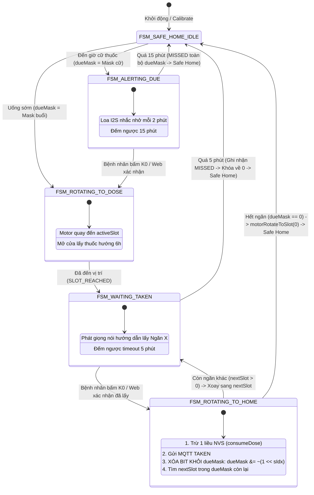

# KẾ HOẠCH CHI TIẾT SỬA LỖI MẮC KẸT TRẠNG THÁI TẠI NGĂN X KHI XÁC NHẬN LẤY THUỐC
> **Tài liệu Kỹ thuật & Kế hoạch Thực thi (Action Plan)**  
> **Dự án**: SmartMed - Hộp thuốc thông minh 8 ngăn xoay tròn IoT  
> **Phiên bản tài liệu**: v1.0 | Ngày lập: 28/10/2026  
> **Tình trạng mã nguồn**: Chỉ lập kế hoạch phân tích và giải pháp, **KHÔNG chỉnh sửa mã nguồn** trực tiếp khi chưa có yêu cầu từ người dùng.

---

## MỤC LỤC
1. [Mô tả hiện tượng và Phạm vi ảnh hưởng](#1-mô-tả-hiện-tượng-và-phạm-vi-ảnh-hưởng)
2. [Phân tích nguyên nhân gốc rễ (Root Cause Analysis - RCA)](#2-phân-tích-nguyên-nhân-gốc-rễ-root-cause-analysis---rca)
   - [2.1 Firmware: Vòng lặp do Bitmask `dueMask` và chuyển trạng thái FSM](#21-firmware-vòng-lặp-do-bitmask-duemask-và-chuyển-trạng-thái-fsm)
   - [2.2 Firmware: Thiếu chuyển về `FSM_SAFE_HOME_IDLE` khi hết ngăn](#22-firmware-thiếu-chuyển-về-fsm_safe_home_idle-khi-hết-ngăn)
   - [2.3 Firmware: Xử lý Timeout 5 phút tại `FSM_WAITING_TAKEN` sai chuẩn y tế](#23-firmware-xử-lý-timeout-5-phút-tại-fsm_waiting_taken-sai-chuẩn-y-tế)
   - [2.4 Firmware: Hàm `fsmTriggerManualDispense` không khởi tạo `dueMask`](#24-firmware-hàm-fsmtriggermanualdispense-không-khởi-tạo-duemask)
   - [2.5 Backend: Endpoint `/early-session` chỉ cấp slot đầu tiên](#25-backend-endpoint-early-session-chỉ-cấp-slot-đầu-tiên)
   - [2.6 Frontend: Web UI thiếu đồng bộ trạng thái cữ hẹn và thiếu nút bấm 2 chiều](#26-frontend-web-ui-thiếu-đồng-bộ-trạng-thái-cữ-hẹn-và-thiếu-nút-bấm-2-chiều)
3. [Sơ đồ luồng trạng thái chuẩn hóa (FSM Architecture)](#3-sơ-đồ-luồng-trạng-thái-chuẩn-hóa-fsm-architecture)
4. [Kế hoạch chi tiết sửa code từng File (Step-by-step Solution)](#4-kế-hoạch-chi-tiết-sửa-code-từng-file-step-by-step-solution)
   - [Bước 1: Sửa đổi Firmware ESP32 (`firmware/src/fsm_controller.cpp`)](#bước-1-sửa-đổi-firmware-esp32-firmwaresrcfsm_controllercpp)
   - [Bước 2: Cập nhật Backend API (`backend/api/dispensing.py`)](#bước-2-cập-nhật-backend-api-backendapidispensingpy)
   - [Bước 3: Bổ sung Frontend API Client (`frontend/js/api.js`)](#bước-3-bổ-sung-frontend-api-client-frontendjsapijs)
   - [Bước 4: Nâng cấp Web UI Dashboard (`frontend/js/app.js`)](#bước-4-nâng-cấp-web-ui-dashboard-frontendjsappjs)
5. [Kế hoạch kiểm thử và Nghiệm thu (Verification & Acceptance Testing)](#5-kế-hoạch-kiểm-thử-và-nghiệm-thu-verification--acceptance-testing)
6. [Bảng tóm tắt rủi ro và Biện pháp phòng ngừa (Risk Mitigation)](#6-bảng-tóm-tắt-rủi-ro-và-biện-pháp-phòng-ngừa-risk-mitigation)

---

## 1. MÔ TẢ HIỆN TƯỢNG VÀ PHẠM VI ẢNH HƯỞNG

### 1.1 Hiện tượng lỗi xảy ra
Trong chu trình cấp phát thuốc (cả cữ tự động theo lịch hẹn và cữ uống sớm):
1. **Giai đoạn báo thức (`FSM_ALERTING_DUE`)**: Hộp thuốc phát chuông báo, giọng nói nhắc nhở, màn hình hiển thị đếm ngược 15 phút.
2. **Giai đoạn mở khay (`FSM_ROTATING_TO_DOSE` $\rightarrow$ `FSM_WAITING_TAKEN`)**: Người bệnh bấm nút PUSH hoặc K0 để xác nhận $\rightarrow$ Khay xoay Ngăn $X$ ra cửa mở 6h, loa phát giọng nói chỉ dẫn số ngăn và liều uống.
3. **Giai đoạn hoàn tất ngăn $X$**: Bệnh nhân lấy thuốc xong và nhấn nút PUSH/K0 (hoặc click trên Web) để xác nhận đã lấy thuốc.
4. **HÀNH VI LỖI PHÁT SINH**:
   - Nếu cữ thuốc có **nhiều ngăn** (ví dụ cữ sáng cần uống Ngăn 1 và Ngăn 2): Khay **không xoay tiếp sang Ngăn 2** mà giữ nguyên tại Ngăn 1, trạng thái tiếp tục là `FSM_WAITING_TAKEN`.
   - Nếu cữ thuốc chỉ có **1 ngăn** (hoặc đã lấy đến ngăn cuối cùng): Khay **không chịu xoay về Slot 0 (Safe Home)**, cửa thuốc vẫn mở toang ở Ngăn $X$.
   - Khi người bệnh bấm thêm nút PUSH/K0 với hy vọng đóng khay: Hệ thống lại tiếp tục trừ hao thêm 1 liều của Ngăn $X$ trong bộ nhớ flash NVS/Database, rồi lại tiếp tục giữ nguyên tại Ngăn $X$.
   - Sau 5 phút timeout: Thiết bị tự động trừ thuốc oan hoặc rơi vào trạng thái mất kiểm soát.
   - Trên Web Dashboard: Bảng điều khiển chuyển về trạng thái chờ (`Idle`) hoặc không có nút bấm tương ứng để giải phóng khay thuốc từ xa.

### 1.2 Mức độ nghiêm trọng
- **Cấp độ**: **Critical (Nghiêm trọng - An toàn y tế)**.
- **Rủi ro**:
  - Người bệnh có thể uống trùng lặp thuốc nếu cố nhấn nút nhiều lần.
  - Tồn kho thuốc bị trừ sai lệch so với thực tế.
  - Khay không đóng kín về Slot 0 (Safe Home) làm mất tính năng bảo vệ an toàn trẻ em và bảo quản thuốc chống ẩm mốc.

---

## 2. PHÂN TÍCH NGUYÊN NHÂN GỐC RỄ (ROOT CAUSE ANALYSIS - RCA)

Hệ thống SmartMed là hệ thống IoT phân tán gồm 3 tầng: **Firmware ESP32-S3**, **Backend FastAPI/MQTT**, và **Frontend Web Dashboard**. Lỗi mắc kẹt phát sinh từ sự kết hợp của các nguyên nhân dưới đây:

```
┌────────────────────────────────────────────────────────────────────────┐
│                        CÁC NGUYÊN NHÂN GỐC RỄ                          │
├────────────────────────┬───────────────────────────────────────────────┤
│ Tầng Firmware          │ 1. dueMask không xóa bit ngăn vừa hoàn tất    │
│ (fsm_controller.cpp)   │ 2. Thiếu fsmTransitionTo(FSM_SAFE_HOME_IDLE)  │
│                        │ 3. Timeout 5 phút tự động trừ thuốc oan       │
│                        │ 4. fsmTriggerManualDispense không set dueMask │
├────────────────────────┼───────────────────────────────────────────────┤
│ Tầng Backend           │ 5. Endpoint /early-session chỉ cấp 1 slot duy │
│ (dispensing.py)        │    nhất thay vì toàn bộ buổi                  │
├────────────────────────┼───────────────────────────────────────────────┤
│ Tầng Frontend          │ 6. App.js thiếu lắng nghe dose_due và thiếu   │
│ (app.js / api.js)      │    nút xác nhận điều khiển 2 chiều            │
└────────────────────────┴───────────────────────────────────────────────┘
```

### 2.1 Firmware: Vòng lặp do Bitmask `dueMask` và chuyển trạng thái FSM
- **File**: `firmware/src/fsm_controller.cpp`
- **Vị trí**: Hàm `fsmTransitionTo(FSM_ROTATING_TO_HOME)`
- **Cơ chế lỗi**:
  - `dueMask` là thanh ghi bitmask 8-bit quản lý các ngăn cần uống trong cữ (Bit 0 = Ngăn 1, Bit 1 = Ngăn 2, ... Bit 6 = Ngăn 7).
  - Khi người dùng lấy xong Ngăn $X$, code xử lý:
    ```cpp
    int sIdx = activeSlot - 1;
    consumeDose(sIdx);
    addHist(sIdx, isManualTake ? H_MANUAL : H_TAKEN);
    dueMask &= ~(1 << sIdx); // Xóa bit ngăn vừa uống
    ```
  - Trong logic tìm ngăn tiếp theo:
    ```cpp
    int nextSlot = 0;
    for (int s = 0; s < N_SLOTS; s++) {
        if ((dueMask >> s) & 1) {
            nextSlot = s + 1;
            break;
        }
    }
    ```
  - **Lỗi 1 (Đệ quy FSM không an toàn)**: Khi `nextSlot > 0`, mã nguồn gọi:
    ```cpp
    activeSlot = nextSlot;
    motorRotateToSlot(activeSlot);
    mqttPublishSlotReached(activeSlot);
    fsmTransitionTo(FSM_WAITING_TAKEN); // <--- GỌI ĐỆ QUY TỪ TRONG FSM_ROTATING_TO_HOME
    ```
    Hàm `fsmTransitionTo` bị gọi lồng nhau khi biến `currentState` chưa hoàn tất quá trình dọn dẹp trạng thái cũ, khiến biến timer `stateEntryMs` bị ghi đè không kiểm soát.
  - **Lỗi 2 (Xung đột âm thanh)**: Lệnh `audioPlayDispenseNext()` phát ra nhưng ngay lập tức bị hàm `audioPlayDispenseSlot(activeSlot)` trong `FSM_WAITING_TAKEN` ghi đè qua I2S DMA, làm mất âm thanh và đôi khi gây nghẽn task âm thanh I2S.

### 2.2 Firmware: Thiếu chuyển về `FSM_SAFE_HOME_IDLE` khi hết ngăn
- **File**: `firmware/src/fsm_controller.cpp`
- **Vị trí**: Nhánh `else` của `FSM_ROTATING_TO_HOME`
- **Cơ chế lỗi**:
  - Trong cấu trúc FSM ban đầu, khi `nextSlot == 0` (đã lấy hết thuốc):
    ```cpp
    } else {
        Serial.println("[FSM] Benh nhan da lay het thuoc, quay ve Slot 0 Safe Home...");
        motorRotateToSlot(0);
        mqttPublishHomeReached();
        dueMask = 0;
        if (activeSchedIndex >= 0) {
            markSchedTakenToday(activeSchedIndex);
            activeSchedIndex = -1;
        }
        audioPlayTakenSuccess();
        // THIẾU fsmTransitionTo(FSM_SAFE_HOME_IDLE); HOẶC currentState VẪN LÀ FSM_ROTATING_TO_HOME!
        if (screen == S_DUE_ALERT) {
            goTo(S_HOME);
        }
    }
    ```
  - Nếu `currentState` không được chuyển dứt khoát về `FSM_SAFE_HOME_IDLE`:
    + Trong `fsmUpdate()`, không có nhánh xử lý cho `FSM_ROTATING_TO_HOME`.
    + Các hàm kích hoạt khác như `fsmTriggerDueAlert`, `fsmTriggerManualDispense`, `fsmTriggerEarlySession` đều kiểm tra điều kiện bảo vệ:
      ```cpp
      if (currentState != FSM_SAFE_HOME_IDLE) return; // BỊ TỪ CHỐI TOÀN BỘ!
      ```
    + Khi người dùng bấm nút PUSH/K0: Hàm `main.cpp` kiểm tra `st == FSM_ALERTING_DUE` hay `st == FSM_WAITING_TAKEN` $\rightarrow$ Đều không khớp $\rightarrow$ **Thiết bị hoàn toàn bất động**.

### 2.3 Firmware: Xử lý Timeout 5 phút tại `FSM_WAITING_TAKEN` sai chuẩn y tế
- **File**: `firmware/src/fsm_controller.cpp`
- **Vị trí**: `fsmUpdate()` $\rightarrow$ `case FSM_WAITING_TAKEN:`
- **Cơ chế lỗi**:
  ```cpp
  case FSM_WAITING_TAKEN: {
      // Quá 5 phút (300 giây) mở khay mà bệnh nhân quên bấm K0 -> Tự động đóng khay về Slot 0 an toàn
      if (now - stateEntryMs >= 300000) {
          Serial.println("[FSM TIMEOUT] Qua 5 phut mo khay -> Tu dong khoa ve Slot 0 Safe Home");
          fsmTransitionTo(FSM_ROTATING_TO_HOME); // <--- LỖI NGUY HIỂM!
          if (screen == S_DUE_ALERT) {
              goTo(S_HOME);
          }
      }
      break;
  }
  ```
  - Khi timeout 300 giây, việc gọi `fsmTransitionTo(FSM_ROTATING_TO_HOME)` đồng nghĩa với việc gọi hàm `consumeDose()` và `mqttPublishTaken()`.
  - **Hậu quả**: Bệnh nhân không uống thuốc nhưng hệ thống vẫn tự ý trừ tồn kho, ghi nhận là đã uống (`TAKEN`), và tiếp tục dính lỗi chuyển ngăn kẹt lại.
  - **Yêu cầu y tế**: Khi quá thời gian chờ lấy thuốc, phải ghi nhận là **BỎ LỠ (`MISSED`)**, lập tức đóng khay về Slot 0, phát âm thanh cảnh báo cữ thuốc đã bị bỏ lỡ, và không được trừ bất kỳ viên thuốc nào.

### 2.4 Firmware: Hàm `fsmTriggerManualDispense` không khởi tạo `dueMask`
- **File**: `firmware/src/fsm_controller.cpp`
- **Cơ chế lỗi**:
  ```cpp
  void fsmTriggerManualDispense(int slot) {
      if (currentState != FSM_SAFE_HOME_IDLE) return;
      if (slot < 1 || slot > N_SLOTS) return;
      activeSlot = slot;
      isManualTake = true;
      // THIẾU: dueMask = (1 << (slot - 1));
      // THIẾU: activeSchedIndex = -1;
      fsmTransitionTo(FSM_ROTATING_TO_DOSE);
  }
  ```
  - Khi người dùng bấm lấy thuốc lẻ qua Web hoặc API, `dueMask` không được gán bit tương ứng.
  - Sau khi lấy xong Ngăn $X$, FSM kiểm tra `dueMask`: Nếu trước đó `dueMask` còn sót dữ liệu rác, nó sẽ xoay sang ngăn rác đó; nếu `dueMask == 0`, nó không xác định được trạng thái kế tiếp.

### 2.5 Backend: Endpoint `/early-session` chỉ cấp slot đầu tiên
- **File**: `backend/api/dispensing.py`
- **Cơ chế lỗi**:
  ```python
  @router.post("/early-session")
  async def early_session_dispense(payload: EarlySessionRequest):
      ...
      first_slot = payload.slots[0]
      return await dispensing_engine.dispense_now(
          slot_number=first_slot,
          trigger_source="EARLY_MANUAL",
      )
  ```
  - Khi người dùng chọn uống sớm "Buổi Sáng" (gồm Ngăn 1 và Ngăn 3), mảng `payload.slots = [1, 3]`.
  - Backend chỉ lấy `payload.slots[0]` (Ngăn 1) để dispatch lệnh `cmd/dispense`.
  - ESP32 nhận lệnh chỉ biết có mỗi Ngăn 1, không hề biết có Ngăn 3 tiếp theo trong buổi.

### 2.6 Frontend: Web UI thiếu đồng bộ trạng thái cữ hẹn và thiếu nút bấm 2 chiều
- **Files**: `frontend/js/app.js` và `frontend/js/api.js`
- **Cơ chế lỗi**:
  - `backend/services/scheduler_engine.py` phát sự kiện WebSocket `dose_due` khi đến giờ uống thuốc.
  - Trong `frontend/js/app.js`, không có listener `wsClient.on('dose_due', ...)`. Người dùng đang mở Web không nhận được thông báo toast khẩn cấp và không thấy giao diện đổi màu cảnh báo.
  - Khi ESP32 đang ở trạng thái `ALERTING_DUE` hoặc `WAITING_CONFIRM`, hàm `renderConsolePanel()` trên Web kiểm tra `activeSession`: Vì cữ tự động của ESP32 không tạo `activeSession` trong RAM backend, Web UI hiển thị bảng điều khiển rảnh rỗi (`Idle Console`) thay vì hiển thị các nút thao tác cấp cứu:
    + Nút: **"Xác nhận đến uống thuốc (Mở khay)"**
    + Nút: **"Xác nhận đã lấy thuốc ra & Chuyển tiếp / Khóa Safe Home"**
    + Nút: **"Hồi vị khẩn cấp về Safe Home"**

---

## 3. SƠ ĐỒ LUỒNG TRẠNG THÁI CHUẨN HÓA (FSM ARCHITECTURE)

Dưới đây là sơ đồ FSM sau khi được thiết kế và chuẩn hóa lại để giải quyết dứt điểm tình trạng mắc kẹt:



---

## 4. KẾ HOẠCH CHI TIẾT SỬA CODE TỪNG FILE (STEP-BY-STEP SOLUTION)

> **LƯU Ý QUAN TRỌNG**: Toàn bộ các đoạn mã dưới đây được cung cấp chi tiết kèm số dòng và diff để sẵn sàng áp dụng khi bắt đầu triển khai code.

### Bước 1: Sửa đổi Firmware ESP32 (`firmware/src/fsm_controller.cpp`)

#### Mục tiêu 1.1: Sửa triệt để nhánh hoàn tất và chuyển tiếp tại `FSM_ROTATING_TO_HOME`
- **File**: `firmware/src/fsm_controller.cpp`
- **Vị trí**: Khoảng dòng 132 - 185
- **Mã nguồn giải pháp**:
```cpp
    case FSM_ROTATING_TO_HOME: {
        homeDirty = false;
        // 1. Cập nhật số lượng và nhật ký y tế cho ngăn vừa uống
        if (activeSlot >= 1 && activeSlot <= N_SLOTS) {
            int sIdx = activeSlot - 1;
            consumeDose(sIdx);
            addHist(sIdx, isManualTake ? H_MANUAL : H_TAKEN);
            dueMask &= ~(1 << sIdx); // Xóa bit ngăn vừa hoàn tất khỏi dueMask
            mqttPublishTaken(activeSlot, meds[sIdx].dose ? meds[sIdx].dose : 1);
            Serial.printf("[FSM] Da hoan tat Ngan %d -> dueMask con lai: 0x%02X\n", activeSlot, dueMask);
        }
        saveCfg();

        // 2. Tìm ngăn tiếp theo trong cùng cữ thuốc / buổi
        int nextSlot = 0;
        for (int s = 0; s < N_SLOTS; s++) {
            if ((dueMask >> s) & 1) {
                nextSlot = s + 1;
                break;
            }
        }

        if (nextSlot > 0) {
            // Vẫn còn ngăn thuốc khác -> Tiếp tục xoay thẳng sang ngăn tiếp theo
            activeSlot = nextSlot;
            Serial.printf("[FSM] Con Ngan %d trong cu, tiep tuc xoay thang den Ngan %d...\n", activeSlot, activeSlot);
            motorRotateToSlot(activeSlot);
            mqttPublishSlotReached(activeSlot);
            fsmTransitionTo(FSM_WAITING_TAKEN);
        } else {
            // Đã uống hết toàn bộ cữ thuốc -> Quay về 0 và khóa an toàn
            Serial.println("[FSM] Benh nhan da lay het thuoc trong cu, quay ve Slot 0 Safe Home...");
            motorRotateToSlot(0);
            mqttPublishHomeReached();
            dueMask = 0;
            if (activeSchedIndex >= 0) {
                markSchedTakenToday(activeSchedIndex);
                activeSchedIndex = -1;
            }
            audioPlayTakenSuccess(); // 🔊 "Xác nhận đã lấy thuốc, cảm ơn bạn đã uống đúng giờ"
            fsmTransitionTo(FSM_SAFE_HOME_IDLE); // ĐẢM BẢO CHUYỂN DỨT KHOÁT VỀ IDLE
            if (screen == S_DUE_ALERT) {
                goTo(S_HOME);
            }
        }
        break;
    }
```

#### Mục tiêu 1.2: Sửa Timeout 5 phút tại `FSM_WAITING_TAKEN` đảm bảo chuẩn an toàn y tế
- **File**: `firmware/src/fsm_controller.cpp`
- **Vị trí**: Khoảng dòng 245 - 260
- **Mã nguồn giải pháp**:
```cpp
    case FSM_WAITING_TAKEN: {
        // Quá 5 phút (300 giây) mở khay mà bệnh nhân không lấy thuốc -> Tự động đóng khay về Slot 0 an toàn & ghi nhận MISSED
        if (now - stateEntryMs >= 300000) {
            Serial.println("[FSM TIMEOUT] Qua 5 phut mo khay khong lay thuoc -> Tu dong khoa ve Slot 0 Safe Home va ghi nhan MISSED");
            
            // Ghi nhận MISSED cho ngăn đang mở và tất cả các ngăn còn lại trong cữ
            if (activeSlot >= 1 && activeSlot <= N_SLOTS) {
                addHist(activeSlot - 1, H_MISS);
                mqttPublishMissed(activeSlot);
            }
            for (int s = 0; s < N_SLOTS; s++) {
                if (((dueMask >> s) & 1) && (s != activeSlot - 1)) {
                    addHist(s, H_MISS);
                    mqttPublishMissed(s + 1);
                }
            }
            
            dueMask = 0;
            activeSchedIndex = -1;
            motorRotateToSlot(0);
            mqttPublishHomeReached();
            audioPlayMissedTimeout(); // 🔊 "Đã hết thời gian chờ lấy thuốc, cữ thuốc được ghi nhận là bỏ lỡ"
            fsmTransitionTo(FSM_SAFE_HOME_IDLE);
            if (screen == S_DUE_ALERT) {
                goTo(S_HOME);
            }
        }
        break;
    }
```

#### Mục tiêu 1.3: Khởi tạo đầy đủ ngữ cảnh trong `fsmTriggerManualDispense`
- **File**: `firmware/src/fsm_controller.cpp`
- **Vị trí**: Khoảng dòng 343 - 355
- **Mã nguồn giải pháp**:
```cpp
void fsmTriggerManualDispense(int slot) {
    if (currentState != FSM_SAFE_HOME_IDLE) {
        Serial.printf("[FSM] Tu choi manual dispense: FSM dang ban hoac loi (State: %s)\n", fsmGetStateString());
        return;
    }
    if (slot < 1 || slot > N_SLOTS) return;
    activeSlot = slot;
    dueMask = (1 << (slot - 1)); // KHỞI TẠO ĐÍCH DANH BIT CỦA NGĂN THỦ CÔNG
    activeSchedIndex = -1;
    isManualTake = true;
    fsmTransitionTo(FSM_ROTATING_TO_DOSE);
}
```

---

### Bước 2: Cập nhật Backend API (`backend/api/dispensing.py`)

#### Mục tiêu 2.1: Hỗ trợ uống sớm đa ngăn theo buổi trong `/early-session`
- **File**: `backend/api/dispensing.py`
- **Vị trí**: Khoảng dòng 65 - 85
- **Mã nguồn giải pháp**:
```python
@router.post(
    "/early-session",
    response_model=DoseLogResponse,
    status_code=202,
    summary="Lấy thuốc sớm theo Buổi",
    description="Kích hoạt phiên cấp thuốc sớm cho danh sách slot theo buổi.",
)
async def early_session_dispense(payload: EarlySessionRequest):
    if not device_state.is_online:
        device_state.set_online()
        device_state.update_fsm("SAFE_HOME_IDLE")
        device_state.update_slot(0)

    # Tính toán bitmask gộp của tất cả các ngăn trong buổi
    combined_mask = sum(1 << (s - 1) for s in payload.slots if 1 <= s <= 7)
    first_slot = payload.slots[0]

    from device.mqtt_client import mqtt_client
    from device.protocol import topic_cmd
    from config import settings

    # Gửi lệnh cấp thuốc với đầy đủ mask đa ngăn xuống ESP32
    await mqtt_client.publish(
        topic_cmd(settings.DEVICE_ID, "dispense"),
        {
            "command": "DISPENSE",
            "slot": first_slot,
            "target_slot": first_slot,
            "slots": payload.slots,
            "mask": combined_mask,
            "trigger_source": "EARLY_MANUAL",
            "session_label": payload.session_label,
            "timeout_seconds": settings.DISPENSE_TIMEOUT_SECONDS,
        }
    )

    return await dispensing_engine.dispense_now(
        slot_number=first_slot,
        trigger_source="EARLY_MANUAL",
    )
```

#### Mục tiêu 2.2: Bổ sung endpoint xác nhận cữ hẹn từ xa `/confirm-dose`
- **File**: `backend/api/dispensing.py`
- **Mã nguồn giải pháp**:
```python
@router.post(
    "/confirm-dose",
    status_code=202,
    summary="Xác nhận đến uống thuốc cữ hẹn từ Web UI",
    description="Tương đương bấm nút PUSH / K0 trên hộp khi đang báo cữ hẹn 15 phút.",
)
async def confirm_dose():
    from device.mqtt_client import mqtt_client
    from device.protocol import topic_cmd
    from config import settings
    if device_state.is_online:
        await mqtt_client.publish(
            topic_cmd(settings.DEVICE_ID, "confirm_dose"),
            {"command": "CONFIRM_DOSE"}
        )
    return {"accepted": True, "message": "Đã gửi lệnh xác nhận uống thuốc xuống ESP32."}
```

---

### Bước 3: Bổ sung Frontend API Client (`frontend/js/api.js`)

- **File**: `frontend/js/api.js`
- **Mục tiêu**: Bổ sung hàm gọi API `/dispense/confirm-dose`
- **Mã nguồn giải pháp**:
```javascript
  // Xác nhận đến uống thuốc cữ hẹn từ xa (khi hộp đang reo ALERTING_DUE)
  async confirmDose() {
    return this._fetch('/dispense/confirm-dose', { method: 'POST' });
  }
```

---

### Bước 4: Nâng cấp Web UI Dashboard (`frontend/js/app.js`)

#### Mục tiêu 4.1: Thêm hàm xử lý `handleConfirmDose`
- **File**: `frontend/js/app.js`
- **Mã nguồn giải pháp**:
```javascript
async function handleConfirmDose() {
  try {
    await window.api.confirmDose();
    showToast('🔔 Đã xác nhận đến uống thuốc! Hộp thuốc đang mở khay...', 'info');
    await loadDashboardData();
  } catch (err) {
    showToast(err.message || 'Lỗi khi xác nhận cữ thuốc', 'error');
  }
}
window.handleConfirmDose = handleConfirmDose;
```

#### Mục tiêu 4.2: Lắng nghe sự kiện WebSocket `dose_due`
- **File**: `frontend/js/app.js`
- **Vị trí**: Trong hàm `initWebSocket()`
- **Mã nguồn giải pháp**:
```javascript
window.wsClient.on('dose_due', (data) => {
  console.log('[WS] dose_due event:', data);
  const med = data.medicine_name || data.label || 'Vui lòng kiểm tra khay';
  showToast(`🔔 ĐÃ ĐẾN CỮ UỐNG THUỐC: ${med}`, 'warning');
  if (appState.carousel3D) appState.carousel3D.setLEDState('amber');
  loadDashboardData();
});
```

#### Mục tiêu 4.3: Nâng cấp `renderConsolePanel()` hiển thị bảng điều khiển theo trạng thái thực tế của FSM
- **File**: `frontend/js/app.js`
- **Logic**:
  - Khi `appState.device.fsm_state === 'ALERTING_DUE'`: Hiển thị thông báo chuông reo cùng nút **"🔔 Xác nhận đến uống thuốc (Mở khay)"**.
  - Khi `appState.device.fsm_state === 'WAITING_CONFIRM' || appState.device.fsm_state === 'WAITING_TAKEN'`: Hiển thị card trạng thái Ngăn đang mở kèm nút **"✅ Xác nhận đã lấy thuốc ra & Chuyển tiếp / Khóa Safe Home"** và nút **"🏠 Hồi vị khẩn cấp"**.

---

## 5. KẾ HOẠCH KIỂM THỬ VÀ NGHIỆM THU (VERIFICATION & ACCEPTANCE TESTING)

Sau khi áp dụng các sửa đổi trên, tiến hành nghiệm thu qua 5 bài test nghiêm ngặt sau:

| Mã Test | Kịch bản kiểm thử | Thao tác thực hiện | Kết quả kỳ vọng đạt chuẩn |
| :--- | :--- | :--- | :--- |
| **TC-01** | **Cữ thuốc đơn 1 ngăn (Single-slot dose)** | 1. Cài đặt lịch cho Ngăn 1 lúc $T$.<br>2. Đến giờ, máy reo `ALERTING_DUE`.<br>3. Bấm K0 trên hộp.<br>4. Lấy thuốc xong, bấm K0 lần 2. | - Khay mở Ngăn 1.<br>- Sau khi bấm lần 2, khay **quay ngay về Slot 0 (Safe Home)**.<br>- Loa phát âm thanh cảm ơn.<br>- Màn hình về `S_HOME`.<br>- **Không bị kẹt ở Ngăn 1**. |
| **TC-02** | **Cữ thuốc đa ngăn (Multi-slot dose)** | 1. Cài đặt lịch cho Ngăn 1 và Ngăn 2 cùng lúc $T$.<br>2. Đến giờ, bấm xác nhận.<br>3. Lấy Ngăn 1 xong, bấm K0.<br>4. Lấy Ngăn 2 xong, bấm K0. | - Sau khi lấy xong Ngăn 1: Khay **tự động xoay tiếp sang Ngăn 2**.<br>- Loa hướng dẫn lấy Ngăn 2.<br>- Sau khi lấy xong Ngăn 2: Khay **quay về Slot 0 Safe Home** và khóa kín.<br>- Trừ đúng mỗi ngăn 1 liều, không trừ lặp. |
| **TC-03** | **Uống sớm đa ngăn theo buổi** | 1. Chọn "Uống sớm Buổi Sáng" (Ngăn 1 + Ngăn 3).<br>2. Lấy Ngăn 1 $\rightarrow$ xác nhận.<br>3. Lấy Ngăn 3 $\rightarrow$ xác nhận. | - Khay mở Ngăn 1 $\rightarrow$ chuyển tiếp sang Ngăn 3 $\rightarrow$ về Slot 0 Safe Home an toàn.<br>- Lịch buổi sáng được đánh dấu đã uống trong ngày. |
| **TC-04** | **Điều khiển 2 chiều qua Web Dashboard** | 1. Thiết bị đang reo cữ hẹn.<br>2. Bấm nút "Xác nhận đến uống" trên Web UI.<br>3. Khi khay mở, bấm "Xác nhận đã lấy thuốc" trên Web UI. | - ESP32 xoay mở khay khi nhận lệnh từ Web.<br>- Khi bấm xác nhận đã lấy trên Web, ESP32 xoay sang ngăn tiếp hoặc về Slot 0 đồng bộ với mô hình 3D. |
| **TC-05** | **Timeout an toàn (Fail-safe 5 phút)** | 1. Khay mở ở Ngăn $X$.<br>2. Bỏ mặc không thao tác trong 300 giây. | - Đúng 300s, khay **tự động đóng về Slot 0 Safe Home**.<br>- Hệ thống ghi nhận trạng thái **MISSED**.<br>- **Tồn kho thuốc KHÔNG bị trừ**. |

---

## 6. BẢNG TÓM TẮT RỦI RO VÀ BIỆN PHÁP PHÒNG NGỪA (RISK MITIGATION)

| Rủi ro tiềm ẩn | Mức độ | Biện pháp kỹ thuật phòng ngừa |
| :--- | :---: | :--- |
| **Xung đột luồng giữa MQTT và FSM Timer** | Trung bình | Biến `currentState` và `dueMask` được cập nhật đồng bộ trong vòng lặp Core 1, có log Serial kiểm tra bitmask trước và sau khi thay đổi. |
| **Trừ trùng tồn kho khi mạng lag** | Cao | Backend `dispensing_engine.py` có hàm `get_recent_by_slot(seconds=90)` chặn mọi bản ghi trùng lặp trong vòng 90 giây cho cùng một ngăn. |
| **Kẹt cơ học khi khay xoay liên tục giữa các ngăn** | Thấp | Mỗi bước xoay đều có watchdog kiểm tra cảm biến TCRT5000; nếu quá thời gian không thấy vạch thì kích hoạt `FSM_ERROR_JAMMED` và nhả nguồn motor (`motorDeenergize`). |
| **Mất nguồn đột ngột khi đang mở khay** | Trung bình | Cơ chế phục hồi khi khởi động (`autoHoming`) tự động tìm lại vạch cảm biến và đưa về Slot 0 Safe Home trước khi nhận bất kỳ lệnh mới nào. |

---
*Kế hoạch đã hoàn tất và sẵn sàng để thực thi khi người dùng yêu cầu.*
