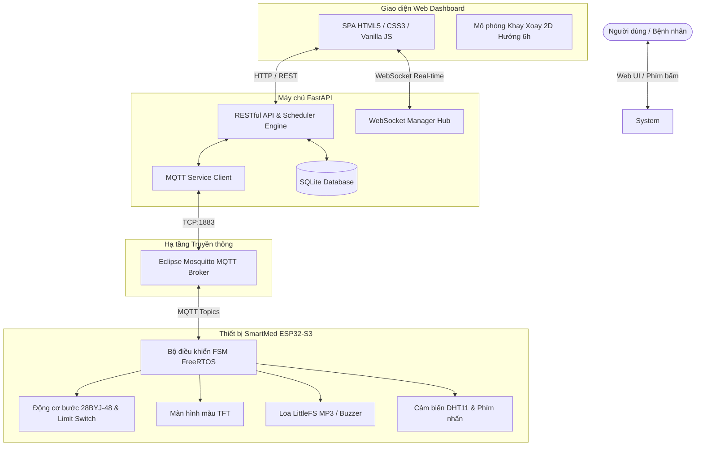

# 💊 SmartMed — Hệ Thống Hộp Thuốc Thông Minh IoT

> **Hệ thống hộp chia thuốc thông minh tự động hóa** kết hợp phần cứng nhúng **ESP32-S3**, máy chủ điều phối **FastAPI (MQTT & WebSocket)** và giao diện điều khiển **Web Dashboard** thời gian thực.

---

## 🌟 Tính Năng Nổi Bật

- **Khay xoay 8 ngăn thông minh**: 1 ngăn truy xuất an toàn (Home 6h) và 7 ngăn chứa thuốc độc lập (Slot 1–7), vận hành bởi động cơ bước 28BYJ-48 + Driver ULN2003 và công tắc hành trình căn chỉnh vị trí tự động.
- **Hệ thống cảnh báo đa giác quan**:
  - Màn hình màu TFT hiển thị trực quan thông tin cữ thuốc, giờ uống, trạng thái cảm biến.
  - Loa phát âm thanh / giọng nói hướng dẫn tiếng Việt lưu trữ trên LittleFS.
  - Đèn LED trạng thái và còi buzzer cảnh báo.
- **Giám sát môi trường & an toàn**: Tích hợp cảm biến DHT11 theo dõi nhiệt độ & độ ẩm buồng thuốc, tự động cảnh báo điều kiện bảo quản.
- **Kết nối IoT thời gian thực**: Giao thức MQTT trao đổi trạng thái và lệnh điều khiển hai chiều với Broker (Mosquitto), WebSocket truyền dữ liệu trực tiếp lên Web Dashboard.
- **Quản lý đa nền tảng**:
  - Web Dashboard: Lập lịch 4 buổi (Sáng, Trưa, Chiều, Tối), nạp thuốc theo ngăn, uống sớm (Early Take), xả thuốc (Clear Slot), chẩn đoán phần cứng in-place.
  - Phím bấm vật lý: Hỗ trợ tương tác trực tiếp tại thiết bị khi không có mạng.

---

## 🏗️ Kiến Trúc Hệ Thống



---

## 📁 Cấu Trúc Thư Mục Dự Án

```text
├── backend/                  # Máy chủ FastAPI & SQLite
│   ├── api/                  # Endpoints REST API (medicines, schedules, slots, device...)
│   ├── database/             # SQLite ORM models & database session
│   ├── device/               # Trình quản lý thiết bị ảo / ngoại vi
│   ├── schemas/              # Pydantic schemas xác thực dữ liệu
│   ├── services/             # Logic nghiệp vụ (Scheduler, Dispensing, MQTT service...)
│   ├── main.py               # Điểm khởi chạy FastAPI backend
│   ├── ws_manager.py         # Quản lý kết nối WebSocket tập trung
│   ├── config.py             # Cấu hình môi trường & hằng số hệ thống
│   └── requirements.txt      # Thư viện phụ thuộc Python
│
├── frontend/                 # Giao diện người dùng Web Dashboard
│   ├── index.html            # Trang điều khiển chính (SPA)
│   ├── css/                  # Giao diện y tế hiện đại, responsive
│   └── js/                   # Module kết nối REST, WebSocket, Canvas khay xoay 2D
│
├── firmware/                 # Mã nguồn Firmware ESP32-S3 (PlatformIO)
│   ├── src/                  # Mã nguồn C++ (FSM, drivers, services, main...)
│   ├── include/              # Header files cấu hình chân GPIO & giao thức
│   ├── data/audio/           # File âm thanh giọng nói LittleFS (.mp3)
│   ├── platformio.ini        # Cấu hình nạp vi điều khiển ESP32-S3
│   └── partitions_16mb.csv   # Bảng phân vùng Flash 16MB LittleFS/App
│
├── HUONG_DAN_CHI_TIET/       # Tài liệu cẩm nang vận hành chi tiết
│   ├── 01_KIEN_TRUC_VA_HUONG_DAN_CODE_TUNG_FILE.md
│   ├── 02_HUONG_DAN_BIEN_DICH_VA_NAP_PLATFORMIO.md
│   ├── 03_QUY_TRINH_KHOI_DONG_MOI_KHI_BAT_MAY.md
│   └── 04_KE_HOACH_THUC_CHIEN_FIRMWARE_TUNG_TAC_VU.md
│
├── KHOI_DONG_HE_THONG.bat    # Script 1-click khởi chạy Mosquitto + Backend + Web
├── DUNG_HE_THONG.bat         # Script dừng nhanh toàn bộ tiến trình hệ thống
├── SYSTEM_SPECIFICATION.md   # Đặc tả kỹ thuật toàn diện phần cứng & phần mềm
├── PROJECT_PLAN.md           # Kế hoạch triển khai & tiến độ chi tiết
└── MQTT_SPECIFICATION.md     # Đặc tả gói tin MQTT giữa Backend và ESP32
```

---

## 🚀 Hướng Dẫn Khởi Chạy Nhanh

### 1. Khởi chạy 1-Click (Khuyên dùng trên Windows)
Nhấp đúp chuột vào file:
```cmd
KHOI_DONG_HE_THONG.bat
```
Script sẽ tự động:
1. Bật dịch vụ Mosquitto MQTT Broker (port 1883).
2. Kích hoạt Backend FastAPI (port 8000).
3. Mở giao diện Web Dashboard trên trình duyệt mặc định.

Để dừng hệ thống, chạy file `DUNG_HE_THONG.bat`.

### 2. Chạy thủ công từng phần

#### Backend (Python 3.10+)
```bash
cd backend
python -m venv venv
venv\Scripts\activate
pip install -r requirements.txt
python main.py
```

#### Frontend
Mở trực tiếp file `frontend/index.html` trên trình duyệt hoặc chạy qua Web Server / Live Server tại cổng local.

#### Firmware ESP32-S3 (PlatformIO)
1. Mở thư mục `firmware/` bằng VS Code đã cài extension PlatformIO.
2. Nạp dữ liệu âm thanh LittleFS:
   ```bash
   pio run -t uploadfs
   ```
3. Nạp firmware lên ESP32-S3:
   ```bash
   pio run -t upload
   ```

---

## 📄 Bản Quyền & Giấy Phép
Dự án được phát triển phục vụ mục đích nghiên cứu y tế thông minh và chăm sóc sức khỏe cộng đồng.
