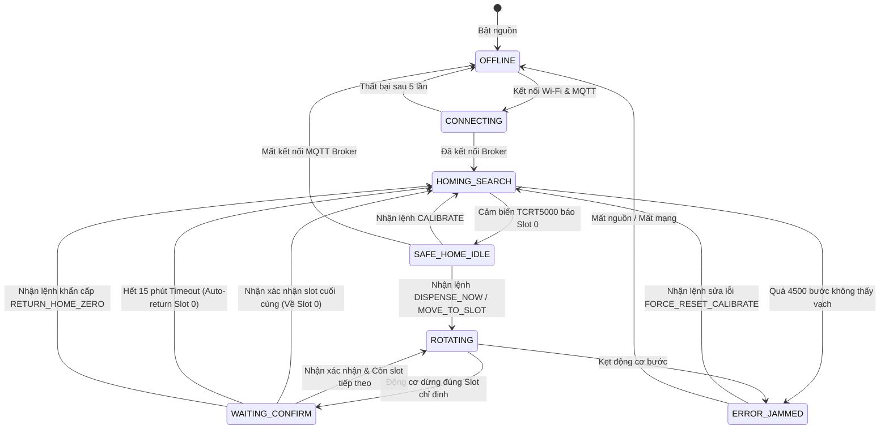
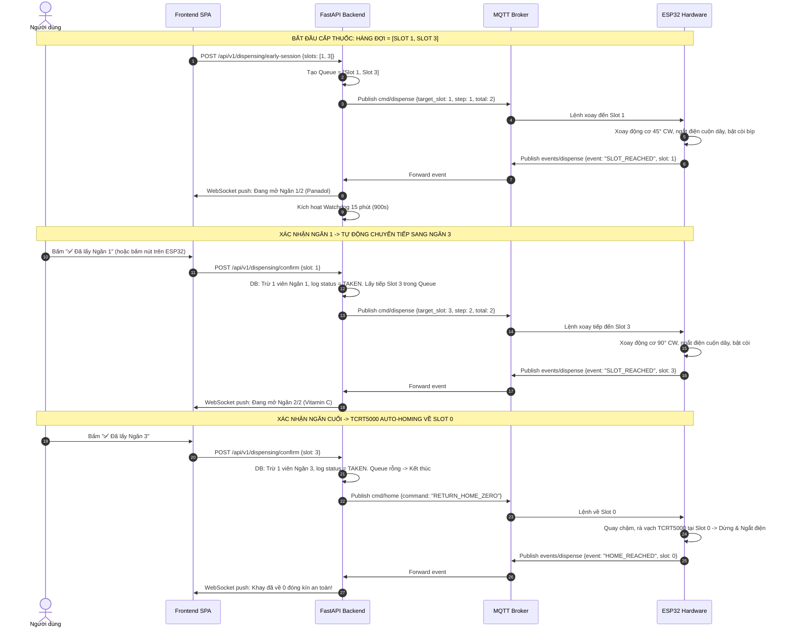

# TÀI LIỆU ĐẶC TẢ HỆ THỐNG TOÀN DIỆN — SMART PILLBOX (PHASE 1)
**Dự án:** Hệ thống Hộp thuốc Thông minh (Smart Pill Dispenser)  
**Phiên bản:** 2.0.0 (Master Finalized)  
**Ngày cập nhật:** 2026-09-25  
**Trạng thái:** ĐÃ PHÊ DUYỆT KIẾN TRÚC (FROZEN ARCHITECTURE)

---

## MỤC LỤC
1. [Tổng Quan Kiến Trúc & Ngăn Xếp Công Nghệ](#1-tổng-quan-kiến-trúc--ngăn-xếp-công-nghệ)
2. [Đặc Tả Phần Cứng & Sơ Đồ Chân GPIO](#2-đặc-tả-phần-cứng--sơ-đồ-chân-gpio)
3. [Cơ Chế Auto-Homing Với Cảm Biến Dò Line TCRT5000](#3-cơ-chế-auto-homing-với-cảm-biến-dò-line-tcrt5000)
4. [Đặc Tả Chuẩn Truyền Thông MQTT (ESP32 ↔ Backend)](#4-đặc-tả-chuẩn-truyền-thông-mqtt-esp32--backend)
5. [Đặc Tả Chuẩn WebSocket (Backend ↔ Frontend SPA)](#5-đặc-tả-chuẩn-websocket-backend--frontend-spa)
6. [Đặc Tả Cơ Sở Dữ Liệu SQLite (DDL, Constraints & Rules)](#6-đặc-tả-cơ-sở-dữ-liệu-sqlite-ddl-constraints--rules)
7. [Đặc Tả REST API (Full Endpoints Spec)](#7-đặc-tả-rest-api-full-endpoints-spec)
8. [Máy Trạng Thái Thiết Bị (Device Finite State Machine)](#8-máy-trạng-thái-thiết-bị-device-finite-state-machine)
9. [Quy Trình Cấp Thuốc Tuần Tự & Watchdog 15 Phút](#9-quy-trình-cấp-thuốc-tuần-tự--watchdog-15-phút)
10. [Ma Trận Xử Lý Lỗi Ngoại Lệ (Failure Cases & Recovery)](#10-ma-trận-xử-lý-lỗi-ngoại-lệ-failure-cases--recovery)
11. [Kiến Trúc Frontend Vanilla SPA & Khay Xoay 2D](#11-kiến-trúc-frontend-vanilla-spa--khay-xoay-2d)
12. [Cấu Trúc Thư Mục Dự Án Toàn Diện](#12-cấu-trúc-thư-mục-dự-án-toàn-diện)
13. [Đặc Tả Hệ Thống Âm Thanh & Giọng Nói Y Tế (I2S Audio Spec)](#13-đặc-tả-hệ-thống-âm-thanh--giọng-nói-y-tế-i2s-audio-voice-prompts-specification)

---

## 1. TỔNG QUAN KIẾN TRÚC & NGĂN XẾP CÔNG NGHỆ

Hệ thống Smart Pillbox Phase 1 được tổ chức theo mô hình **Tam giác Điều khiển IoT chuẩn mực**:

```mermaid
graph TD
    subgraph Client_Layer ["Giao diện Người dùng (Frontend SPA)"]
        SPAApp["Vanilla HTML5 / CSS3 / ES6+ SPA"]
        PillCanvas["Khay Xoay 2D 8 Ngăn Hướng 6h (carousel2d.js)"]
    end

    subgraph Server_Layer ["Hệ thống Trung tâm (Backend Monolith)"]
        FastAPI["FastAPI (Python 3.11+, Asyncio)"]
        SQLiteDB[(SQLite Database - WAL Mode)]
        MqttClient["Async MQTT Service (aiomqtt)"]
        WSHub["WebSocket Event Hub (/ws)"]
        Scheduler["Background Scheduler Engine (VN TZ)"]
        Watchdog["15-Min Safety Watchdog"]
    end

    subgraph Messaging_Layer ["Hạ tầng Message Broker"]
        MQTT_Broker["MQTT Broker (Mosquitto / EMQX, Port 1883)"]
    end

    subgraph Hardware_Layer ["Phần cứng Nhúng (Edge Device)"]
        ESP32["ESP32-S3 N16R8 (FreeRTOS / C++)"]
        TCRT["Cảm biến TCRT5000 (Dò Mốc Slot 0 Safe Home)"]
        Motor["Stepper 28BYJ-48 + ULN2003"]
        Display["TFT 2.4 inch ST7789 IPS 320x240 (SPI)"]
        Audio["Loa I2S MAX98357A + MP3 LittleFS"]
        Input["Núm Xoay EC11 + Nút PUSH + Nút K0"]
        DHT["Cảm biến Nhiệt Độ & Độ Ẩm DHT11"]
    end

    SPAApp <-->|HTTP REST API (CRUD)| FastAPI
    SPAApp <-->|WebSocket Stream (Realtime UI)| WSHub
    FastAPI <-->|SQL Queries / ACID Transactions| SQLiteDB
    FastAPI <--> MqttClient
    MqttClient <-->|Pub/Sub QoS 1| MQTT_Broker
    MQTT_Broker <-->|Pub/Sub QoS 1 & LWT| ESP32
    ESP32 <--> TCRT & Motor & Display & Audio & Input & DHT
```

### Công nghệ Lựa chọn:
* **Embedded MCU:** ESP32-S3-WROOM-1 N16R8 (16MB Flash Octal, 8MB PSRAM Octal), FreeRTOS C++ trên PlatformIO.
* **Position Sensor:** Cảm biến phản xạ hồng ngoại TCRT5000 (Digital Output) dò vạch Slot 0.
* **Communication Broker:** MQTT Broker (Mosquitto / EMQX, Port 1883).
* **Backend Framework:** FastAPI (Python), `aiomqtt`, `aiosqlite`, `pydantic`.
* **Database:** SQLite 3 với chế độ WAL (`PRAGMA journal_mode = WAL`) và ràng buộc khóa ngoại (`PRAGMA foreign_keys = ON`).
* **Frontend:** Single Page Application (Vanilla HTML5 / CSS3 / ES6+), Glassmorphism Medical Design System, Native WebSocket Client, không phụ thuộc Node.js hay build tools.

---

## 2. ĐẶC TẢ PHẦN CỨNG & SƠ ĐỒ CHÂN GPIO

### 2.1. Cấu hình Khay thuốc Vật lý
* Khay tròn hình trụ chia làm **8 vị trí hướng tâm** (mỗi góc chính xác $45^\circ$).
* **Slot 0 (Safe Home):** Góc $0^\circ$ (Vị trí che chắn nắp đóng an toàn). Nắp đóng kín tuyệt đối, không chứa thuốc, chống ẩm mốc, bụi bẩn và trẻ em.
* **Slot 1 đến 7 (Ngăn khả dụng):** Góc $45^\circ, 90^\circ, 135^\circ, 180^\circ, 225^\circ, 270^\circ, 315^\circ$. Cửa nạp và lấy thuốc (Access Window) **cố định tại hướng 6 giờ** (hướng nhìn trực diện của người dùng). Khay thuốc tự xoay để đưa ngăn yêu cầu ra đúng vị trí 6 giờ.

### 2.2. Sơ đồ Đấu Nối Chân GPIO (ESP32-S3 N16R8 Chuẩn Phần Cứng)

> [!WARNING]
> **CẢNH BÁO AN TOÀN ESP32-S3 N16R8:**  
> Module N16R8 sử dụng bus Octal SPI (OPI) nội bộ cho cả 16MB Flash và 8MB PSRAM.  
> **CẤM TUYỆT ĐỐI KHÔNG DÙNG CÁC CHÂN TỪ GPIO 26 ĐẾN GPIO 37.** Chạm vào bus này sẽ làm sập nguồn hoặc treo chip ngay lập tức.

| Ngoại Vi / Module | Chân Linh Kiện | Chân ESP32-S3 | Chức Năng & Chế Độ Hoạt Động |
|---|---|:---:|---|
| **Động cơ bước 28BYJ-48 (Driver ULN2003)** | IN1<br>IN2<br>IN3<br>IN4<br>+5V & GND | **GPIO 7**<br>**GPIO 6**<br>**GPIO 5**<br>**GPIO 4**<br>5V / GND | Half-step 8 bước, lực kéo khỏe, chạy êm 1.2ms/bước.<br>**BẮT BUỘC de-energize cả 4 chân về LOW sau khi dừng.** |
| **Cảm biến quang TCRT5000 (Dò Mốc Slot 0)** | DO (Digital Out)<br>VCC & GND | **GPIO 47**<br>3.3V / GND | Ngõ vào số (INPUT_PULLUP). Vạch đen phản xạ mốc 0 = mức HIGH (ngắt bước và nhận mốc Slot 0 Safe Home). |
| **Mạch Loa I2S MAX98357A (Giọng nói & Âm báo MP3)** | BCLK<br>LRC<br>DIN<br>VIN & GND | **GPIO 16**<br>**GPIO 15**<br>**GPIO 17**<br>5V / GND | Giao tiếp I2S giải mã âm thanh MP3 từ LittleFS. Giữ xung I2S clock liên tục để tránh tiếng lách tách. |
| **Màn hình ST7789 2.4" 320x240 IPS (SPI)** | SCL (SCLK)<br>SDA (MOSI)<br>RES (RST)<br>DC<br>CS<br>BLK (Đèn nền) | **GPIO 12**<br>**GPIO 11**<br>**GPIO 10**<br>**GPIO 9**<br>**GPIO 8**<br>**3.3V** | Giao tiếp SPI 40MHz qua thư viện TFT_eSPI.<br>Sử dụng Native Hardware Fonts (Font 2, Font 4, Font 6, Font 7) cố định tỉ lệ 1x, chống vỡ font. |
| **Núm xoay EC11 & Phím chức năng** | CLK (Phase A)<br>DT (Phase B)<br>PUSH (Nút núm vặn)<br>K0 (Nút phụ) | **GPIO 38**<br>**GPIO 39**<br>**GPIO 40**<br>**GPIO 2** | Ngắt phần cứng bắt xung xoay trái/phải.<br>Nút PUSH: Xác nhận cữ thuốc / Lưu lịch.<br>Nút K0: Thoát màn hình / Return Menu / Hồi vị (GPIO 2 an toàn tuyệt đối). |
| **Cảm biến Nhiệt Độ & Độ Ẩm DHT11** | DATA<br>VCC & GND | **GPIO 1**<br>3.3V / GND | Giao thức 1-Wire đọc nhiệt độ và độ ẩm phòng định kỳ cập nhật lên màn hình TFT và Telemetry. |

> [!CAUTION]
> **Quy tắc an toàn cuộn dây động cơ (De-energize coils):**  
> Sau khi động cơ bước 28BYJ-48 xoay xong số bước chỉ định, firmware **BẮT BUỘC** phải kéo cả 4 chân GPIO 7, 6, 5, 4 xuống mức `LOW` (ngắt điện). Tuyệt đối không để cuộn dây ngậm điện liên tục khi đứng yên để chống nóng động cơ và bảo vệ khay nhựa.

---

## 3. CƠ CHẾ AUTO-HOMING VỚI CẢM BIẾN DÒ LINE TCRT5000

### 3.1. Bố trí vạch phản xạ
* Dưới đáy đĩa xoay tại vị trí đối xứng với **Slot 0** được dán một vạch phản xạ quang học.
* Cảm biến TCRT5000 được bắt vít cố định ở khung đáy hộp thuốc.
* Khi Slot 0 xoay vào vị trí nắp che kín an toàn $\implies$ vạch phản xạ nằm ngay trên đầu quang TCRT5000 $\implies$ Chân `DO` kích hoạt mức logic `LOW` (hoặc `HIGH` tùy chỉnh chiết áp).

### 3.2. Thuật toán Rà Vị trí Gốc (Auto-Homing Routine)
1. **Bước 1 (Kiểm tra ban đầu):** Đọc chân `GPIO 4`. Nếu đang ở mức Active (đang đè vạch) $\implies$ Cho động cơ xoay lùi 100 bước để thoát hẳn ra ngoài vùng nhận diện.
2. **Bước 2 (Rà chậm theo chiều kim đồng hồ - CW):** Băm xung quay từng bước với chu kỳ $5\text{ms/step}$.
3. **Bước 3 (Bắt điểm kích hoạt):** Kiểm tra liên tục chân `GPIO 4`. Ngay khi phát hiện mức Active:
   * Ngắt xung động cơ lập tức.
   * Ngắt dòng điện cả 4 cuộn dây (De-energize).
   * Đặt biến đếm xung nội bộ `current_step = 0`.
   * Đặt biến vị trí `current_slot = 0`.
   * Lưu cờ `is_homed = true` vào bộ nhớ Flash NVS.
4. **Bước 4 (Cơ chế chống kẹt & bảo vệ cảm biến):**
   * Nếu động cơ đã quay quá **4.500 bước** (vượt quá 1 vòng tròn 4.096 bước chuẩn của 28BYJ-48) mà cảm biến vẫn không kích hoạt:
   * Lập tức ngắt động cơ, chuyển FSM sang trạng thái `ERROR_JAMMED`.
   * Publish sự kiện cảnh báo `{"event": "DEVICE_ALERT", "error_code": "SENSOR_HOMING_FAIL"}` lên MQTT.

---

## 4. ĐẶC TẢ CHUẨN TRUYỀN THÔNG MQTT (ESP32 ↔ BACKEND)

### 4.1. Cấu trúc Topic Hierarchy

| Chiều | Topic | QoS | Retain | Mục đích |
|---|---|:---:|:---:|---|
| **Backend $\to$ ESP32** | `pillbox/{device_id}/cmd/dispense` | 1 | False | Lệnh xoay khay cấp thuốc theo cữ |
| **Backend $\to$ ESP32** | `pillbox/{device_id}/cmd/confirm` | 1 | False | Lệnh từ Web báo người dùng đã lấy thuốc |
| **Backend $\to$ ESP32** | `pillbox/{device_id}/cmd/home` | 1 | False | Lệnh khẩn cấp hồi vị an toàn về Slot 0 |
| **Backend $\to$ ESP32** | `pillbox/{device_id}/cmd/calibrate`| 1 | False | Lệnh kích hoạt chu trình Auto-Homing TCRT5000 |
| **Backend $\to$ ESP32** | `pillbox/{device_id}/cmd/sync_schedules` | 1 | False | Đồng bộ lịch uống xuống NVS phòng mất mạng |
| **ESP32 $\to$ Backend** | `pillbox/{device_id}/state/status` | 1 | **True** | LWT & Báo sống: `{"online": true/false}` |
| **ESP32 $\to$ Backend** | `pillbox/{device_id}/state/telemetry` | 0 | False | Gửi định kỳ 5s: vị trí, rssi, trạng thái |
| **ESP32 $\to$ Backend** | `pillbox/{device_id}/events/dispense` | 1 | False | Báo kết quả xoay: `SLOT_REACHED`, `HOME_REACHED` |
| **ESP32 $\to$ Backend** | `pillbox/{device_id}/events/taken` | 1 | False | Báo người dùng nhấn nút vật lý xác nhận |
| **ESP32 $\to$ Backend** | `pillbox/{device_id}/events/alert` | 1 | False | Cảnh báo kẹt cơ `JAMMED`, quá giờ `TIMEOUT` |

### 4.2. Chi tiết Payload JSON Chuẩn

#### 1. Lệnh Cấp Thuốc: `DISPENSE_NOW`
* **Topic:** `pillbox/{device_id}/cmd/dispense`
```json
{
  "command": "DISPENSE_NOW",
  "command_id": "cmd_987654",
  "target_slot": 3,
  "queue_step": 1,
  "queue_total": 2,
  "dose_log_id": 42,
  "medicine_name": "Panadol Extra 500mg",
  "dose_quantity": 1,
  "instructions": "Sau ăn",
  "timeout_seconds": 900,
  "timestamp": 1774324800
}
```

#### 2. Lệnh Hồi Vị Khẩn Cấp: `RETURN_HOME_ZERO`
* **Topic:** `pillbox/{device_id}/cmd/home`
```json
{
  "command": "RETURN_HOME_ZERO",
  "command_id": "cmd_987655",
  "use_sensor": true,
  "timestamp": 1774324900
}
```

#### 3. Báo Sống & LWT (Last Will and Testament): `STATUS`
* **Topic:** `pillbox/{device_id}/state/status`
```json
{
  "device_id": "ESP32_PILLBOX_01",
  "online": true,
  "ip_address": "192.168.1.150",
  "mac_address": "C8:F0:9E:A1:B2:C3",
  "firmware_version": "1.0.0",
  "timestamp": 1774324500
}
```
*(Khi mất nguồn đột ngột, Broker tự động publish `{"device_id": "ESP32_PILLBOX_01", "online": false}`)*

#### 4. Báo Kết Quả Xoay Khay: `SLOT_REACHED` & `HOME_REACHED`
* **Topic:** `pillbox/{device_id}/events/dispense`
```json
{
  "event": "SLOT_REACHED",
  "device_id": "ESP32_PILLBOX_01",
  "command_id": "cmd_987654",
  "current_slot": 3,
  "steps_moved": 1536,
  "timestamp": 1774324805
}
```
```json
{
  "event": "HOME_REACHED",
  "device_id": "ESP32_PILLBOX_01",
  "command_id": "cmd_987655",
  "current_slot": 0,
  "sensor_triggered": true,
  "timestamp": 1774324910
}
```

#### 5. Báo Xác Nhận Lấy Thuốc Vật Lý: `TAKEN_BUTTON_PRESSED`
* **Topic:** `pillbox/{device_id}/events/taken`
```json
{
  "event": "TAKEN_BUTTON_PRESSED",
  "device_id": "ESP32_PILLBOX_01",
  "slot_number": 3,
  "button_held_ms": 120,
  "timestamp": 1774324835
}
```

#### 6. Báo Cáo Đo Đạc Định Kỳ (Telemetry)
* **Topic:** `pillbox/{device_id}/state/telemetry`
```json
{
  "device_id": "ESP32_PILLBOX_01",
  "temperature": 27.5,
  "humidity": 62.0,
  "current_slot": 0,
  "fsm_state": "SAFE_HOME_IDLE",
  "wifi_rssi": -58,
  "free_heap": 184512,
  "uptime_seconds": 43200,
  "is_locked": true,
  "timestamp": 1774325000
}
```

#### 7. Lệnh Xác Nhận Đã Lấy Thuốc: `CONFIRM_DOSE`
* **Topic:** `pillbox/{device_id}/cmd/confirm`
```json
{
  "command": "CONFIRM_DOSE",
  "command_id": "cmd_987656",
  "slot_number": 3,
  "dose_log_id": 42,
  "timestamp": 1774324830
}
```

#### 8. Lệnh Kích Hoạt Auto-Homing TCRT5000: `CALIBRATE_HOME`
* **Topic:** `pillbox/{device_id}/cmd/calibrate`
```json
{
  "command": "CALIBRATE_HOME",
  "command_id": "cmd_987657",
  "sensor_pin": 1,
  "max_steps": 4500,
  "timestamp": 1774324850
}
```

#### 9. Lệnh Đồng Bộ Bảng Lịch Xuống Flash NVS: `SYNC_SCHEDULES`
* **Topic:** `pillbox/{device_id}/cmd/sync_schedules`
```json
{
  "command": "SYNC_SCHEDULES",
  "command_id": "cmd_987658",
  "schedules": [
    {"slot": 1, "time": "08:00", "dose": 1, "name": "Panadol"},
    {"slot": 2, "time": "12:00", "dose": 1, "name": "Vitamin C"}
  ],
  "timestamp": 1774324860
}
```

#### 10. Cảnh Báo Lỗi Phần Cứng: `DEVICE_ALERT`
* **Topic:** `pillbox/{device_id}/events/alert`
```json
{
  "event": "DEVICE_ALERT",
  "device_id": "ESP32_PILLBOX_01",
  "error_code": "JAMMED",
  "error_msg": "Động cơ vượt quá 4500 bước không chạm cảm biến Slot 0",
  "timestamp": 1774324950
}
```

#### 11. Cài Đặt Lịch Uống Từ Núm Xoay EC11: `SCHEDULE_CREATE`
* **Topic:** `pillbox/{device_id}/events/schedule_create`
```json
{
  "event": "SCHEDULE_CREATE",
  "device_id": "ESP32_PILLBOX_01",
  "slot_number": 2,
  "time_of_day": "08:00",
  "dose_quantity": 1,
  "timestamp": 1774324980
}
```

---

## 5. ĐẶC TẢ CHUẨN WEBSOCKET (BACKEND ↔ FRONTEND SPA)

Backend mở WebSocket endpoint tại `ws://<backend_ip>:8000/ws` phục vụ truyền dữ liệu thời gian thực cho ứng dụng Web.

### Cấu trúc Tin Nhắn Chuẩn:
```json
{
  "type": "event_type",
  "data": { ... },
  "ts": "2026-10-12T12:00:00.000000+00:00"
}
```

### Các Sự Kiện Backend Broadcast lên Web Frontend:
1. `connected`: Gửi snapshot toàn diện ngay khi client vừa mở kết nối.
2. `device_online` / `device_offline`: Đồng bộ trạng thái kết nối phần cứng từ LWT MQTT.
3. `device_status`: Cập nhật trạng thái RAM thiết bị (`fsm_state`, `current_slot`).
4. `telemetry`: Cập nhật viễn trắc định kỳ: RSSI Wi-Fi, Uptime, Free Heap, Nhiệt độ & Độ ẩm DHT11.
5. `dispense_started`: Bắt đầu phiên cấp thuốc (thông báo cữ uống và thời gian chờ 15 phút).
6. `slot_reached`: Khay đã xoay đến ngăn đích (kèm LED sáng và nút xác nhận).
7. `home_reached`: Khay đã về Slot 0 Safe Home khóa nắp an toàn.
8. `taken`: Người dùng đã lấy thuốc (qua nút vật lý hoặc Web).
9. `missed`: Hết thời gian chờ 15 phút không lấy thuốc (khay tự thu về 0, log MISSED).
10. `jammed`: Cảnh báo kẹt cơ động cơ khay thuốc.
11. `schedule_updated`: Thông báo đồng bộ lịch uống từ thiết bị (núm EC11) lên Web.

---

## 6. ĐẶC TẢ CƠ SỞ DỮ LIỆU SQLITE (DDL, CONSTRAINTS & RULES)

### 6.1. Schema DDL Chính Thức

```sql
-- Kích hoạt chế độ WAL & Ràng buộc Khóa Ngoại
PRAGMA journal_mode = WAL;
PRAGMA foreign_keys = ON;

-- 1. BẢNG DEVICES
CREATE TABLE IF NOT EXISTS devices (
    id VARCHAR(64) PRIMARY KEY,
    name VARCHAR(128) NOT NULL,
    mac_address VARCHAR(32) UNIQUE,
    status VARCHAR(20) NOT NULL DEFAULT 'OFFLINE',
    total_slots INTEGER NOT NULL DEFAULT 8,
    current_slot INTEGER NOT NULL DEFAULT 0,
    last_heartbeat DATETIME,
    created_at DATETIME DEFAULT CURRENT_TIMESTAMP,
    updated_at DATETIME DEFAULT CURRENT_TIMESTAMP,
    CHECK (total_slots = 8),
    CHECK (current_slot >= 0 AND current_slot <= 7),
    CHECK (status IN ('ONLINE', 'OFFLINE', 'ERROR', 'JAMMED'))
);

-- 2. BẢNG MEDICINES
CREATE TABLE IF NOT EXISTS medicines (
    id INTEGER PRIMARY KEY AUTOINCREMENT,
    name VARCHAR(150) NOT NULL,
    dosage_unit VARCHAR(30) NOT NULL DEFAULT 'viên',
    instructions VARCHAR(50) NOT NULL DEFAULT 'Không phụ thuộc',
    created_at DATETIME DEFAULT CURRENT_TIMESTAMP,
    updated_at DATETIME DEFAULT CURRENT_TIMESTAMP,
    CHECK (instructions IN ('Trước ăn', 'Sau ăn', 'Không phụ thuộc'))
);

-- 3. BẢNG SLOTS (8 Vị trí: Slot 0 là Safe Home, Slot 1..7 là ngăn thuốc)
CREATE TABLE IF NOT EXISTS slots (
    id INTEGER PRIMARY KEY AUTOINCREMENT,
    device_id VARCHAR(64) NOT NULL REFERENCES devices(id) ON DELETE CASCADE,
    slot_number INTEGER NOT NULL,
    medicine_id INTEGER REFERENCES medicines(id) ON DELETE SET NULL,
    capacity INTEGER NOT NULL DEFAULT 10,
    current_quantity INTEGER NOT NULL DEFAULT 0,
    is_active BOOLEAN NOT NULL DEFAULT 1,
    last_refilled_at DATETIME,
    updated_at DATETIME DEFAULT CURRENT_TIMESTAMP,
    UNIQUE (device_id, slot_number),
    CHECK (slot_number >= 0 AND slot_number <= 7),
    CHECK (current_quantity >= 0 AND current_quantity <= capacity),
    -- RÀNG BUỘC TUYỆT ĐỐI NGĂN 0: Khóa Safe Home, cấm nạp thuốc
    CHECK (
        (slot_number = 0 AND medicine_id IS NULL AND capacity = 0 AND current_quantity = 0) OR
        (slot_number > 0 AND capacity > 0)
    )
);

-- 4. BẢNG SCHEDULES (Lịch uống hằng ngày - Tự động gom Buổi)
CREATE TABLE IF NOT EXISTS schedules (
    id INTEGER PRIMARY KEY AUTOINCREMENT,
    device_id VARCHAR(64) NOT NULL REFERENCES devices(id) ON DELETE CASCADE,
    slot_number INTEGER NOT NULL,
    time_of_day VARCHAR(5) NOT NULL,
    label VARCHAR(50) NOT NULL,
    dose_quantity INTEGER NOT NULL DEFAULT 1,
    is_active BOOLEAN NOT NULL DEFAULT 1,
    created_at DATETIME DEFAULT CURRENT_TIMESTAMP,
    updated_at DATETIME DEFAULT CURRENT_TIMESTAMP,
    CHECK (slot_number >= 1 AND slot_number <= 7), -- Cấm lập lịch Slot 0
    CHECK (dose_quantity > 0),
    CHECK (time_of_day GLOB '[0-2][0-9]:[0-5][0-9]'),
    CHECK (label IN ('Buổi Sáng', 'Buổi Trưa', 'Buổi Chiều', 'Buổi Tối')),
    UNIQUE (device_id, time_of_day, slot_number) -- Chống trùng ngăn cùng giờ
);

-- 5. BẢNG DOSE_LOGS (Nhật ký cữ uống & Kiểm toán)
CREATE TABLE IF NOT EXISTS dose_logs (
    id INTEGER PRIMARY KEY AUTOINCREMENT,
    schedule_id INTEGER REFERENCES schedules(id) ON DELETE SET NULL,
    device_id VARCHAR(64) NOT NULL REFERENCES devices(id) ON DELETE CASCADE,
    slot_number INTEGER NOT NULL,
    scheduled_time DATETIME NOT NULL,
    dispensed_time DATETIME,
    confirmed_time DATETIME,
    status VARCHAR(25) NOT NULL,
    trigger_source VARCHAR(30) NOT NULL DEFAULT 'AUTO_SCHEDULE',
    notes TEXT,
    created_at DATETIME DEFAULT CURRENT_TIMESTAMP,
    CHECK (status IN ('PENDING', 'DISPENSED', 'TAKEN', 'EARLY_TAKEN', 'MISSED', 'JAMMED')),
    CHECK (trigger_source IN ('AUTO_SCHEDULE', 'EARLY_MANUAL', 'LOCAL_BUTTON', 'EMERGENCY_HOME'))
);

-- CHỈ MỤC TỐI ƯU TRUY VẤN
CREATE INDEX IF NOT EXISTS idx_slots_dev_slot ON slots(device_id, slot_number);
CREATE INDEX IF NOT EXISTS idx_schedules_scan ON schedules(device_id, is_active, time_of_day);
CREATE INDEX IF NOT EXISTS idx_dose_logs_watchdog ON dose_logs(device_id, status);
CREATE INDEX IF NOT EXISTS idx_dose_logs_history ON dose_logs(device_id, scheduled_time DESC);
```

### 6.2. Quy Tắc Nghiệp Vụ Cốt Lõi (Core Business Rules)
1. **Quy tắc Trừ kho (Inventory Rule):** Số lượng thuốc trong bảng `slots` **CHỈ BỊ TRỪ** khi chuyển trạng thái thành công sang `TAKEN` hoặc `EARLY_TAKEN`. Nếu xảy ra Timeout 15 phút (`MISSED`), số lượng thuốc **giữ nguyên không đổi**.
2. **Quy tắc Tính Buổi Tự Động (Auto-Session Rule):**
   * `05:00 - 10:59` $\implies$ `"Buổi Sáng"`
   * `11:00 - 13:59` $\implies$ `"Buổi Trưa"`
   * `14:00 - 17:59` $\implies$ `"Buổi Chiều"`
   * `18:00 - 04:59` $\implies$ `"Buổi Tối"`
3. **Quy tắc An toàn Dữ liệu (Audit Rule):** Bảng `dose_logs` là nhật ký kiểm toán y tế vĩnh viễn, **tuyệt đối không cung cấp API DELETE**.

---

## 7. ĐẶC TẢ REST API (FULL ENDPOINTS SPEC)

Tiền tố chung: `/api/v1`

### 7.1. Phân hệ Thuốc (`/medicines`)
* `GET /api/v1/medicines`: Trả về danh sách tất cả thuốc.
* `POST /api/v1/medicines`: Tạo thuốc mới. Body: `{"name": "...", "dosage_unit": "viên", "instructions": "Sau ăn"}`.
* `PUT /api/v1/medicines/{id}`: Sửa tên / chỉ định dùng thuốc.
* `DELETE /api/v1/medicines/{id}`: Xóa thuốc. Trả về `409 Conflict` nếu thuốc đang được gán vào Slot hoặc Schedule.

### 7.2. Phân hệ Cấu hình Ngăn (`/slots`)
* `GET /api/v1/slots`: Lấy danh sách 8 ngăn kèm thuốc được gán và tồn kho.
* `PUT /api/v1/slots/{slot_number}`: Nạp thuốc vào ngăn. Body: `{"medicine_id": 1, "capacity": 10, "current_quantity": 10, "is_active": true}`. Chặn `400 Bad Request` nếu cố tình sửa Slot 0.

### 7.3. Phân hệ Lịch trình (`/schedules`)
* `GET /api/v1/schedules`: Danh sách lịch uống đã gom nhóm theo Buổi.
* `POST /api/v1/schedules`: Thêm cữ uống. Body: `{"slot_number": 2, "time_of_day": "08:00", "dose_quantity": 1}`. Hệ thống tự động gán nhãn `label = "Buổi Sáng"`. Chặn nếu trùng slot ở cùng giờ.
* `PATCH /api/v1/schedules/{id}/toggle`: Bật/Tắt lịch trình.
* `DELETE /api/v1/schedules/{id}`: Xóa lịch trình.

### 7.4. Phân hệ Cấp phát Thuốc (`/dispensing`)
* `POST /api/v1/dispensing/early-session`: Yêu cầu lấy thuốc sớm theo Buổi.
  * Body: `{"session": "Buổi Sáng", "slot_numbers": [1, 3]}`.
  * Trả về: `202 Accepted` kèm cấu hình hàng đợi. Backend publish lệnh MQTT xuống ESP32.
* `POST /api/v1/dispensing/confirm`: Xác nhận người dùng đã lấy ngăn hiện tại.
  * Body: `{"slot_number": 1}`.
  * Backend trừ kho, ghi log `TAKEN`. Nếu còn ngăn trong hàng đợi $\to$ điều khiển xoay tiếp sang ngăn tiếp; nếu hết $\to$ phát lệnh về Slot 0.
* `POST /api/v1/dispensing/home`: Ép khay dừng mọi hàng đợi và xoay về Slot 0 an toàn ngay lập tức.

### 7.5. Phân hệ Kiểm thử Phần cứng (`/device`)
* `GET /api/v1/device/status`: Trạng thái chi tiết (Online, Slot, FSM state, Uptime, RSSI).
* `POST /api/v1/device/move`: Xoay tới slot chỉ định (0..7). Body: `{"target_slot": 4}`.
* `POST /api/v1/device/calibrate`: Kích hoạt chu trình Auto-Homing TCRT5000 để rà mốc chuẩn.
* `POST /api/v1/device/test-hardware`: Kiểm tra linh kiện. Body: `{"component": "buzzer" | "display"}`.

---

## 8. MÁY TRẠNG THÁI THIẾT BỊ (DEVICE FINITE STATE MACHINE)



---

## 9. QUY TRÌNH CẤP THUỐC TUẦN TỰ & WATCHDOG 15 PHÚT

Kịch bản: Cữ thuốc Buổi Sáng có 2 loại thuốc tại **Slot 1 (Panadol)** và **Slot 3 (Vitamin C)**.



---

## 10. MA TRẬN XỬ LÝ LỖI NGOẠI LỆ (FAILURE CASES & RECOVERY)

| Tình Huống Lỗi | Nguyên Nhân | Phát Hiện Bởi | Trạng Thái Hệ Thống | Hiển Thị Giao Diện Web | Hành Động Phục Hồi (Recovery) | Tác Động Cơ Sở Dữ Liệu |
|---|---|---|---|---|---|---|
| **1. ESP32 Mất Nguồn / Mất Mạng** | Rút phích cắm hoặc mất Wi-Fi. | MQTT Broker (LWT) & Backend Monitor. | `DEVICE_OFFLINE`. | Banner đỏ cảnh báo: *"Hộp thuốc đang ngoại tuyến!"*. Nút cấp thuốc bị vô hiệu hóa. | Chặn nhận lệnh mới. Tự động kết nối lại khi có nguồn/mạng. | Không ghi log mới. |
| **2. Kẹt Động Cơ (Motor Jammed)** | Dị vật chèn khay, tuột bước động cơ. | ESP32 băm xung quá 4500 bước không chạm cảm biến TCRT5000. | FSM: `ERROR_JAMMED`. | Banner đỏ nhấp nháy: *"CẢNH BÁO: Động cơ bị kẹt! Vui lòng kiểm tra khay."* | Ngắt điện cuộn dây lập tức để chống cháy driver. Yêu cầu kiểm tra cơ khí và bấm nút Calibrate lại. | `dose_logs.status` = `'JAMMED'`. `devices.status` = `'ERROR'`. |
| **3. Quá 15 Phút Không Lấy (Timeout Missed)** | Người bệnh đi vắng hoặc ngủ quên. | Backend Watchdog & ESP32 Local Timer (900s). | Khay tự thu về Slot 0 đóng kín. | Banner vàng thông báo: *"Cữ thuốc lúc 08:00 đã bị bỏ lỡ!"*. | Hộp thuốc hú 3 tiếng bíp dài, khay tự động xoay về Slot 0 để bảo quản thuốc. | `dose_logs.status` = `'MISSED'`. **Số lượng thuốc GIỮ NGUYÊN KHÔNG TRỪ.** |
| **4. Hết Thuốc Trong Ngăn (Quantity = 0)** | Quên nạp thêm thuốc sau nhiều ngày sử dụng. | Business Logic tại `dispensing_service.py`. | Chặn tiến trình cấp thuốc. | Cảnh báo: *"Ngăn X đã hết thuốc! Vui lòng nạp thêm trước khi lấy."* | Từ chối thực thi; điều hướng người dùng tới trang nạp thuốc. | Không trừ kho; không gửi lệnh xoay khay xuống phần cứng. |
| **5. Bấm Đúp Nút Lấy Thuốc (Duplicate Action)** | Người dùng click chuột liên tục nhiều lần. | Frontend Debounce Guard + Backend `asyncio.Lock`. | Bỏ qua các click đến sau. | Nút bấm chuyển sang Spinner xám ngay cú nhấp đầu tiên. | Trả về HTTP 409 Conflict nếu lọt request thứ 2. | Chỉ sinh đúng 1 bản ghi cữ thuốc. |
| **6. Lỗi Cảm Biến TCRT5000 (Đứt Dây / Mất Vạch)** | Dây tín hiệu GPIO 4 bị lỏng hoặc vạch phản xạ bị bám bẩn. | ESP32 đếm bước vượt giới hạn bảo vệ. | FSM: `ERROR_JAMMED`. | Cảnh báo: *"Không tìm thấy điểm gốc Slot 0. Kiểm tra cảm biến TCRT5000."* | Ngắt động cơ bảo vệ cơ khí. Cho phép người dùng chuyển sang chế độ bước thủ công trên Web. | Ghi log cảnh báo phần cứng. |

---

## 11. KIẾN TRÚC FRONTEND SPA SIÊU NHẸ (VANILLA HTML5 / CSS3 / ES6+)

### 11.1. Triết Lý Thiết Kế & Công Nghệ
* **Zero Dependency:** Chạy trực tiếp trên trình duyệt, không cần Node.js, npm hay các bước build bundle phức tạp.
* **FastAPI Mount:** Được phục vụ trực tiếp từ thư mục `frontend/` qua `app.mount("/", StaticFiles(directory=FRONTEND_DIR, html=True))`.
* **Medical Dark/Light Design System:** Phong cách Glassmorphism y tế cao cấp, phông chữ Plus Jakarta Sans hiện đại, độ phản hồi mượt mà.

### 11.2. Hệ Thống Màu Sắc & Ngữ Nghĩa Y Tế (Medical Design Tokens)
* **Primary (Chủ đạo):** `#2563EB` (Xanh y tế hiện đại, tin cậy).
* **Safe Green (An toàn):** `#10B981` (Dành cho Slot 0 Safe Home 🔒 và trạng thái Online).
* **Alert Yellow (Cảnh báo):** `#F59E0B` (Dành cho sắp hết thuốc $\le 2$ viên và đếm ngược 15p).
* **Warning Red (Khẩn cấp):** `#EF4444` (Dành cho kẹt cơ, mất mạng, bỏ lỡ cữ thuốc).
* **Dark Slate (Nền/Chữ):** `#0F172A` / `#F8FAFC` (Độ tương phản cao, số liệu dùng `tabular-nums` chống rung giật).
* **Bảng màu nhận diện 8 ngăn riêng biệt (8-Slot Palette):**
  - **Ngăn 0 (Safe Home 🔒):** Slate Dark `#334155` + viền xanh an toàn `#10B981`
  - **Ngăn 1:** 🔵 Xanh Đại Dương (`#2563EB`)
  - **Ngăn 2:** 🟢 Xanh Ngọc Lục Bảo (`#059669`)
  - **Ngăn 3:** 🟠 Vàng Cam Hổ Phách (`#D97706`)
  - **Ngăn 4:** 🟣 Tím Thạch Anh (`#7C3AED`)
  - **Ngăn 5:** 🔴 Hồng San Hô (`#E11D48`)
  - **Ngăn 6:** 🔷 Xanh Lơ Aqua (`#0891B2`)
  - **Ngăn 7:** 🔮 Xanh Chàm Indigo (`#4F46E5`)

### 11.3. Mô Hình Khay Xoay 2D Hướng 6 Giờ (`carousel2d.js`)
* Khay tròn 8 ngăn hướng tâm phân biệt bằng 8 màu sắc riêng biệt (Slot 0 Safe Home màu xám Slate có ổ khóa 🔒).
* Cửa nạp và lấy thuốc **cố định tại hướng 6 giờ** (hướng nhìn của người dùng). Khay thuốc tự xoay để đưa ngăn yêu cầu về đúng hướng 6 giờ.
* Công thức góc xoay: $\text{angle} = 90^\circ - (k \times 45^\circ)$
* Hiệu ứng mượt mà: `transition: transform 1.2s cubic-bezier(0.4, 0, 0.2, 1)`.
* Đèn LED chỉ thị đa trạng thái tại cửa 6 giờ: Xanh lá (Safe Home), Xanh dương (Sẵn sàng lấy thuốc), Đỏ (Kẹt cơ).

### 11.4. Bảng Điều Khiển Tác Vụ In-Place & Lịch Uống 4 Buổi
* **In-Place Console:** Không dùng modal popup làm mờ khay; giao diện Nạp thuốc và Lấy thuốc sớm hiển thị trực tiếp bên cạnh khay xoay.
  - Chọn Nạp Ngăn $k$ $\to$ Khay xoay Ngăn $k$ ra hướng 6 giờ $\to$ Đổ thuốc & nhập tên, liều $\to$ Bấm `✅ Xác nhận đã nạp thuốc & Về vị trí Safe 🔒` $\to$ Khay tự động quay về Ngăn 0 Safe Home đóng kín nắp.
* **Lịch 4 Buổi (Chuẩn 24H):** Tự động phân loại 4 buổi:
  - 🌅 **Buổi Sáng:** `05:00 – 10:59`
  - ☀️ **Buổi Trưa:** `11:00 – 13:59`
  - 🌇 **Buổi Chiều:** `14:00 – 17:59`
  - 🌙 **Buổi Tối:** `18:00 – 04:59`
* **Ràng buộc Fail-Safe:** Chỉ cho phép đặt lịch cho các ngăn đang có thuốc (`quantity > 0`).

### 11.5. Chi Tiết 4 Phân Hệ Giao Diện (4 SPA Tabs)
1. **Tab 1: 📊 Tổng quan & Khay 2D (`tab-dashboard`):** 4 Stat Cards, Khay 2D 8 ngăn phân màu, Bảng tác vụ In-Place (Nạp thuốc / Lấy sớm theo Buổi), Lộ trình đơn thuốc tiếp theo, Lưới tồn kho 7 ngăn thuốc.
2. **Tab 2: 📅 Lịch uống 4 Buổi (`tab-schedules`):** Dòng thời gian nhóm 4 Buổi, TimePicker 24h, form thêm cữ ràng buộc ngăn có thuốc, công tắc Toggle On/Off tức thì.
3. **Tab 3: 🛠️ Chẩn đoán phần cứng (`tab-device`):** Motor Manual Dock 8 nút, Nút kích hoạt Auto-Homing TCRT5000, Card viễn trắc Telemetry sống (Uptime, Heap, RSSI, DHT11 Temp/Humidity), Audit logs console.
4. **Tab 4: 📋 Nhật ký cữ uống (`tab-history`):** Lịch sử cữ uống (TAKEN, MISSED, EARLY_TAKEN, JAMMED), bộ lọc trạng thái.

---

## 12. CẤU TRÚC THƯ MỤC DỰ ÁN TOÀN DIỆN THỰC TẾ

```text
new/                                 # Thư mục gốc dự án SmartMed
├── SYSTEM_SPECIFICATION.md          # ĐẶC TẢ HỆ THỐNG TOÀN DIỆN (Single Source of Truth)
├── PROJECT_PLAN.md                  # KẾ HOẠCH TRIỂN KHAI 16 TASKS & NHẬT KÝ TIẾN ĐỘ
├── firmware.md                      # ĐẶC TẢ CHUYÊN SÂU FIRMWARE ESP32-S3 (FreeRTOS)
├── start_app.bat                    # Script 1-click khởi chạy Server & Web Browser
├── Chay_SmartMed.bat                # Script chạy tự động (Mosquitto + Backend + Web)
│
├── backend/                         # FASTAPI BACKEND (Python 3.13)
│   ├── main.py                      # App entry point, CORS, Lifespan, Static Mount
│   ├── config.py                    # Cấu hình biến môi trường (PORT, MQTT_BROKER, DB_PATH)
│   ├── ws_manager.py                # WebSocket Hub phát sóng sự kiện thời gian thực
│   ├── pillbox.db                   # Cơ sở dữ liệu SQLite (5 bảng quan hệ y tế)
│   ├── requirements.txt             # fastapi, uvicorn, aiomqtt, aiosqlite, pydantic
│   ├── api/                         # REST API Routers
│   │   ├── dependencies.py          # Dependency injection (DB context)
│   │   ├── medicines.py             # CRUD danh mục thuốc
│   │   ├── slots.py                 # Cấu hình 8 ngăn (Bảo vệ Slot 0)
│   │   ├── schedules.py             # Quản lý lịch uống thuốc
│   │   ├── dispensing.py            # Cấp thuốc sớm, xác nhận, hồi vị 0
│   │   ├── device.py                # Chẩn đoán, Motor Dock, Auto-Homing
│   │   └── ws.py                    # WebSocket endpoint (/ws)
│   ├── services/                    # Business Logic Engines
│   │   ├── dispensing_engine.py     # FSM điều phối cấp thuốc, Watchdog 15p, trừ kho ACID
│   │   ├── scheduler_engine.py      # Quét lịch hằng phút theo giờ Việt Nam
│   │   ├── slot_service.py          # Nghiệp vụ ngăn thuốc
│   │   ├── schedule_service.py      # Tự động gán nhãn 4 buổi
│   │   └── medicine_service.py      # Nghiệp vụ thuốc
│   ├── device/                      # Giao tiếp phần cứng
│   │   ├── mqtt_client.py           # Kết nối Broker, Subscribe & Dispatch Topics
│   │   ├── protocol.py              # Serializer / Deserializer JSON Commands & Events
│   │   └── device_state.py          # Cache trạng thái RAM thiết bị
│   ├── database/                    # SQLite Data Layer
│   │   ├── connection.py            # Kết nối bất đồng bộ (WAL mode, Foreign Keys)
│   │   ├── schema.sql               # DDL 5 bảng quan hệ y tế
│   │   ├── seed.sql                 # Dữ liệu khởi tạo ban đầu
│   │   └── repositories/            # SQL thuần: dose_log, slot, schedule, medicine
│   └── tests/                       # Bộ test tự động
│       ├── audit_test.py            # Test 17 tiêu chí toàn diện Backend & Frontend
│       ├── test_scheduler.py        # Test quét lịch & recovery
│       └── mock_esp32_mqtt.py       # Script Python giả lập phần cứng MQTT
│
├── frontend/                        # FRONTEND SPA SIÊU NHẸ (HTML5 / CSS3 / ES6+)
│   ├── index.html                   # Giao diện SPA 4 phân hệ y tế
│   ├── css/
│   │   └── style.css                # Design system Glassmorphism y tế cao cấp
│   └── js/
│       ├── api.js                   # REST Client gọi API Backend
│       ├── ws.js                    # Native WebSocket Client kết nối /ws
│       ├── carousel2d.js            # Khay xoay 2D 8 ngăn hướng 6h (SVG Canvas)
│       └── app.js                   # Điều phối chính: Lịch 4 buổi, In-place Console
│
└── firmware/                        # ESP32-S3 FIRMWARE (PlatformIO / FreeRTOS / C++)
    ├── platformio.ini               # Cấu hình board esp32-s3-n16r8, 16MB Flash, 8MB PSRAM
    ├── include/
    │   ├── config.h                 # Định nghĩa toàn bộ GPIO chân an toàn
    │   ├── app_state.h              # Cấu trúc dữ liệu Med, Sched, Hist, Screen
    │   ├── display_ui.h             # Giao diện màn hình TFT ST7789 2.4" 320x240
    │   ├── motor_control.h          # Điều khiển động cơ bước 28BYJ-48
    │   ├── audio_player.h           # Loa I2S MAX98357A phát âm thanh MP3
    │   ├── dht_sensor.h             # Cảm biến nhiệt độ & độ ẩm phòng DHT11
    │   └── fsm_controller.h         # Máy trạng thái 7 State FSM y tế
    ├── src/
    │   ├── main.cpp                 # Entrypoint FreeRTOS, ngắt núm EC11, nút K0
    │   ├── display_ui.cpp           # Render 11 màn hình TFT với Hardware Fonts
    │   ├── motor_control.cpp        # Xoay vị trí ngăn & Auto-Homing TCRT5000
    │   ├── audio_player.cpp         # Driver I2S persistent clock, LittleFS MP3
    │   ├── dht_sensor.cpp           # Đọc dữ liệu môi trường DHT11
    │   └── fsm_controller.cpp       # FSM 7 trạng thái vận hành y tế
    └── data/audio/                  # File âm thanh giọng nói MP3 trong LittleFS
```

---

## 13. ĐẶC TẢ HỆ THỐNG ÂM THANH & GIỌNG NÓI Y TẾ (I2S AUDIO & VOICE PROMPTS SPECIFICATION)

### 13.1. Kiến Trúc Phần Cứng & Giải Mã Âm Thanh
* **IC Khuếch Đại & Giải Mã:** MAX98357A I2S Class-D Amplifier (Công suất cực đại 3W với nguồn 5V, không gây sụt áp đường 3.3V của ESP32-S3).
* **Kết Nối GPIO:**
  * `BCLK` (Bit Clock): **GPIO 16**
  * `LRC / WS` (Word Select / Left-Right Clock): **GPIO 15**
  * `DIN` (Serial Data): **GPIO 17**
  * `VIN`: **5V** | `GND`: **GND** | `GAIN & SD`: Để hở (Mặc định Gain 9dB - 12dB, Mono Mix).
* **Kiến Trúc Đa Nhân FreeRTOS:**
  * Giải mã stream MP3 chạy trên **Core 0** (Task `AudioI2STask`, stack 8KB, priority 2).
  * Luồng chính điều khiển màn hình TFT, động cơ bước và FSM chạy trên **Core 1**, đảm bảo âm thanh phát mượt mà, không giật lag và không chặn giao diện/động cơ.
  * Giữ xung I2S Persistent (`AudioOutputI2SPersistent`) để triệt tiêu tiếng "bụp" (pop noise) khi bắt đầu hoặc kết thúc phát nhạc.
* **Bộ Nhớ Lưu Trữ:** Phân vùng Flash **LittleFS 8.8MB** (`/data/audio/`).
* **Tiêu Chuẩn File Âm Thanh:** Định dạng **MP3**, tần số lấy mẫu **24kHz / 16-bit Mono**, tốc độ bit 64kbps, chuẩn hóa âm lượng đỉnh $-0.5\text{dB}$, giọng đọc AI tự nhiên truyền cảm (Tiếng Việt).

### 13.2. Ma Trận Mức Độ Ưu Tiên Phát Âm Thanh (Audio Priority Queue)

| Mức Ưu Tiên | Giá Trị Enum | Định Nghĩa Y Tế | Quy Tắc Ngắt & Chặn |
|:---:|:---|:---|:---|
| **1 (Cao nhất)** | `AUDIO_PRIO_ALARM` | Báo động khẩn cấp (`alarm_jammed.mp3`) | Ngắt ngay lập tức mọi âm thanh đang phát để phát báo động. |
| **2** | `AUDIO_PRIO_MEDICAL` | Nhắc cữ thuốc, cảnh báo quá giờ (`alert_due`, `missed_timeout`, `warn_empty_stock`) | Ngắt âm thông tin/UI; không bị ngắt bởi UI. |
| **3** | `AUDIO_PRIO_INFO` | Hướng dẫn thao tác, nạp thuốc, uống sớm, kết nối Wi-Fi | Chỉ phát khi không có âm y tế/khẩn cấp. |
| **4 (Thấp nhất)** | `AUDIO_PRIO_UI` | Âm thanh giao diện (`click.mp3`, `intro.mp3`, `beep_*`) | Không ngắt bất kỳ giọng nói y tế hay âm thanh nào đang phát. |

### 13.3. Danh Mục Chi Tiết Bộ Âm Thanh Y Tế (Bao Gồm Giọng Nói Đích Danh Từng Ngăn 1..7)

#### Nhóm 1: Chu Trình Cữ Thuốc & Uống Sớm (FSM Y Tế)
| Tên File | Lời Thoại / Nội Dung Tiếng Việt | Hoàn Cảnh Kích Hoạt | Mức Ưu Tiên |
|:---|:---|:---|:---:|
| `alert_due.mp3` | *"Đã đến giờ uống thuốc, xin mời bạn nhấn nút trên hộp để lấy thuốc."* | Bắt đầu cữ thuốc theo lịch (Phase 1: Alerting) | `MEDICAL` |
| `alert_remind.mp3` | *"Nhắc lại: Đã đến giờ uống thuốc, xin bạn vui lòng đến lấy thuốc."* | Định kỳ nhắc lại mỗi 2 phút nếu chưa xác nhận | `MEDICAL` |
| `dispense_slot1.mp3` $\dots$ `dispense_slot7.mp3` | *"Đang mở ngăn số X. Xin mời bạn lấy thuốc ở ngăn số X."* *(X từ 1 đến 7)* | Khay xoay mở đúng ngăn thuốc cho bệnh nhân (Phase 2) | `INFO` |
| ~~`dispense_generic.mp3`~~ | ~~*"Khay đang mở, xin mời bạn lấy thuốc ở ngăn đang mở."*~~ | **[DEPRECATED — SẼ XÓA KHI CODE]**: Đã thay thế bằng 7 file đích danh `dispense_slotX`. Khi bắt đầu code sẽ xóa bỏ hoàn toàn ở `audio_player.cpp` (bỏ nhánh fallback) và xóa file vật lý trong `/data/audio/`. | `INFO` |
| `dispense_next.mp3` | *"Lấy ngăn tiếp theo..."* *(Câu đệm siêu ngắn ~1s)* | Phát ngay khi bắt đầu xoay chuyển sang ngăn kế tiếp trong cữ đa ngăn | `INFO` |
| `taken_success.mp3` | *"Xác nhận đã lấy đủ thuốc. Cảm ơn bạn đã uống thuốc đúng giờ."* | Bệnh nhân đã lấy xong toàn bộ ngăn, khay về Home | `INFO` |
| `missed_timeout.mp3` | *"Đã hết thời gian chờ. Cữ thuốc này được ghi nhận là bỏ lỡ."* | Quá 15 phút không bấm lấy thuốc | `MEDICAL` |
| `early_take_morning.mp3` | *"Lấy thuốc cho buổi sáng."* | Xác nhận lấy thuốc sớm cữ Sáng hôm nay | `INFO` |
| `early_take_noon.mp3` | *"Lấy thuốc cho buổi trưa."* | Xác nhận lấy thuốc sớm cữ Trưa hôm nay | `INFO` |
| `early_take_afternoon.mp3` | *"Lấy thuốc cho buổi chiều."* | Xác nhận lấy thuốc sớm cữ Chiều hôm nay | `INFO` |
| `early_take_evening.mp3` | *"Lấy thuốc cho buổi tối."* | Xác nhận lấy thuốc sớm cữ Tối hôm nay | `INFO` |
| `early_no_dose.mp3` | *"Hôm nay bạn đã uống hết các cữ thuốc, không có cữ nào cần uống sớm."* | Vào Task 3 khi không có cữ khả dụng | `INFO` |

> [!TIP]
> **1. Cơ chế Chuỗi Âm Thanh Đa Ngăn (Multi-Slot Sequential Audio Flow):**  
> Khi một cữ thuốc có từ 2 ngăn trở lên cần uống liên tiếp (ví dụ cữ sáng cần uống cả Ngăn 1 và Ngăn 3):  
> * Bước 1: Khi bấm xác nhận lấy xong Ngăn 1 $\implies$ Loa phát ngay câu đệm ngắn `dispense_next.mp3` (*"Lấy ngăn tiếp theo..."*), đồng thời khay bắt đầu xoay.  
> * Bước 2: Khi khay xoay đến đúng Ngăn 3 và dừng lại $\implies$ Loa phát tiếp `dispense_slot3.mp3` (*"Đang mở ngăn số 3. Xin mời bạn lấy thuốc ở ngăn số 3."*).  
> $\implies$ Chuỗi âm thanh liền mạch: *"Lấy ngăn tiếp theo... Đang mở ngăn số 3. Xin mời bạn lấy thuốc ở ngăn số 3."*
>
> **2. Cơ chế Âm Thanh Uống Thuốc Sớm Theo Buổi (Early Take Session Flow):**  
> Khi người dùng chọn uống sớm cho một buổi trong ngày (Sáng, Trưa, Chiều, Tối):  
> * Bấm xác nhận buổi: Loa phát câu đệm buổi tương ứng (ví dụ `early_take_noon.mp3` *"Lấy thuốc cho buổi trưa."*).  
> * Đồng thời khay xoay tới ngăn đầu tiên của buổi đó, khi dừng lại phát tiếp `dispense_slot{X}.mp3` (*"Đang mở ngăn số X. Xin mời bạn lấy thuốc ở ngăn số X."*).  
> $\implies$ Chuỗi âm thanh hoàn chỉnh: *"Lấy thuốc cho buổi trưa... Đang mở ngăn số 2. Xin mời bạn lấy thuốc ở ngăn số 2."*

#### Nhóm 2: 4 Tác Vụ Chính Trên Menu & Nạp/Xóa Đích Danh Số Ngăn (Task 1 đến Task 4)
| Tên File | Lời Thoại / Nội Dung Tiếng Việt | Hoàn Cảnh Kích Hoạt | Mức Ưu Tiên |
|:---|:---|:---|:---:|
| `task1_sched_enter.mp3` | *"Chế độ đặt lịch uống thuốc."* | Chọn Task 1: Đặt lịch uống thuốc | `UI` |
| `task1_sched_saved.mp3` | *"Đã lưu lịch uống thuốc thành công."* | Khi lưu xong một mốc giờ hoặc bật/tắt ngăn trong cữ | `INFO` |
| `task2_refill_enter.mp3` | *"Chế độ nạp và quản lý ngăn thuốc."* | Chọn Task 2: Nạp & Quản lý thuốc | `UI` |
| `refill_open_slot1.mp3` $\dots$ `refill_open_slot7.mp3` | *"Đang mở ngăn số X để nạp thuốc. Xin hãy kiểm tra đúng loại thuốc và số lượng cần nạp."* *(X từ 1 đến 7)* | Mở đích danh ngăn X để nạp thuốc (từ bàn phím hộp hoặc Web) | `INFO` |
| `refill_done.mp3` | *"Nạp thuốc thành công, khay đã khóa về vị trí an toàn."* | Xác nhận đã bỏ thuốc vào ngăn, khay quay về Home | `INFO` |
| `refill_cancel.mp3` | *"Đã hủy nạp thuốc, khay đã khóa về vị trí an toàn."* | Người dùng hoặc Web bấm Hủy thao tác nạp thuốc | `INFO` |
| `clear_open_slot1.mp3` $\dots$ `clear_open_slot7.mp3` | *"Đang mở ngăn số X, xin hãy lấy hết thuốc ra ngoài."* *(X từ 1 đến 7)* | Mở đích danh ngăn X để dọn sạch thuốc / xóa ngăn | `INFO` |
| `clear_done.mp3` | *"Xác nhận xóa, dữ liệu đã được dọn, khay trở về vị trí an toàn."* | Xác nhận đã lấy hết thuốc ra khỏi ngăn dọn / xóa ngăn | `INFO` |
| `task3_early_enter.mp3` | *"Chế độ uống thuốc sớm theo buổi."* | Chọn Task 3: Uống thuốc sớm | `UI` |
| `task4_hist_enter.mp3` | *"Nhật ký lịch sử uống thuốc."* | Chọn Task 4: Xem lịch sử | `UI` |
| `calib_enter.mp3` | *"Chế độ căn chỉnh khay thuốc, đang rà tìm mốc an toàn."* | Nhấn giữ núm PUSH trên màn hình Home để hiệu chuẩn | `INFO` |

#### Nhóm 3: Cảnh Báo An Toàn Y Tế & Môi Trường Bảo Quản
| Tên File | Lời Thoại / Nội Dung Tiếng Việt | Hoàn Cảnh Kích Hoạt | Mức Ưu Tiên |
|:---|:---|:---|:---:|
| `warn_low_stock.mp3` | *"Chú ý: Thuốc trong ngăn sắp hết, xin vui lòng nạp thêm thuốc."* | Số lượng viên trong ngăn còn $\le 5$ viên sau khi uống | `INFO` |
| `warn_empty_stock.mp3` | *"Cảnh báo: Ngăn thuốc này hiện đã hết, không thể lấy thuốc."* | Số lượng viên trong ngăn bằng 0 khi đến cữ | `MEDICAL` |
| `warn_temp_high.mp3` | *"Cảnh báo: Nhiệt độ hộp thuốc đang quá cao, xin chuyển hộp đến nơi mát mẻ."* | Cảm biến DHT11 ghi nhận nhiệt độ phòng $T > 32^\circ\text{C}$ | `MEDICAL` |
| `warn_hum_high.mp3` | *"Cảnh báo: Độ ẩm không khí quá cao, có thể ảnh hưởng đến chất lượng thuốc."* | Cảm biến DHT11 ghi nhận độ ẩm không khí $H > 75\%$ | `MEDICAL` |
| `alarm_jammed.mp3` | *"Cảnh báo khẩn cấp! Khay xoay gặp sự cố kẹt cơ, vui lòng kiểm tra hộp thuốc."* | Động cơ bước xoay quá 4500 bước không tìm thấy mốc TCRT5000 | `ALARM` |

#### Nhóm 4: Trạng Thái Kết Nối Mạng IoT & Hệ Thống
| Tên File | Lời Thoại / Nội Dung Tiếng Việt | Hoàn Cảnh Kích Hoạt | Mức Ưu Tiên |
|:---|:---|:---|:---:|
| `intro.mp3` | *"Hộp thuốc thông minh Medbox đã sẵn sàng hoạt động."* | ESP32-S3 khởi động xong & Auto-Homing về Ngăn 0 thành công | `UI` |
| `wifi_connected.mp3` | *"Đã kết nối Wi-Fi và đồng bộ dữ liệu với máy chủ y tế."* | Wi-Fi kết nối thành công và MQTT Broker sẵn sàng | `INFO` |
| `wifi_disconnected.mp3` | *"Mất kết nối Wi-Fi, hộp thuốc đang chạy ở chế độ ngoại tuyến."* | Mất sóng Wi-Fi hoặc ngắt kết nối MQTT | `UI` |
| `reset_success.mp3` | *"Đã khôi phục cài đặt gốc của hộp thuốc."* | Thực hiện Factory Reset toàn bộ hệ thống | `INFO` |

#### Nhóm 5: Hiệu Ứng Âm Thanh Giao Diện Tự Nhiên (Tactile & Machine UI Sound Effects)
| Tên File | Thiết Kế Âm Sắc Cơ Học / Thiết Bị Chuẩn Y Tế | Hoàn Cảnh Kích Hoạt |
|:---|:---|:---|
| `click.mp3` | **Tiếng "tách" cơ học siêu đầm (Micro-Mechanical Click, 15ms - 20ms):** Triệt tiêu hoàn toàn khoảng lặng đầu/đuôi (zero latency). Âm sắc va chạm cơ khí vi mô đanh, dứt khoát, tự nhiên như núm xoay thiết bị y tế cao cấp (Braun / Philips), khớp 100% từng nấc khấc của núm EC11. | Vặn núm xoay EC11 qua từng nấc |
| `beep_ok.mp3` | **Hợp âm đôi thanh thoát (Soft Dual-Tone Chime, ~80ms):** Nốt đôi dịu dàng (880Hz $\to$ 1318Hz, fade-out êm dịu), mang lại cảm giác an tâm, thư thái khi bấm chọn. | Bấm nút PUSH / K0 xác nhận thao tác thành công |
| `beep_err.mp3` | **Âm trầm kép cảnh báo mềm (Soft Low Double-Pulse, ~60ms):** Xung âm trầm 180Hz dứt khoát, báo hiệu thao tác bị chặn / không hợp lệ mà không gây chói tai hay giật mình cho người bệnh. | Thao tác không hợp lệ hoặc mục bị vô hiệu hóa |
| `beep_cancel.mp3` | **Âm trượt lùi nhẹ (Soft Downward Micro-Glide, ~50ms):** Âm điệu trượt xuống êm ái, tạo cảm giác "lùi lại / đóng lại" tự nhiên theo tâm lý học âm thanh. | Bấm nút K0 để lùi lại màn hình trước (Back/Cancel) |

---

### 13.4. Kế Hoạch Triển Khai & Lộ Trình Kỹ Thuật (Implementation Roadmap)

1. **Giai đoạn 1 — Tạo bộ file âm thanh AI Tiếng Việt chuẩn:**
   * Sinh tự động 45 file MP3 chất lượng cao qua công nghệ Text-to-Speech (TTS giọng nữ tiếng Việt truyền cảm, phát âm tròn vành rõ chữ).
   * Chuẩn hóa âm thanh: 24kHz, 16-bit Mono, bitrate 64kbps, normalize volume $-0.5\text{dB}$ để loa MAX98357A phát âm lượng lớn nhất mà không bị rè hay vỡ tiếng.
2. **Giai đoạn 2 — Nạp phân vùng LittleFS:**
   * Lưu trữ toàn bộ file vào thư mục `firmware/data/audio/`.
   * Thực thi lệnh PlatformIO `uploadfs` để ghi dữ liệu trực tiếp vào phân vùng 8.8MB trên chip Flash ESP32-S3.
3. **Giai đoạn 3 — Nâng cấp thư viện phân hệ âm thanh (`audio_player.h`, `audio_player.cpp`):**
   * **Dọn dẹp code thừa & file cũ:** Xóa hoàn toàn file vật lý `dispense_generic.mp3` trong `/data/audio/`, xóa bỏ nhánh fallback trong hàm `audioPlayDispenseSlot()` tại `audio_player.cpp` để chỉ gọi đích danh file theo số ngăn `dispense_slot%d.mp3`.
   * Bổ sung các API chuyên biệt:
     * `audioPlayRefillSlot(int slot)`: Phát đúng file `refill_open_slot{X}.mp3`.
     * `audioPlayClearSlot(int slot)`: Phát đúng file `clear_open_slot{X}.mp3`.
     * `audioPlayClearDone()`: Phát `clear_done.mp3`.
     * `audioPlayDispenseSlot(int slot)`: Phát đúng file `dispense_slot{X}.mp3`.
     * Bổ sung các hàm phát Menu, Wi-Fi, Cảnh báo môi trường DHT11.
4. **Giai đoạn 4 — Tích hợp logic kích hoạt sự kiện:**
   * Ghép nối vào `fsm_controller.cpp`: Phát đúng file khi mở ngăn uống/nạp/dọn và khi chuyển tiếp đa ngăn.
   * Ghép nối vào `display_ui.cpp` & `main.cpp`: Phát âm thanh khi người dùng duyệt menu, lưu lịch, xóa ngăn hoặc bấm nút.
   * Ghép nối vào `dht_sensor.cpp`: Phát cảnh báo khi vượt ngưỡng nhiệt độ/độ ẩm.
   * Ghép nối vào `mqtt_manager.cpp`: Phát trạng thái kết nối Wi-Fi & MQTT.
5. **Giai đoạn 5 — Biên dịch & Kiểm thử:**
   * Biên dịch kiểm tra kích thước RAM & Flash, xác nhận không xung đột FreeRTOS Core 0/1.
   * Kiểm thử nghe trực tiếp trên loa I2S MAX98357A.

---
*Bản đặc tả này là cơ sở kỹ thuật bất biến (Single Source of Truth) phục vụ toàn bộ các giai đoạn phát triển của dự án SmartMed.*
