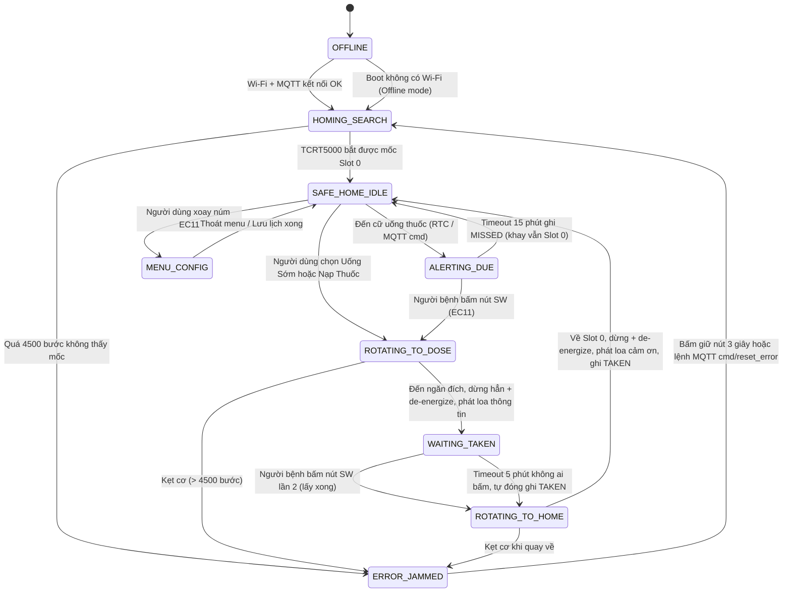

# KẾ HOẠCH FIRMWARE ESP32 — SMARTMED PILL DISPENSER
> **Phiên bản:** `2.1.0` (Nâng cấp ESP32-S3 N16R8 — 2026-10-10)  
> **Nền tảng:** ESP32-S3 (ESP32-S3-WROOM-1 N16R8: 16MB Flash Octal / 8MB PSRAM Octal) | Arduino Framework + FreeRTOS  
> **Trạng thái:** Bản thiết kế kiến trúc — *Đã tối ưu hóa cho phần cứng S3*

---

> [!NOTE]
> ### 📑 MỤC LỤC
> - **Mục 1:** [Phần cứng & Sơ đồ chân GPIO (ESP32-S3 N16R8)](#1-phần-cứng--sơ-đồ-chân-gpio)
> - **Mục 2:** [Máy trạng thái FSM 7 trạng thái](#2-máy-trạng-thái-fsm-7-trạng-thái)
> - **Mục 3:** [Luồng hoạt động chính](#3-luồng-hoạt-động-chính)
>   - 3.1 [Khởi động & Auto-Homing](#31-khởi-động--auto-homing)
>   - 3.2 [Cấp thuốc 2 giai đoạn (Quy trình cốt lõi)](#32-cấp-thuốc-2-giai-đoạn--quy-trình-cốt-lõi)
>   - 3.3 [Uống thuốc sớm (Early Dispense)](#33-uống-thuốc-sớm-early-dispense)
>   - 3.4 [Nạp thuốc từ Web (Refill)](#34-nạp-thuốc-từ-web-refill)
>   - 3.5 [Cài lịch bằng núm xoay EC11](#35-cài-lịch-bằng-núm-xoay-ec11)
>   - 3.6 [Hoạt động Offline (Mất Wi-Fi)](#36-hoạt-động-offline-mất-wi-fi)
> - **Mục 4:** [Hệ thống âm thanh — Audio Engine](#4-hệ-thống-âm-thanh--audio-engine)
>   - 4.1 [Danh mục file âm thanh & nguồn gốc](#41-danh-mục-file-âm-thanh--nguồn-gốc)
>   - 4.2 [File âm thanh động (TTS Online)](#42-file-âm-thanh-động--tts-online)
>   - 4.3 [Audio Priority Queue](#43-audio-priority-queue)
>   - 4.4 [Cơ chế ngắt audio thread-safe](#44-cơ-chế-ngắt-audio-thread-safe)
> - **Mục 5:** [Bộ nhớ Flash 16MB, Phân vùng NVS & Tận dụng 8MB PSRAM](#5-bộ-nhớ-flash-nvs--offline-first)
> - **Mục 6:** [Kiến trúc FreeRTOS Dual-Core](#6-kiến-trúc-freertos-dual-core)
> - **Mục 7:** [Quy tắc an toàn phần cứng](#7-quy-tắc-an-toàn-phần-cứng)
> - **Mục 8:** [Cấu trúc thư mục mã nguồn](#8-cấu-trúc-thư-mục-mã-nguồn)
> - **Mục 9:** [Lộ trình lập trình 6 bước](#9-lộ-trình-lập-trình-6-bước)
> - **Mục 10:** [Checklist nghiệm thu & Kịch bản kiểm thử](#10-checklist-nghiệm-thu--kịch-bản-kiểm-thử)

---

## 1. PHẦN CỨNG & SƠ ĐỒ CHÂN GPIO (ESP32-S3 N16R8)

### 1.1. Bảng phân bổ chân GPIO an toàn cho ESP32-S3

> [!WARNING]
> **CẢNH BÁO TỬ HUYỆT CỦA ESP32-S3 N16R8:**  
> Module N16R8 sử dụng giao tiếp **Octal SPI (OPI)** cho cả 16MB Flash và 8MB PSRAM.  
> **CẤM TUYỆT ĐỐI KHÔNG DÙNG CÁC CHÂN TỪ GPIO 26 ĐẾN GPIO 37** (đây là bus nội bộ của Octal Flash và PSRAM, chạm vào sẽ làm sập nguồn hoặc treo chip ngay lập tức).  
> Đồng thời, toàn bộ chân trên ESP32-S3 **đều có điện trở kéo lên/kéo xuống nội bộ (INPUT_PULLUP)**, không có chân input-only như chip ESP32 đời cũ.

| Ngoại Vi | Chân Linh Kiện | GPIO ESP32-S3 | Chế Độ | Ghi Chú |
|---|---|:---:|---|---|
| **Động cơ bước 28BYJ-48** (ULN2003) | IN1 / IN2 / IN3 / IN4 | **GPIO 4 / 5 / 6 / 7** | Output | Half-step 8 bước. **Bắt buộc De-energize khi dừng.** |
| **Cảm biến mốc Slot 0** TCRT5000 | DO (Digital Out) | **GPIO 1** | Input Pull-up | LOW = đang ở mốc Slot 0 Safe Home |
| **Loa I2S MAX98357A** | BCLK / LRC / DIN | **GPIO 15 / 16 / 17** | I2S Output | Nguồn 5V. Phát MP3 LittleFS stream qua PSRAM buffer |
| **Module TFT 2.4" ST7789 + EC11 + K0 (Header 12 chân JP1)** | **1: GND**<br>**2: VCC**<br>**3: SCL**<br>**4: SDA**<br>**5: RES**<br>**6: DC**<br>**7: CS**<br>**8: BLK**<br>**9: A**<br>**10: B**<br>**11: PUSH**<br>**12: KEY0 (K0)** | **GND**<br>**3.3V**<br>**GPIO 12**<br>**GPIO 11**<br>**GPIO 8**<br>**GPIO 9**<br>**GPIO 10**<br>**GPIO 3**<br>**GPIO 38**<br>**GPIO 39**<br>**GPIO 40**<br>**GPIO 2** | Power GND<br>Power 3.3V<br>SPI SCLK<br>SPI MOSI<br>TFT Reset<br>Data / Command<br>Chip Select (Active LOW)<br>Backlight (hoặc 3.3V)<br>EC11 Phase A (Ngắt xoay)<br>EC11 Phase B<br>EC11 SW (Xác nhận/Uống thuốc)<br>Nút phụ (Menu Return/Confirm) | Module tích hợp tất cả trong 1:<br>• SPI 40MHz qua PSRAM Sprite.<br>• EC11 giải mã xung xoay.<br>• 2 phím vật lý độc lập (PUSH và K0) có sẵn trở kéo `INPUT_PULLUP` nội trên ESP32-S3. |
| **Cảm biến DHT11** | DATA | **GPIO 41** | 1-Wire + Pull-up 4.7K | Đọc định kỳ 3s, không dùng delay() |
| **Native USB C** | D- / D+ | **GPIO 19 / 20** | USB CDC Native | Nạp code trực tiếp tốc độ cao & Debug Serial qua cổng USB-C |

### 1.2. Danh sách chân CẤM & Hạn chế trên ESP32-S3 N16R8

| Nhóm Chân | Danh Sách GPIO | Lý Do Cấm / Hạn Chế |
|---|:---:|---|
| **Bus Octal Flash & PSRAM** | **GPIO 26, 27, 28, 29, 30, 31, 32, 33, 34, 35, 36, 37** | **CẤM CHẠM VÀO.** Dành riêng cho 16MB Flash OPI & 8MB PSRAM OPI nội bộ. |
| **Strapping Pins (Boot)** | **GPIO 0, 45, 46** | Ảnh hưởng điện áp bootloader và nguồn SPI flash khi khởi động. |
| **USB Native / Debug** | **GPIO 19, 20** | Cổng USB-C D-/D+ chuyên dùng nạp code và Serial Monitor tốc độ cao. |

---

## 2. MÁY TRẠNG THÁI FSM 7 TRẠNG THÁI

### 2.1. Sơ đồ trạng thái



### 2.2. Chi tiết từng trạng thái

| Trạng Thái | Vị Trí Khay | Hành Vi |
|---|:---:|---|
| **OFFLINE** | Giữ nguyên | Chưa xác định vị trí. Chưa được phép điều khiển motor. |
| **HOMING_SEARCH** | Đang xoay | Motor quay chậm CW, đếm bước, chờ TCRT5000 phát hiện mốc. |
| **SAFE_HOME_IDLE** | Slot 0 🔒 | Đóng kín an toàn. TFT hiện Dashboard. Motor de-energize. |
| **ALERTING_DUE** | Slot 0 🔒 | Tuyệt đối không xoay khay. Loa I2S nhắc alert_due.mp3 định kỳ, TFT đếm ngược 15:00. |
| **ROTATING_TO_DOSE** | Đang xoay | Motor quay đến ngăn đích. **Disable SW interrupt** khi đang quay. |
| **WAITING_TAKEN** | Ngăn đích 🟢 | Ngăn mở. Motor de-energize. Loa phát thông tin. Chờ bấm nút (timeout 5 phút). |
| **ROTATING_TO_HOME** | Đang xoay về | Motor quay về Slot 0. **Disable SW interrupt** khi đang quay. |
| **MENU_CONFIG** | Slot 0 🔒 | Người dùng cài lịch bằng núm xoay. Motor không được phép quay. |
| **ERROR_JAMMED** | Không xác định ⛔ | Motor ngắt điện tức thì. Loa I2S phát alarm_jammed.mp3. Chờ lệnh re-home. |

> [!IMPORTANT]
> **Quy tắc bất biến:** SW interrupt của EC11 (GPIO 35) phải bị vô hiệu hóa trong các trạng thái ROTATING_TO_DOSE và ROTATING_TO_HOME để tránh race condition gọi lại rotate() khi motor đang chạy.

---

## 3. LUỒNG HOẠT ĐỘNG CHÍNH

### 3.1. Khởi động & Auto-Homing

```
[Cắm nguồn / Pin dự phòng]
        │
        ▼
[ESP32 Boot — Đọc NVS: last_fsm_state, schedules, offline_logs]
        │
        ├─► Thử kết nối Wi-Fi (timeout 10s)
        │     ├─ Thành công → Đồng bộ NTP → is_online = true
        │     └─ Thất bại   → is_online = false, dùng Internal RTC
        │
        ▼
[FSM: HOMING_SEARCH]
        │ Motor quay CW chậm, đếm bước
        │ TCRT5000 bắt mốc Slot 0?
        ├─ Có  → Dừng → De-energize → FSM: SAFE_HOME_IDLE
        └─ Không (> 4500 bước) → De-energize → FSM: ERROR_JAMMED
        │
        ▼ (khi vào SAFE_HOME_IDLE)
[Phát audio: intro.mp3]
[TFT: Màn hình Dashboard Idle]
[MQTT publish: pillbox/{id}/state/status → {status: "ONLINE", slot: 0}]
        │
        ▼
[Kiểm tra NVS: Có offline_log chờ xả không?]
        └─ Có + Online → Xả hàng đợi lên Backend (xem Mục 5)
```

**Xử lý phục hồi sau mất nguồn đột ngột:**
Khi boot lại, ESP32 đọc last_fsm_state từ NVS:
- Nếu last_fsm_state == ALERTING_DUE và remaining_timeout > 0 → Khôi phục ALERTING_DUE, tiếp tục đếm ngược.
- Nếu last_fsm_state == WAITING_TAKEN → Tự động xoay về Slot 0, ghi TAKEN (giả định người bệnh đã lấy).
- Các trạng thái khác → Reset về HOMING_SEARCH bình thường.

---

### 3.2. Cấp thuốc 2 giai đoạn — Quy trình cốt lõi

> [!IMPORTANT]
> **QUY TẮC AN TOÀN Y TẾ:**
> 1. Khi đến cữ uống → Khay TUYỆT ĐỐI KHÔNG TỰ XOAY. Đứng yên Slot 0.
> 2. Chỉ khi người bệnh bấm nút SW → mới cho motor quay.
> 3. Chỉ sau khi motor dừng hẳn + de-energize → mới phát loa thông tin tên thuốc.
> 4. Nếu quá 15 phút không ai bấm → chốt MISSED. Khay vẫn ở Slot 0 an toàn.
> 5. Nếu quá 5 phút ở WAITING_TAKEN không bấm nút lần 2 → tự đóng, ghi TAKEN.

```
======================================================
 GIAI ĐOẠN 1: ĐẾN CỮ HẸN (KHAY VẪN Ở SLOT 0)
======================================================
[Đến giờ hẹn — Scheduler khớp giờ NVS/RTC]
        │
        ▼
[FSM: ALERTING_DUE]  <─── KHAY VẪN Ở SLOT 0 (ĐÓNG KÍN 100%)
        ├─► Lưu NVS: last_fsm_state = ALERTING_DUE, remaining_timeout = 900
        ├─► Audio: Phát alert_due.mp3 qua loa I2S mỗi 2 phút 1 lần
        ├─► TFT: Màn hình cảnh báo đỏ + đếm ngược 15:00
        ├─► MQTT publish: pillbox/{id}/events/due_alert
        │   payload: {status: "ALERTING_DUE", target_slot: X, timeout: 900}
        │
        ▼ Xử lý 2 trường hợp:
        │
┌───────┴─────────────────────────────────────────┐
│                                                 │
▼                                                 ▼
[Người bệnh bấm nút SW]              [Hết 15 phút — Timeout]
│                                                 │
GIAI ĐOẠN 2A: XOAY & LẤY THUỐC      GIAI ĐOẠN 2B: BỎ LỊCH
│                                                 │
▼                                                 ▼
[Disable SW interrupt]               [Dừng phát alert_due.mp3]
[FSM: ROTATING_TO_DOSE]              [Khay VẪN Ở SLOT 0 — không quay]
│ Motor quay đến ngăn X              [Audio: missed_timeout.mp3]
│ Đếm bước + TCRT5000 guard          [MQTT: events/missed → MISSED]
│                                    [NVS: ghi log MISSED]
▼                                    [FSM: SAFE_HOME_IDLE]
[Đến nơi — Dừng hẳn]
[De-energize 4 cuộn dây]
[FSM: WAITING_TAKEN]
[Enable SW interrupt]
        │
        ├─► Audio: Phát dispense_slot{X}.mp3 (TTS động — xem Mục 4.2)
        │         hoặc dispense_generic.mp3 nếu file chưa có
        ├─► TFT: Hiện tên thuốc, liều dùng, hướng dẫn
        ├─► MQTT: events/dispense → {status: "DOSE_OPENED", slot: X}
        │
        ▼ (Timeout 5 phút nếu không bấm → cũng chuyển sang đây)
[Người bệnh bấm nút SW lần 2 (hoặc timeout 5p)]
        │
        ▼
[Disable SW interrupt]
[FSM: ROTATING_TO_HOME]
        │ Motor quay về Slot 0
        ▼
[Đến Slot 0 — TCRT5000 báo mốc]
[Dừng hẳn — De-energize]
[FSM: SAFE_HOME_IDLE]
[Enable SW interrupt]
        │
        ├─► Audio: taken_success.mp3
        ├─► MQTT: events/taken → {status: "TAKEN", slot: X, dispensed_at: timestamp}
        ├─► NVS: Ghi log TAKEN, gắn cờ taken_today = true
        └─► TFT: Trở về Dashboard Idle
```

---

### 3.3. Uống thuốc sớm theo Buổi (Early Session Dispense)

Kích hoạt từ Menu **3. Uống thuốc sớm** (`S_MENU` mục 3) khi người bệnh cần đi làm hoặc ra ngoài trước cữ giờ chính thức:

```
[Màn hình MENU] ──► Chọn mục "3. Uong thuoc som" ──► Màn hình S_EARLY_SESSION
        │
        ▼ BƯỚC 1: CHỌN BUỔI TRONG NGÀY (S_EARLY_SESSION)
[TFT hiện danh sách tất cả các buổi/cữ lịch đã cài đặt trong ngày]
Ví dụ:
  > 08:00 (Buoi Sang) Ng:1,2  [CHUA UONG]
    12:00 (Buoi Trua) Ng:3    [DA UONG]
    18:30 (Buoi Toi)  Ng:1,4  [CHUA UONG]
        ├─► Vặn núm EC11: Di chuyển chọn Buổi muốn uống sớm
        ├─► Nếu bấm vào Buổi [DA UONG]: Toast cảnh báo "Cữ này đã uống rồi! Không thể uống lặp lại"
        ├─► Nhấn nút K0: Thoát về Menu chính
        └─► Nhấn nút PUSH vào Buổi [CHUA UONG]: Chuyển sang Bước 2
        │
        ▼ BƯỚC 2: XEM CHI TIẾT CÁC NGĂN & NÚT XÁC NHẬN LẤY (S_EARLY_CONFIRM)
[TFT hiển thị chi tiết tên thuốc, liều lượng số viên của từng ngăn trong cữ đó]
Ví dụ:
  * Ngan 1: Paracetamol (Lieu: 1v | Con: 12v)
  * Ngan 2: Vitamin C   (Lieu: 2v | Con: 8v)
  Nút xác nhận lớn: [ >>> BAM PUSH: XAC NHAN UONG SOM <<< ]
        ├─► Bấm nút K0: Quay lại danh sách chọn buổi
        └─► Bấm nút PUSH: XÁC NHẬN LẤY SỚM BUỔI NÀY!
                │
                ├─► 1. Đánh dấu cữ này đã uống hôm nay: markSchedTakenToday(idx) -> Lưu Flash NVS
                ├─► 2. Bắn MQTT đồng bộ Web: events/taken → {"event":"EARLY_TAKEN", "h":8, "m":0, "mask":0x03}
                ├─► 3. FSM mở tuần tự từng ngăn thuốc trong buổi:
                │      - Xoay khay đến Ngăn 1 -> Loa: early_take.mp3 -> Chờ người bệnh lấy thuốc -> Bấm PUSH
                │      - Tự động xoay tiếp đến Ngăn 2 -> Loa: dispense_slot -> Chờ lấy thuốc -> Bấm PUSH
                │      - Khi hết các ngăn trong buổi -> TỰ ĐỘNG XOAY KHÓA VỀ NGĂN 0 (SAFE HOME)!
                │      - Loa: taken_success.mp3 ("Xác nhận đã lấy thuốc, cảm ơn bạn đã uống đúng giờ")
                └─► 4. CHỐNG UỐNG TRÙNG LẶP: Đến giờ thực tế (VD 08:00), Scheduler tick phát hiện
                       isSchedTakenToday(idx) == true -> TỰ ĐỘNG BỎ QUA, KHÔNG REO LẠI!
```

---

### 3.4. Nạp thuốc (Refill)

#### 3.4.1. Nạp thuốc trực tiếp trên màn hình TFT (Thao tác nhanh 2 bước)
Kích hoạt trực tiếp tại màn hình máy Medbox qua Menu **2. Nạp & Quản lý thuốc** (`S_MEDS`):

```
[Màn hình S_MEDS: Danh sách 7 ngăn] 
        │
        ▼ Người dùng xoay EC11 chọn Ngăn X -> Bấm PUSH núm xoay
[Xoay khay đến Ngăn X] ──► motorRotateToSlot(curSlot + 1)
[Audio: refill_start.mp3] "Đang mở ngăn nạp thuốc, xin hãy kiểm tra đúng loại thuốc"
[MQTT: events/refill → {"event":"REFILL_READY","slot":X}]
        │
        ▼ Chuyển sang Màn hình S_REFILL_QTY (Bước 1: Chọn số viên nạp thêm)
[TFT S_REFILL_QTY: Hiển thị tên thuốc, số viên hiện có, thẻ "+ N viên", tổng dự kiến]
        ├─► Vặn núm EC11: Tăng / Giảm số lượng nạp thêm (1 .. 50 viên)
        ├─► Bấm nút K0: Hủy nạp -> Tự động đóng khay về Ngăn 0 Safe Home
        └─► Bấm nút PUSH: Lưu tạm số viên -> Chuyển sang Bước 2
        │
        ▼ Chuyển sang Màn hình S_REFILL_CONFIRM (Bước 2: Xác nhận đã bỏ thuốc)
[TFT S_REFILL_CONFIRM: Hộp cảnh báo y tế "ĐÃ BỎ +N VIÊN VÀO NGĂN X?", nút "BẤM PUSH ĐỂ XÁC NHẬN"]
        ├─► Bấm nút K0: Hủy xác nhận -> Tự động quay về Ngăn 0 Safe Home (không cộng thuốc)
        └─► Bấm nút PUSH: XÁC NHẬN ĐÃ BỎ THUỐC VÀO NGĂN
                │
                ├─► Cộng dồn tồn kho: meds[curSlot].qty += refillAddQty -> Lưu Flash NVS
                ├─► MQTT: events/refill → {"event":"REFILL_DONE","slot":X,"qty":M,"added":N}
                ├─► TỰ ĐỘNG XOAY KHAY ĐÓNG VỀ NGĂN 0 (SAFE HOME): motorRotateToSlot(0)
                ├─► Audio: refill_done.mp3 "Nạp thuốc thành công, khay đã khóa an toàn"
                ├─► MQTT: events/home → {"event":"HOME_REACHED","slot":0}
                └─► Quay về màn hình danh sách S_MEDS (Khay đã đóng kín an toàn)
```

#### 3.4.2. Nạp thuốc từ Web (Remote Refill)

Kích hoạt bởi lệnh MQTT `cmd/refill` từ Web Dashboard:

```
[MQTT nhận: pillbox/{id}/cmd/refill → {target_slot: X}]
        │
        ▼
[FSM đang ở SAFE_HOME_IDLE?]
        ├─ Không → Từ chối, MQTT reply lỗi: "Device busy"
        └─ Có    → Tiến hành
        │
        ▼
[Audio: refill_start.mp3]
[FSM: ROTATING_TO_DOSE — quay đến ngăn X]
[Dừng, de-energize]
[TFT: "Đang mở ngăn X để nạp thuốc — Hãy kiểm tra đúng loại thuốc"]
[MQTT: state/status → {status: "REFILL_OPEN", slot: X}]
        │
        ▼ Chờ lệnh MQTT: cmd/refill_done hoặc bấm nút SW trên máy
[Khay quay về Slot 0 — Dừng — De-energize]
[Audio: refill_done.mp3]
[MQTT: events/refill → {status: "REFILL_DONE", slot: X}]
[FSM: SAFE_HOME_IDLE]
```

> [!NOTE]
> Sau khi nạp thuốc thành công → Backend sinh file âm thanh TTS mới cho ngăn X và gửi xuống ESP32 (xem Mục 4.2).

---

### 3.5. Cài lịch bằng núm xoay EC11

```
[SAFE_HOME_IDLE] → Click núm EC11 → [MENU_CONFIG]
        │
        ├─► TFT hiện Menu:
        │   > [Thêm Lịch Uống]
        │     [Uống Thuốc Sớm]
        │     [Xem Lịch Trình]
        │     [Hiệu Chuẩn Slot 0]
        │
        ▼ Chọn "Thêm Lịch Uống"
        │ Vặn núm: Chọn Ngăn [1..7]
        │ Bấm xác nhận
        │ Vặn núm: Chỉnh Giờ [00..23]
        │ Bấm xác nhận
        │ Vặn núm: Chỉnh Phút [00..59]
        │ Bấm giữ 1.5 giây → LƯU
        │
        ▼
[NVS: Ghi lịch mới vào slot_X (JSON)]
[RAM ScheduleList: cập nhật ngay]
[Gắn cờ schedules_dirty = true]
[MQTT: events/schedule → {action: "ADD", slot: X, time: "HH:MM"}]
[Web tự động cập nhật lịch]
[Audio: click.mp3 khi vặn, taken_success.mp3 khi lưu thành công]
[FSM: SAFE_HOME_IDLE]
```

---

### 3.6. Hoạt động Offline (Mất Wi-Fi)

**Nguồn điện:** Pin dự phòng (UPS / Pin 18650 sạc) cấp nguồn liên tục → ESP32 không bao giờ reset khi mất điện lưới.

**Đồng hồ:** Sau khi đồng bộ NTP 1 lần, Internal Software RTC (FreeRTOS timer + time.h) chạy liên tục chính xác.

```
[Phát hiện mất Wi-Fi: is_online = false]
        │
        ├─► TFT: Hiện biểu tượng Wi-Fi gạch chéo ở status bar
        ├─► Tiếp tục chạy FSM bình thường (tất cả chức năng hoạt động offline)
        │
        ▼
[Đến cữ uống → Quy trình 3.2 chạy bình thường từ NVS/RTC]
        │
        ├─► Mọi sự kiện (TAKEN/MISSED/EARLY_TAKEN) → Ghi vào NVS namespace "offline_logs"
        └─► Không gửi MQTT (is_online = false)
        │
        ▼
[Wi-Fi phục hồi: is_online = true]
        │
        ├─► MQTT publish: state/status → ONLINE
        ├─► Đồng bộ NTP để hiệu chỉnh đồng hồ
        └─► Xả hàng đợi offline_logs (xem Mục 5.6)
```

**Tính năng Offline đầy đủ:**
- ✅ Cảnh báo đến cữ và quy trình 2 giai đoạn hoàn chỉnh
- ✅ Cài lịch bằng núm xoay EC11
- ✅ Xem lịch trình trên TFT
- ✅ Uống thuốc sớm
- ✅ Chống uống trùng liều (taken_today flag)
- ✅ Lưu log vào NVS chờ xả

---

## 4. HỆ THỐNG ÂM THANH — AUDIO ENGINE

### 4.1. Danh mục file âm thanh tĩnh (Cố định — tạo 1 lần)

**Nguồn tạo:** Microsoft Edge Neural TTS  
**Giọng:** vi-VN-HoaiMyNeural (nữ, miền Bắc, rõ ràng)  
**Định dạng:** MP3 Mono, 24000Hz, 64kbps (~15–40KB/file)  
**Lưu trữ:** LittleFS phân vùng Flash /data/audio/

| # | Tên File | Kích Hoạt Khi | Nội Dung | Ưu Tiên |
|:--:|---|---|---|:---:|
| 1 | intro.mp3 | Khởi động xong | "SmartMed đã sẵn sàng hoạt động." | 4 |
| 2 | alert_due.mp3 | ALERTING_DUE (mỗi 2 phút) | "Đã đến giờ uống thuốc, xin mời bạn nhấn nút trên hộp để lấy thuốc." | 2 |
| 3 | taken_success.mp3 | Sau khi khay về Slot 0 | "Xác nhận đã lấy thuốc, cảm ơn bạn đã uống thuốc đúng giờ." | 3 |
| 4 | missed_timeout.mp3 | Hết 15 phút không bấm | "Đã hết thời gian chờ lấy thuốc, cữ thuốc được ghi nhận là bỏ lỡ." | 2 |
| 5 | early_take.mp3 | Sau khi mở ngăn uống sớm | "Đã mở ngăn để lấy thuốc sớm, chúc bạn mau khỏe." | 3 |
| 6 | refill_start.mp3 | Bắt đầu mở ngăn nạp | "Đang mở ngăn nạp thuốc, xin hãy kiểm tra đúng loại thuốc." | 3 |
| 7 | refill_done.mp3 | Nạp xong, khay đóng | "Nạp thuốc thành công, khay đã khóa an toàn." | 3 |
| 8 | alarm_jammed.mp3 | Kẹt cơ > 4500 bước | "Cảnh báo! Khay xoay gặp sự cố kẹt cơ, vui lòng kiểm tra hộp thuốc!" | 1 |
| 9 | dispense_generic.mp3 | Fallback khi không có TTS | "Đã mở ngăn thuốc, xin mời bạn lấy thuốc đúng liều lượng." | 3 |
| 10 | click.mp3 | Vặn 1 nấc EC11 | Tiếng "tích" ngắn 20ms | 4 |

---

### 4.2. File âm thanh động — TTS Online

Các file này chứa tên thuốc, liều lượng, số ngăn cụ thể → không thể tạo sẵn cứng.

| # | Tên File | Kích Hoạt Khi | Nội Dung Mẫu |
|:--:|---|---|---|
| D1 | dispense_slot1.mp3 ... dispense_slot7.mp3 | WAITING_TAKEN — sau khi ngăn mở | "Đã mở ngăn số 3, liều dùng 1 viên Panadol Extra, xin mời bạn lấy thuốc." |

**Quy trình sinh file TTS Online:**

```
[Người dùng nhập thông tin thuốc vào Web Dashboard]
[Nhấn "Lưu & Áp dụng"]
        │
        ▼
[Backend FastAPI — api/pills/update]
        │ 1. Cập nhật DB (tên thuốc, liều dùng, ngăn X)
        │ 2. Gọi TTS API (Google Cloud TTS hoặc edge-tts Python)
        │    Text: "Đã mở ngăn số {X}, liều dùng {Y} viên {Tên thuốc}, xin mời bạn lấy thuốc."
        │ 3. Lưu file MP3 vào thư mục /tts_cache/ trên server
        │ 4. Publish MQTT: pillbox/{id}/cmd/upload_audio
        │    payload: {filename: "dispense_slot3.mp3", size: 28400}
        │
        ▼
[ESP32 nhận lệnh upload_audio]
        │ 1. Mở kết nối HTTP GET đến: http://{backend}/tts_cache/dispense_slot3.mp3
        │ 2. Stream download từng chunk 1KB → Ghi vào LittleFS: /audio/dispense_slot3.mp3
        │ 3. Publish MQTT: pillbox/{id}/events/audio_ready
        │    payload: {filename: "dispense_slot3.mp3", status: "OK"}
        │
        ▼
[File sẵn sàng — Sẽ được phát khi đến cữ uống tương ứng]
```

> [!WARNING]
> **Fallback khi không có file TTS:** Nếu dispense_slot{X}.mp3 không tồn tại trong LittleFS, ESP32 sẽ phát dispense_generic.mp3 thay thế. File này luôn có sẵn.

**TTS API ưu tiên theo thứ tự:**
1. **Google Cloud Text-to-Speech** — miễn phí 1 triệu ký tự/tháng, giọng vi-VN-Wavenet-A
2. **Microsoft Edge TTS** — miễn phí qua thư viện edge-tts Python, giọng vi-VN-HoaiMyNeural

---

### 4.3. Audio Priority Queue

Khi nhiều sự kiện xảy ra đồng thời, âm thanh được phát theo thứ tự ưu tiên:

```
Priority 1 (Khẩn cấp): alarm_jammed.mp3
    → Ngắt bất kỳ file nào đang phát ngay lập tức

Priority 2 (Y tế cao): alert_due.mp3, missed_timeout.mp3
    → Không bị ngắt bởi Priority 3/4

Priority 3 (Thông tin): dispense_slot{X}.mp3, taken_success.mp3,
                         refill_start.mp3, refill_done.mp3, early_take.mp3
    → Chờ Priority 2 kết thúc

Priority 4 (UI): intro.mp3, click.mp3
    → Bỏ qua nếu có file priority cao hơn đang phát
    → click.mp3 không bao giờ ngắt file đang phát
```

---

### 4.4. Cơ chế ngắt audio thread-safe

**Vấn đề:** Audio decode chạy trên Core 0. Lệnh ngắt audio đến từ Core 1 (FSM / button ISR).

**Giải pháp — Atomic flag + FreeRTOS Critical Section:**

```cpp
// audio_player.h — Cờ atomic toàn cục
volatile bool audio_stop_requested = false;
portMUX_TYPE audio_mux = portMUX_INITIALIZER_UNLOCKED;

// Core 1 muốn ngắt audio:
void AudioPlayer::requestStop() {
    portENTER_CRITICAL(&audio_mux);
    audio_stop_requested = true;
    portEXIT_CRITICAL(&audio_mux);
}

// Core 0 — vòng decode MP3 kiểm tra cờ mỗi chunk:
void AudioPlayer::playTask() {
    while (mp3->isRunning()) {
        portENTER_CRITICAL(&audio_mux);
        bool stop = audio_stop_requested;
        portEXIT_CRITICAL(&audio_mux);
        if (stop) { mp3->stop(); break; }
        mp3->loop();
    }
    audio_stop_requested = false;
}
```

**Kịch bản ngắt audio hợp lệ:**
- Người bệnh bấm nút khi alert_due.mp3 đang phát → Ngắt ngay → Bắt đầu ROTATING_TO_DOSE.
- alarm_jammed.mp3 cần phát → Ngắt bất kỳ file nào đang phát.

---

## 5. BỘ NHỚ FLASH 16MB, BẢNG PHÂN VÙNG & TẬN DỤNG 8MB PSRAM

### 5.1. Cấu trúc phân vùng Flash 16MB (partitions_16mb.csv)

Với chip **ESP32-S3 N16R8**, không gian bộ nhớ 16MB cho phép cấu hình phân vùng kép **Dual-App OTA** (cập nhật phần mềm từ xa qua Wi-Fi) kèm phân vùng **LittleFS dung lượng khủng ~8.8MB** để lưu trữ âm thanh:

```
┌────────────────────────────────────────────────────────────────────────────────────────┐
│                              Flash 16MB ESP32-S3 N16R8                                 │
├─────────────┬─────────────┬──────────────┬──────────────┬──────────────────────────────┤
│  Bootloader │ NVS (Prefs) │ otadata(OTA) │ app0 (ota_0) │ app1 (ota_1) │ LittleFS      │
│  ~36KB      │ 64KB        │ 8KB          │ 3.5MB        │ 3.5MB        │ ~8.875MB      │
│  (Rom Code) │ (Lịch, Logs)│ (Chọn boot)  │ (Code chạy)  │ (Dự phòng)   │ (Hàng trăm MP3│
└─────────────┴─────────────┴──────────────┴──────────────┴──────────────┴──────────────┘
```

**Bảng phân vùng chuẩn `partitions_16mb.csv` (100% khớp 16MB = 0x1000000):**

```csv
# Name,   Type, SubType, Offset,   Size,     Flags
nvs,      data, nvs,     0x9000,   0x10000,
otadata,  data, ota,     0x19000,  0x2000,
app0,     app,  ota_0,   0x20000,  0x380000,
app1,     app,  ota_1,   0x3A0000, 0x380000,
littlefs, data, spiffs,  0x720000, 0x8E0000,
```

**`platformio.ini` — Cấu hình PlatformIO cho ESP32-S3 N16R8:**

```ini
[env:esp32-s3-devkitc-1]
platform = espressif32
board = esp32-s3-devkitc-1
framework = arduino
board_build.mcu = esp32s3
board_build.f_cpu = 240000000L
board_build.flash_mode = opi
board_build.flash_size = 16MB
board_build.partitions = partitions_16mb.csv
build_flags = 
    -DBOARD_HAS_PSRAM
    -mfix-esp32-psram-cache-issue
    -DARDUINO_USB_CDC_ON_BOOT=1
lib_deps =
    earlephilhower/ESP8266Audio @ ^1.9.7
    bodmer/TFT_eSPI @ ^2.5.43
    knolleary/PubSubClient @ ^2.8
    bblanchon/ArduinoJson @ ^6.21.3
    adafruit/DHT sensor library @ ^1.4.4
    adafruit/Adafruit Unified Sensor @ ^1.1.9
```

> [!TIP]
> **Đánh giá phân vùng 16MB này:**
> 1. **NVS 64KB (0x10000):** Tăng từ 20KB lên 64KB giúp bộ nhớ NVS có tới 16 Pages 4KB. Cơ chế cân bằng độ hao mòn (Wear Leveling) khi ghi log offline tăng độ bền Flash lên gấp 3 lần.
> 2. **Dual App OTA (3.5MB + 3.5MB):** Cho phép nâng cấp Firmware từ xa qua Web Dashboard hoặc MQTT mà không cần tháo hộp cắm dây USB. Nếu bản mới boot lỗi, chip tự động rollback về app cũ.
> 3. **LittleFS 8.875MB:** Rộng gấp 4 lần bản 4MB cũ, chứa thoải mái 10 file cố định + 7 file TTS động + font Unicode tiếng Việt cho màn hình ST7789.

---

### 5.2. Tận dụng 8MB Octal PSRAM cho Audio & Màn Hình

ESP32-S3 N16R8 có sẵn **8MB PSRAM ngoài** tốc độ cao. Firmware sẽ cấu hình tận dụng tối đa:
* **Audio Ring Buffer (512 KB trong PSRAM):** Dùng `ps_malloc()` để đệm dữ liệu MP3 khi phát qua loa I2S MAX98357A. Nhờ đó, kể cả khi chip đang bận truyền dữ liệu Wi-Fi nặng hoặc đọc cảm biến, âm thanh loa vẫn phát trong vắt, 100% không bao giờ bị giật cục/vấp tiếng.
* **TFT Double Buffering / Canvas:** Toàn bộ buffer vẽ đồ họa màn hình ST7789 được cấp phát trên PSRAM, giúp chuyển đổi giao diện đạt tốc độ 60fps mượt mà, giải phóng 100% Internal SRAM nội cho FreeRTOS.

### 5.3. Namespace NVS — "schedules" (Lịch uống thuốc)

| Key NVS | Kiểu | Nội Dung |
|---|---|---|
| slot_1 ... slot_7 | String JSON | [{"time":"08:00","dose":1,"label":"Sáng","drug":"Panadol 500mg","active":true,"taken_today":false}] |
| schedules_dirty | Bool | true nếu người dùng sửa lịch trên TFT khi offline |
| last_ntp_sync | UInt | Unix timestamp lần đồng bộ NTP gần nhất |
| last_fsm_state | UInt8 | Trạng thái FSM trước khi mất nguồn |
| alerting_remaining | UInt16 | Số giây còn lại khi đang ALERTING_DUE (để phục hồi sau mất nguồn) |

### 5.4. Namespace NVS — "offline_logs" (Hàng đợi sự kiện)

| Key NVS | Kiểu | Nội Dung |
|---|---|---|
| log_count | UInt8 | Số bản ghi hiện có (tối đa 100) |
| log_0 ... log_99 | String JSON | {"slot":3,"status":"TAKEN","dispensed_at":"2026-10-09 08:02:15","trigger":"AUTO"} |

### 5.5. Quy tắc Reset cờ taken_today (Task dailyResetTask)

Task chạy trên Core 1, kiểm tra giờ hệ thống mỗi phút:

```cpp
void dailyResetTask(void* param) {
    while(1) {
        time_t now = time(nullptr);
        struct tm* t = localtime(&now);
        if (t->tm_hour == 0 && t->tm_min == 0) {
            // Reset tất cả cờ taken_today trong RAM
            for (int i = 0; i < 7; i++) {
                for (auto& entry : scheduleList[i]) {
                    entry.taken_today = false;
                }
            }
            saveAllSchedulesToNVS();  // Ghi lại NVS
        }
        vTaskDelay(pdMS_TO_TICKS(60000));  // Kiểm tra mỗi phút
    }
}
```

### 5.6. Xả hàng đợi khi Wi-Fi phục hồi (Reconnection Flush)

```cpp
void flushOfflineLogs() {
    int count = prefs.getInt("log_count", 0);
    for (int i = 0; i < count; i++) {
        String log = prefs.getString(("log_" + String(i)).c_str(), "");
        if (log.length() > 0) {
            // Thêm cờ offline_sync = true vào JSON
            DynamicJsonDocument doc(256);
            deserializeJson(doc, log);
            doc["offline_sync"] = true;
            String payload;
            serializeJson(doc, payload);
            mqttClient.publish(topic_events_taken, payload.c_str());
            prefs.remove(("log_" + String(i)).c_str());
            vTaskDelay(pdMS_TO_TICKS(100));  // Tránh flood MQTT
        }
    }
    prefs.putInt("log_count", 0);
}
```

---

## 6. KIẾN TRÚC FREERTOS DUAL-CORE

```
          ESP32 DUAL-CORE FREERTOS
┌──────────────────────────┬──────────────────────────────┐
│         CORE 0           │          CORE 1              │
│  (Network & Audio)       │  (Hardware Control & UI)     │
├──────────────────────────┼──────────────────────────────┤
│ networkAudioTask (P2)    │ controlUITask (P3 — cao hơn) │
│                          │                              │
│ • Wi-Fi non-blocking     │ • FSM 7 trạng thái           │
│ • MQTT loop pub/sub      │ • Motor bước (half-step)     │
│ • MP3 decode I2S stream  │ • Ngắt EC11 CLK/DT/SW        │
│ • Telemetry 10s/lần      │ • Render TFT ST7789          │
│ • Xả offline log queue   │ • Đọc TCRT5000, DHT11        │
│ • HTTP download TTS file │ • Scheduler (quét lịch 1s)   │
│                          │ • Daily reset task (00:00)   │
└──────────────────────────┴──────────────────────────────┘

Giao tiếp giữa 2 Core:
  • FreeRTOS Queue: audioQueue  (Core 1 → Core 0 gửi lệnh phát audio)
  • FreeRTOS Queue: mqttCmdQueue (Core 0 → Core 1 gửi lệnh từ MQTT)
  • Mutex: audio_mux (bảo vệ cờ audio_stop_requested)
  • Atomic flag: is_online (volatile bool)
```

**Cấu hình quan trọng:**
```cpp
// Tắt power-save Wi-Fi để tránh interrupt bất thường khi phát audio I2S
WiFi.setSleep(WIFI_PS_NONE);
```

---

## 7. QUY TẮC AN TOÀN PHẦN CỨNG

### 7.1. De-energize động cơ bắt buộc

28BYJ-48 có điện trở cuộn dây thấp (~50Ω). Giữ điện khi đứng yên → nóng >60°C → hỏng ULN2003.

```cpp
// Bắt buộc gọi sau MỌI lần motor dừng (không có ngoại lệ)
void deenergize() {
    digitalWrite(MOTOR_IN1, LOW);
    digitalWrite(MOTOR_IN2, LOW);
    digitalWrite(MOTOR_IN3, LOW);
    digitalWrite(MOTOR_IN4, LOW);
}
```

### 7.2. Bảo vệ kẹt cơ (Stall Detection — 4500 bước)

```cpp
// Trong vòng điều khiển motor step:
if (stepCount > STALL_THRESHOLD) {  // STALL_THRESHOLD = 4500
    deenergize();
    fsm.setState(ERROR_JAMMED);
    audioQueue.send({AUDIO_ALARM_JAMMED, PRIORITY_1});
    mqtt.publish(topic_events_jammed, "{\"status\":\"JAMMED\"}");
    return;
}
```

### 7.3. Thoát ERROR_JAMMED (Recovery)

```
ERROR_JAMMED có 2 lối thoát:
  1. Bấm giữ nút SW 3 giây → Trigger re-homing
  2. MQTT: pillbox/{id}/cmd/reset_error → Trigger re-homing
  
  → Cả 2 đều chuyển FSM sang HOMING_SEARCH (Auto-Homing lại từ đầu)
```

### 7.4. Disable SW interrupt khi motor đang quay (Chống race condition)

```cpp
// Trước khi motor bắt đầu quay:
detachInterrupt(digitalPinToInterrupt(EC11_SW));

// Sau khi motor dừng hẳn và de-energize xong:
attachInterrupt(digitalPinToInterrupt(EC11_SW), onButtonPress, FALLING);
```

### 7.5. Các hằng số timeout quan trọng

| Hằng Số | Giá Trị | Mục Đích |
|---|:---:|---|
| ALERTING_DUE_TIMEOUT | 900 giây (15 phút) | Thời gian chờ người bệnh bấm nút từ khi có cữ |
| WAITING_TAKEN_TIMEOUT | 300 giây (5 phút) | Thời gian chờ bấm nút lần 2 sau khi ngăn đã mở |
| STALL_THRESHOLD | 4500 bước | Ngưỡng phát hiện kẹt cơ (1 vòng = 4096 bước) |
| HOMING_MAX_STEPS | 4500 bước | Tối đa cho Auto-Homing |
| STEPS_PER_SLOT | 512 bước | Số bước mỗi ngăn (4096 / 8 ngăn) |
| WIFI_CONNECT_TIMEOUT | 10 giây | Timeout kết nối Wi-Fi khi boot |
| ALERT_DUE_REPEAT_INTERVAL | 120 giây (2 phút) | Chu kỳ phát lại alert_due.mp3 qua loa I2S |
| ERROR_JAMMED_HOLD | 3 giây | Thời gian giữ nút để thoát ERROR_JAMMED |

---

## 8. CẤU TRÚC THƯ MỤC MÃ NGUỒN

```
firmware/
├── audio_tools/                        <- Công cụ tạo audio (chạy trên máy tính)
│   ├── generate_static_audio.py        <- Tạo 10 file MP3 tĩnh dùng edge-tts CLI
│   ├── audio_manifest.json             <- Danh sách 10 câu thoại + cấu hình giọng
│   └── README.md                       <- Hướng dẫn chạy script
│
└── esp32_pillbox/                      <- Dự án Firmware ESP32 chính
    ├── platformio.ini                  <- Cấu hình ESP32-S3 N16R8 (16MB Flash, OPI PSRAM)
    ├── partitions_16mb.csv             <- Bảng phân vùng 16MB: NVS 64KB, OTA 7MB, LittleFS 8.8MB
    │
    ├── data/                           <- Dữ liệu nạp vào LittleFS
    │   └── audio/                      <- Các file .mp3 tĩnh & font chữ
    │       ├── intro.mp3
    │       ├── alert_due.mp3
    │       ├── taken_success.mp3
    │       ├── missed_timeout.mp3
    │       ├── early_take.mp3
    │       ├── refill_start.mp3
    │       ├── refill_done.mp3
    │       ├── alarm_jammed.mp3
    │       ├── click.mp3
    │       ├── dispense_generic.mp3    <- Fallback khi không có TTS động
    │       └── dispense_slot{1..7}.mp3 <- Sinh tự động bởi Backend TTS khi nạp thuốc
    │
    ├── include/
    │   ├── config.h                    <- GPIO, timeout values, MQTT, Wi-Fi credentials
    │   └── mqtt_topics.h               <- Hằng số tất cả MQTT topics
    │
    └── src/
        ├── drivers/                    <- Tầng 1: Điều khiển phần cứng
        │   ├── motor_driver.h/.cpp     <- 28BYJ-48 half-step + deenergize + stall detect
        │   ├── homing_sensor.h/.cpp    <- TCRT5000 Auto-Homing + guard 4500 bước
        │   ├── audio_player.h/.cpp     <- I2S MAX98357A + priority queue + stop flag
        │   ├── display_ui.h/.cpp       <- TFT ST7789 240x320 — 4 màn hình
        │   ├── rotary_encoder.h/.cpp   <- EC11 CLK/DT interrupt + SW click/hold 1.5s
        │   └── dht_sensor.h/.cpp       <- DHT11 30s không dùng delay()
        │
        ├── services/                   <- Tầng 2: Dịch vụ logic & dữ liệu
        │   ├── storage_service.h/.cpp  <- NVS Preferences + ScheduleList RAM cache
        │   ├── scheduler_service.h/.cpp <- Internal RTC + quét lịch 1s + daily reset
        │   ├── network_service.h/.cpp  <- Wi-Fi non-blocking + NTP sync
        │   ├── mqtt_service.h/.cpp     <- MQTT pub/sub + offline queue flush
        │   └── tts_service.h/.cpp      <- HTTP download TTS file → LittleFS
        │
        ├── fsm/
        │   └── fsm_controller.h/.cpp   <- FSM 7 trạng thái + timeout + power recovery
        │
        └── main.cpp                    <- setup() + 2 FreeRTOS Tasks
```

---

## 9. LỘ TRÌNH LẬP TRÌNH 6 BƯỚC

```
[BƯỚC 1] → [BƯỚC 2] → [BƯỚC 3]
 Cấu hình     Driver       NVS &
 & Audio      phần cứng    Scheduler
                               │
                               ▼
[BƯỚC 6] ← [BƯỚC 5] ← [BƯỚC 4]
 Kiểm thử    FSM + TTS    Mạng &
 E2E Full    Service      MQTT
```

### BƯỚC 1: Cấu hình & Tạo file âm thanh tĩnh
- Viết `config.h`: toàn bộ GPIO, hằng số timeout, thông số motor.
- Chạy `generate_static_audio.py` → Tạo 10 file MP3 tĩnh (bao gồm `dispense_generic.mp3`).
- Nạp file âm thanh vào LittleFS bằng PlatformIO Upload Filesystem Image.

### BƯỚC 2: Driver phần cứng cơ sở
1. **motor_driver.cpp:** Half-step 8 bước, tính ngắn nhất CW/CCW, `deenergize()`, đếm bước stall detect.
2. **homing_sensor.cpp:** Auto-Homing TCRT5000, guard 4500 bước.
3. **audio_player.cpp:** I2S stream LittleFS, priority queue, `requestStop()` thread-safe.
4. **display_ui.cpp:** 4 màn hình TFT: Dashboard / Alerting / WaitingTaken / MenuConfig.
5. **rotary_encoder.cpp:** Ngắt CLK/DT, SW click/double-click/hold 1.5s, debounce 5ms.
6. **dht_sensor.cpp:** Đọc DHT11 mỗi 30s bằng FreeRTOS timer, không dùng `delay()`.

### BƯỚC 3: NVS Storage & Scheduler
1. **storage_service.cpp:** Đọc/ghi NVS namespace `schedules` và `offline_logs`. RAM cache `ScheduleList`.
2. **scheduler_service.cpp:** Internal RTC, quét lịch mỗi giây, `dailyResetTask` lúc 00:00, phục hồi `last_fsm_state` khi boot.

### BƯỚC 4: Mạng Wi-Fi & MQTT
1. **network_service.cpp:** Wi-Fi non-blocking, auto-reconnect, `WiFi.setSleep(WIFI_PS_NONE)`, NTP sync.
2. **mqtt_service.cpp:** Subscribe 7 lệnh (`cmd/dispense, cmd/home, cmd/sync_schedules, cmd/reset_error, cmd/refill, cmd/refill_done, cmd/upload_audio`). Publish 6 sự kiện. Telemetry 10s. Flush offline queue khi reconnect.

### BƯỚC 5: FSM Controller & TTS Service
1. **fsm_controller.cpp:** 7 trạng thái đầy đủ, timeout ALERTING_DUE 15p + WAITING_TAKEN 5p, recovery sau mất nguồn, guard disable SW interrupt khi ROTATING.
2. **tts_service.cpp:** Nhận `cmd/upload_audio` → HTTP GET stream → ghi LittleFS → confirm `events/audio_ready`.
3. **main.cpp:** `setup()` khởi tạo toàn bộ, tạo 2 FreeRTOS Tasks (`networkAudioTask` Core 0 P2, `controlUITask` Core 1 P3).

### BƯỚC 6: Kiểm thử tích hợp E2E
Nạp code lên ESP32 thật, kết nối Backend FastAPI + MQTT Broker + Web Dashboard, chạy 15 kịch bản kiểm thử Mục 10.

---

## 10. CHECKLIST NGHIỆM THU & KỊCH BẢN KIỂM THỬ

| # | Kịch Bản | Hành Vi Mong Đợi | Đạt |
|:---:|---|---|:---:|
| 1 | **Khởi động nguồn** | Auto-Homing về Slot 0, de-energize (sờ không nóng), phát intro.mp3, TFT Dashboard, MQTT ONLINE | [x] |
| 2 | **Đến cữ uống — Giai đoạn 1** | Khay đứng yên Slot 0, phát alert_due.mp3 qua loa I2S, TFT đếm ngược 15:00, Web ALERTING_DUE | [x] |
| 3 | **Bấm nút — Giai đoạn 2A** | Motor quay đến ngăn X → dừng de-energize → phát dispense_slot{X}.mp3 → TFT thông tin thuốc → bấm lần 2 → về Slot 0 → taken_success.mp3 → Web TAKEN | [x] |
| 4 | **Quá 15 phút không bấm — 2B** | Dừng phát alert_due, phát missed_timeout.mp3 qua loa I2S, khay vẫn Slot 0, Web MISSED | [x] |
| 5 | **WAITING_TAKEN timeout 5 phút** | Không bấm nút lần 2 trong 5p → khay tự đóng về Slot 0, ghi TAKEN | [x] |
| 6 | **Kẹt cơ — Stall Detection** | Chặn tay → >4500 bước → de-energize tức thì → alarm_jammed.mp3 → Web cảnh báo đỏ | [x] |
| 7 | **Thoát ERROR_JAMMED** | Giữ nút 3s → Homing lại thành công → SAFE_HOME_IDLE | [x] |
| 8 | **Nạp thuốc từ Web + TTS** | MQTT cmd/refill → mở ngăn → Backend sinh dispense_slot{X}.mp3 → ESP32 download → confirm audio_ready | [x] |
| 9 | **Mất Wi-Fi — Offline Mode** | Rút mạng → RTC chạy đúng → đến cữ vẫn báo 2 giai đoạn đầy đủ → lấy thuốc ghi NVS → cắm lại Wi-Fi → tự xả log lên Web | [x] |
| 10 | **Mất nguồn khi ALERTING_DUE** | Boot lại → đọc NVS → khôi phục ALERTING_DUE với thời gian còn lại | [x] |
| 11 | **Mất nguồn khi WAITING_TAKEN** | Boot lại → đọc NVS → tự xoay về Slot 0 → ghi TAKEN | [x] |
| 12 | **Chống uống trùng liều** | Uống sớm lúc 11h → đến cữ 12h chính thức → hệ thống KHÔNG báo lại | [x] |
| 13 | **Reset taken_today lúc 00:00** | Qua nửa đêm → taken_today reset → ngày hôm sau báo cữ bình thường | [x] |
| 14 | **Race condition nút khi motor quay** | Bấm nút liên tục khi motor đang quay → motor không bị lệch, không gọi rotate() lần 2 | [x] |
| 15 | **Audio priority** | Đang phát alert_due.mp3 → kẹt cơ → alarm_jammed.mp3 ngắt và phát ngay lập tức | [x] |
